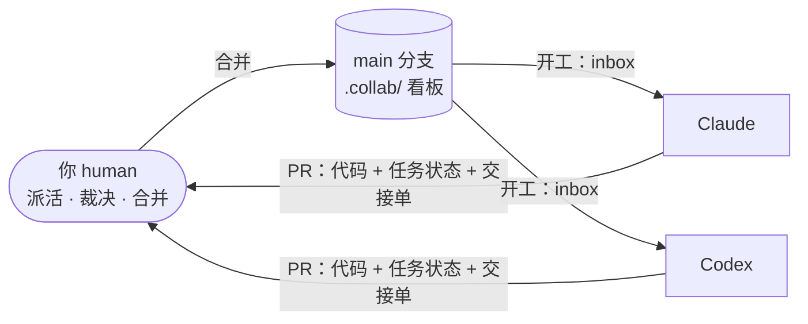
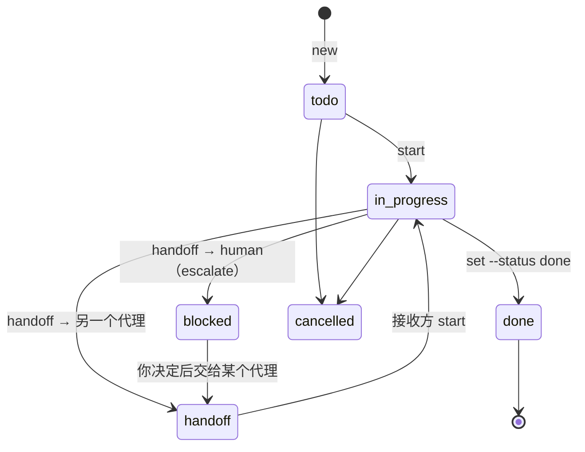

# 协作中心：Claude ↔ Codex 交接方案

这份文档给**你（人类）**看：方案怎么运作、你每天要做什么、遇到问题怎么办。
代理必须遵守的规则写在仓库根目录的 [`AGENTS.md`](../AGENTS.md)。

## 一句话

**仓库里的文件就是看板。** 每个任务一个文件，`owner` 表示“球在谁手里”；
球权只能通过一张写满内容的**交接单**转移；所有状态变化跟代码一起走 PR，**由你合并后生效**。



两个代理之间**不直接对话**，只通过 main 上的文件交接。这样做有三个好处：

1. 两边都没有跨会话记忆，文件是唯一可靠的记忆；
2. 两边都一定能读写仓库文件（Codex 云端沙箱通常不联网，不一定能访问 GitHub Issues）；
3. 你合并 PR 这一步自然成了把关点：没合并的交接不生效，不会出现两边同时动一个东西。

## 目录

```
AGENTS.md                  所有代理的规则（Codex 自动读取）
CLAUDE.md                  引用 AGENTS.md + Claude 专属说明（Claude 自动读取）
.collab/
  README.md                本文件
  tasks/T-0001-xxx.md      任务：头部字段 = 状态，正文末尾 = 进度日志
  handoffs/                交接单：<时间>_<任务>_<from>-to-<to>.md，只增不改
  decisions/D-0001-xxx.md  决策记录（为什么这么做）
  templates/               任务 / 交接单 / 决策模板
scripts/collab.py          命令行工具（只用 Python 标准库，不联网）
scripts/collab_sync.py     CI 专用：把状态镜像到 GitHub Issues
.github/
  pull_request_template.md PR 模板
  workflows/collab.yml     CI：校验 .collab/，输出看板，预览合并后的同步
  workflows/collab-sync.yml main 更新时 / 每天：交接提醒 issue + 看板 issue
```

## 核心概念

### 任务文件的头部

```yaml
id: T-0003
title: 实现登录接口
owner: codex          # 球权：claude | codex | human | unassigned
status: in_progress   # todo | in_progress | handoff | blocked | done | cancelled
priority: P1          # P0（最急）~ P3
branch: codex/login   # 最近的工作分支
paths: src/api/auth   # 本任务会改的目录/文件，用于冲突检测
depends_on: T-0001
```

### 状态机



### 交接单的 8 个固定部分

1. 一句话摘要
2. 已完成（附证据）
3. 交给对方的工作和完成标准（勾选框）
4. **如何验证当前状态**（接收方开工前先跑）
5. 关键决策与理由
6. 已知问题 / 风险 / 坑
7. 不要改动 / 必须保持的约定
8. 相关文件与入口

任何一节留着“（待填写”，`check` 和 CI 都会失败，所以不会出现空的交接单。

## 你的日常操作

### 让代理开工（复制即用）

**Claude**（Claude Code 云端会话，选这个仓库）：

> 按 AGENTS.md 的协作协议开工：先看你的 inbox，处理完后按收工流程提 PR。

**Codex**（Codex 云端任务，选这个仓库的 **main** 分支）：

> 你的协作身份是 codex。按 AGENTS.md 的协作协议开工：先运行 `python3 scripts/collab.py inbox --as codex --no-fetch`，处理完后按收工流程结束。

要指定任务就加一句“处理 T-0003”。

交接合并进 main 后，GitHub 会自动开一个 `[交接]` issue（你会收到通知），里面就有给接收方的这段话，直接复制即可。

### 其他常用说法

| 你想要 | 对代理说 |
|---|---|
| 拆需求 | “把〈需求〉拆成任务（collab.py new），写清目标、验收标准和 paths，给出分配建议，先不要实现。” |
| 指派任务 | “把 T-0005 指派给 codex。”（或自己运行 `collab.py set T-0005 --as human --owner codex -m 指派`） |
| 交叉审查 | 在 Claude 的 PR 下评论 `@codex review`；或对 Claude 说“审查 PR #N，把意见留在 PR 上” |
| 处理上报 | 看 `[交接] … → human` 的 issue 和它链接的交接单，决定后对某个代理说“T-0007 按方案 B 做，交给你了”（代理会先记录这次指派再开工） |
| 看进度 | 打开 GitHub 上的「📋 协作看板」issue（自动更新）；或运行 `python3 scripts/collab.py status` |

### 合并 PR 时检查

- PR 标题带任务号；`collab` 检查是绿的；
- 如果 PR 里有交接单，扫一眼是否写得具体（第 3、4 节最重要）；
- 两个 PR 改到同一处时，先合一个，让另一个代理合并 main 后再提交。

## 命令速查

```bash
python3 scripts/collab.py status                      # 看板（按 owner 分组）
python3 scripts/collab.py inbox   --as codex          # 某个身份的待办（会尝试 fetch 远端）
python3 scripts/collab.py new     --as human --title "..." --owner claude --paths src/api --priority P1
python3 scripts/collab.py start   T-0003 --as codex   # 开始 / 接手交接
python3 scripts/collab.py handoff T-0003 --as codex --to claude --type continue -m "一句话摘要"
python3 scripts/collab.py set     T-0003 --as codex --status done -m "验收标准已全部满足"
python3 scripts/collab.py log     T-0003 --as claude "在 PR 上提了两条审查意见"
python3 scripts/collab.py decision --as claude --title "API 统一用 REST"
python3 scripts/collab.py check                       # 校验（CI 同款）
```

任务号可以简写：`3`、`T-3`、`T-0003` 都可以。

## 两种分工模式（可随时切换）

- **按任务分（默认）**：每个任务谁都可以做，由你指派；作者以外的一方做 PR 审查。适合并行推进。
- **规划 / 实现分离**：一方负责拆任务、写验收标准和审查，另一方负责实现。适合需求还不清楚的早期。

选了哪种，建议写一条决策记录（D-xxxx），两边就都知道了。

## 常见问题

**对方的交接还没合并，能先开始吗？**
默认不行，合并后才生效。`inbox` 第 7 节会预告“尚未合并的交接”。确实着急时，
你可以让接收方从发出方的分支开工，接收方的 PR 会包含两边的提交，原 PR 关闭即可。

**两个代理同时干活会冲突吗？**
各自的任务文件和交接单都是独立文件，几乎不会冲突。代码冲突靠 `paths` 预防：
`inbox` 会列出对方占用的路径，`check` 会对重叠给出警告。真冲突了，就让后提交的一方合并 main 后解决。

**任务号撞了怎么办？**
`new` 会扫描所有远端分支，取最大编号 +1，一般不会撞。万一撞了，CI 会报错，让后合并的那一方改号。

**两个代理意见不一致？**
都不许直接推翻对方。各自写决策提案或在日志里说明理由，escalate 给你，你拍板后改成 accepted。

**代理没按流程走？**
CI 的 `collab` 检查会拦住大部分格式问题（空交接单、状态不一致、编号重复）。
流程上的问题（比如越界改代码）在审查 PR 时指出，并让它在日志里补记录。

**想改协议本身？**
你直接改，或让代理写一个 `proposed` 决策，你批准后再改 `AGENTS.md` / `collab.py`。

## GitHub 上的自动化

`collab-sync` 在 main 每次更新时、以及每天北京时间 09:17 运行（`scripts/collab_sync.py`）：

| 自动做的事 | 说明 |
|---|---|
| 交接提醒 issue | main 上每出现一张新交接单，开一个 `[交接] T-xxxx from → to` 的 issue（标签 `collab-handoff`），里面有摘要、要做的事和**给接收方的开工话术** |
| 自动关闭提醒 | 接收方 `start` 之后（任务不再停在这张交接单上），自动评论并关闭对应提醒 |
| 看板 issue | 维护一个「📋 协作看板」issue（标签 `collab-board`），按 Claude / Codex / 等人类 分组显示所有任务；可以把它置顶 |
| 停滞提醒 | 进行中 / 交接中 / 阻塞超过 3 天没更新的任务，在看板上标 `⚠ N 天未更新` |

这些 issue 只是镜像，事实来源始终是 `.collab/` 下的文件；手动改 issue 不会改变任务状态。
每个 PR 的 `collab` 检查里还有一步“预览合并后的 GitHub 同步”，可以在合并前看到会开哪些提醒。

不用 GitHub Projects：用户名下的 Projects 需要额外配置带权限的令牌，看板 issue 不需要任何配置。

### 建议你在 GitHub 上手动做的设置（可选）

- **Settings → Branches → 为 `main` 添加保护规则**，勾选 “Require status checks to pass”，选中 `check`：
  这样 `collab` 检查不通过的 PR 就合并不了。
- 把「📋 协作看板」issue 置顶（issue 页面右侧 Pin issue）。
