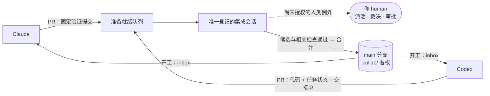
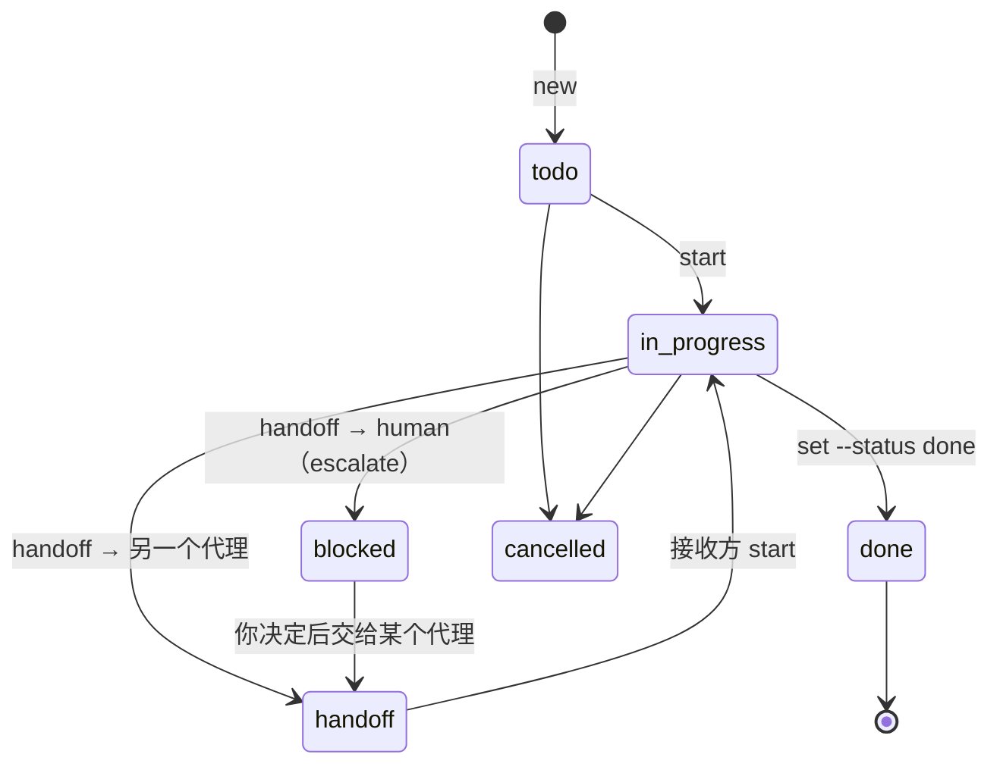

# 协作中心：Claude ↔ Codex 交接方案

这份文档给**你（人类）**看：方案怎么运作、你每天要做什么、遇到问题怎么办。
代理必须遵守的规则写在 [`docs/AGENTS.md`](../docs/AGENTS.md)（仓库根目录的 `AGENTS.md` 是指向它的链接，供 Codex 自动读取）。

## 一句话

**仓库里的文件就是看板。** 每个任务一个文件，`owner` 表示“球在谁手里”；
球权只能通过一张写满内容的**交接单**转移；所有状态变化跟代码一起走 PR，**合并进 main 后生效**。
按 [D-0008](decisions/D-0008-stable-pr-integration.md) 并行开发、固定 PR 提交，由一个登记的集成会话按队列处理；
默认角色为 Claude，Codex 的 PR 默认先经 Claude 审查。首页规则见 [README](../README.md)，
通知、编号预留和人工队列见 [issue #235](https://github.com/brianabc121/WorkspaceCore/issues/235)。



任务与正式交接以 main 上的文件为准；通知、编号预留和人工集成窗口记录在 #235，不替代 owner / status。
所有会话开工和准备合并前读取通知，避免依赖人类手工转发。这样做有三个好处：

1. 两边都没有跨会话记忆，文件是唯一可靠的记忆；
2. 两边都一定能读写仓库文件（Codex 云端沙箱通常不联网，不一定能访问 GitHub Issues）；
3. 合并 PR 这一步是把关点：没合并的交接不生效，不会出现两边同时动一个东西；合并前必须 CI 全绿，Codex 的 PR 还要经过 Claude 审查。

## 目录

```
AGENTS.md                  → docs/AGENTS.md 的链接（Codex 只自动读取根目录这份，不要删）
CLAUDE.md                  引用 docs/AGENTS.md + Claude 专属说明（Claude 自动读取）
docs/AGENTS.md             所有代理的规则（协作协议 + 项目规则）
docs/decisions/            技术决策 ADR（含前后端接口契约）
.collab/
  README.md                本文件
  tasks/T-0001-xxx.md      任务：头部字段 = 状态，正文末尾 = 进度日志
  handoffs/                交接单：<时间>_<任务>_<from>-to-<to>.md，只增不改
  decisions/D-0001-xxx.md  决策记录（为什么这么做）
  templates/               任务 / 交接单 / 决策模板
scripts/collab.py          命令行工具（只用 Python 标准库，不联网）
scripts/collab_sync.py     CI 专用：把状态镜像到 GitHub Issues
.github/
  pull_request_template.md PR 模板
  workflows/collab.yml     CI：校验 .collab/，输出看板，预览合并后的同步
  workflows/collab-sync.yml main 更新时 / 每天：交接提醒 issue + 看板 issue
```

## 核心概念

### 任务文件的头部

```yaml
id: T-0003
title: 实现登录接口
owner: codex          # 球权：claude | codex | human | unassigned
status: in_progress   # todo | in_progress | handoff | blocked | done | cancelled
priority: P1          # P0（最急）~ P3
branch: codex/login   # 最近的工作分支
paths: src/api/auth   # 本任务会改的目录/文件，用于冲突检测
depends_on: T-0001
```

### 状态机



### 交接单的 8 个固定部分

1. 一句话摘要
2. 已完成（附证据）
3. 交给对方的工作和完成标准（勾选框）
4. **如何验证当前状态**（接收方开工前先跑）
5. 关键决策与理由
6. 已知问题 / 风险 / 坑
7. 不要改动 / 必须保持的约定
8. 相关文件与入口

任何一节留着“（待填写”，`check` 和 CI 都会失败，所以不会出现空的交接单。

## 你的日常操作

### 让代理开工（复制即用）

**Claude**（Claude Code 云端会话，选这个仓库）：

> 按 AGENTS.md 的协作协议开工：先看你的 inbox，处理完后按收工流程提 PR。

**Codex**（Codex 云端任务，选这个仓库的 **main** 分支）：

> 你的协作身份是 codex。按 AGENTS.md 的协作协议开工：先运行 `python3 scripts/collab.py inbox --as codex --no-fetch`，处理完后按收工流程结束。

要指定任务就加一句“处理 T-0003”。Sprint 0 前端的开工指令是 `docs/CODEX_START.md`，把全文发给 Codex 即可（对应协作任务 T-0004）。

交接合并进 main 后，GitHub 会自动开一个 `[交接]` issue（你会收到通知），里面就有给接收方的这段话，直接复制即可。

### 其他常用说法

| 你想要 | 对代理说 |
|---|---|
| 拆需求 | “把〈需求〉拆成任务（collab.py new），写清目标、验收标准和 paths，给出分配建议，先不要实现。” |
| 指派任务 | “把 T-0005 指派给 codex。”（或自己运行 `collab.py set T-0005 --as human --owner codex -m 指派`） |
| 交叉审查 | 在 Claude 的 PR 下评论 `@codex review`；或对 Claude 说“审查 PR #N，把意见留在 PR 上” |
| 处理上报 | 看 `[交接] … → human` 的 issue 和它链接的交接单，决定后对某个代理说“T-0007 按方案 B 做，交给你了”（代理会先记录这次指派再开工） |
| 看进度 | 打开 GitHub 上的「📋 协作看板」issue（自动更新）；或运行 `python3 scripts/collab.py status` |

### 合并 PR

平时按 [D-0008](decisions/D-0008-stable-pr-integration.md) 执行：

1. 准备就绪的 PR 在 #235 登记链接、head SHA、类别、检查结果和关联风险。
2. 唯一登记的集成会话按就绪顺序领取窗口；候选验证期间其他 PR 不插队，功能分支可继续开发。
3. 在独立集成分支核对最新 main 与 PR，检查代码及编号 / 迁移 / 契约等语义冲突，按实际改动选择验证。
4. 相关检查成功、无阻塞审查意见后用 merge commit 发布，核对 main 和必要检查，再释放窗口。
5. 失败或中断时记录并释放窗口；作者修好后重新满足入队条件。不得忽略相关失败或伪造通过。

纯文档 / 元数据需要协作、链接 / 格式、密钥与范围检查；人类授权的规则修改还要独立复核。
业务、共享依赖、迁移、安全及关联不确定的变更按 D-0008 扩大验证。main 无关推进不自动触发功能分支同步；
同一 SHA 的既有成功检查保留，已确认的环境瞬态失败只重跑失败 job。平台已启用的额外保护仍须满足。

正式任务号由唯一集成者在 #235 预留后分配；现有 `collab.py new` 不提供原子占号。
已有任务不追溯改号，未分配时先在 issue 提交摘要 / owner / paths；工具改造前由集成者按模板创建正式任务。

当前先人工执行，自动占号、变更分类、`ci-gate`、过期运行取消和自动队列单独实施。
本次规则启动发布由 Codex 完成，之后由 Claude 登记唯一集成会话；“Claude 负责集成”不表示每个 Claude 会话都能同时合并。

未授权修改人类负责的规范 / 开工指令或协作规则、不可逆操作、进入下一个 Sprint 仍须人类决定；已明确批准的同一事项不重复询问。

想在 Claude 的 PR 合并前让 Codex 再看一遍，在 PR 下评论 `@codex review`。

## 命令速查

```bash
python3 scripts/collab.py status                      # 看板（按 owner 分组）
python3 scripts/collab.py inbox   --as codex          # 某个身份的待办（会尝试 fetch 远端）
python3 scripts/collab.py new     --as human --title "..." --owner claude --paths src/api --priority P1
python3 scripts/collab.py start   T-0003 --as codex   # 开始 / 接手交接
python3 scripts/collab.py handoff T-0003 --as codex --to claude --type continue -m "一句话摘要"
python3 scripts/collab.py set     T-0003 --as codex --status done -m "验收标准已全部满足"
python3 scripts/collab.py log     T-0003 --as claude "在 PR 上提了两条审查意见"
python3 scripts/collab.py decision --as claude --title "API 统一用 REST"
python3 scripts/collab.py check                       # 校验（CI 同款）
```

任务号可以简写：`3`、`T-3`、`T-0003` 都可以。

## 分工

当前采用**按模块分工**（[D-0003](decisions/D-0003-module-ownership.md)）：

| 谁 | 负责 |
|---|---|
| Codex | 前端 `apps/web`、`ci-web.yml` |
| Claude | 后端 `services/api`、数据库迁移、Compose / Caddy、根目录文件、第三方 API 核验、每个 Sprint 的联调与验收、审查并合并 PR |
| 你 | 需求与路线图、开工指令、例外情况的决定、批准进入下一个 Sprint |

每个 Sprint：Claude 先提交接口契约（OpenAPI）→ 两边并行实现 → Claude 联调验收并勾选 `docs/TASKS.md` → 你批准进入下一个 Sprint。
每个 PR 由另一个代理审查一次。要换分工方式，写一条新决策取代 D-0003。

## 常见问题

**对方的交接还没合并，能先开始吗？**
默认不行，合并后才生效。`inbox` 第 7 节会预告“尚未合并的交接”。确实着急时，
你可以让接收方从发出方的分支开工，接收方的 PR 会包含两边的提交，原 PR 关闭即可。

**两个代理同时干活会冲突吗？**
各自的任务文件和交接单都是独立文件，几乎不会冲突。代码冲突靠 `paths` 预防：
`inbox` 会列出对方占用的路径，`check` 会对重叠给出警告。真冲突了，就让后提交的一方合并 main 后解决。

**任务号撞了怎么办？**
`new` 会扫描所有远端分支，取最大编号 +1，一般不会撞。万一撞了，CI 会报错，让后合并的那一方改号。

**两个代理意见不一致？**
都不许直接推翻对方。各自写决策提案或在日志里说明理由，escalate 给你，你拍板后改成 accepted。

**代理没按流程走？**
CI 的 `collab` 检查会拦住大部分格式问题（空交接单、状态不一致、编号重复）。
流程上的问题（比如越界改代码）在审查 PR 时指出，并让它在日志里补记录。

**想改协议本身？**
你直接改，或让代理写一个 `proposed` 决策，你批准后再改 `AGENTS.md` / `collab.py`。

## GitHub 上的自动化

`collab-sync` 在 main 每次更新时、以及每天北京时间 09:17 运行（`scripts/collab_sync.py`）：

| 自动做的事 | 说明 |
|---|---|
| 交接提醒 issue | main 上每出现一张新交接单，开一个 `[交接] T-xxxx from → to` 的 issue（标签 `collab-handoff`），里面有摘要、要做的事和**给接收方的开工话术** |
| 自动关闭提醒 | 接收方 `start` 之后（任务不再停在这张交接单上），自动评论并关闭对应提醒 |
| 看板 issue | 维护一个「📋 协作看板」issue（标签 `collab-board`），按 Claude / Codex / 等人类 分组显示所有任务；可以把它置顶 |
| 停滞提醒 | 进行中 / 交接中 / 阻塞超过 3 天没更新的任务，在看板上标 `⚠ N 天未更新` |

这些 issue 只是镜像，事实来源始终是 `.collab/` 下的文件；手动改 issue 不会改变任务状态。
每个 PR 的 `collab` 检查里还有一步“预览合并后的 GitHub 同步”，可以在合并前看到会开哪些提醒。

不用 GitHub Projects：用户名下的 Projects 需要额外配置带权限的令牌，看板 issue 不需要任何配置。

### 建议你在 GitHub 上手动做的设置（可选）

- **Settings → Branches → 为 `main` 添加保护规则**，勾选 “Require status checks to pass”，选中 `check`：
  这样 `collab` 检查不通过的 PR 就合并不了。
- 把「📋 协作看板」issue 置顶（issue 页面右侧 Pin issue）。
