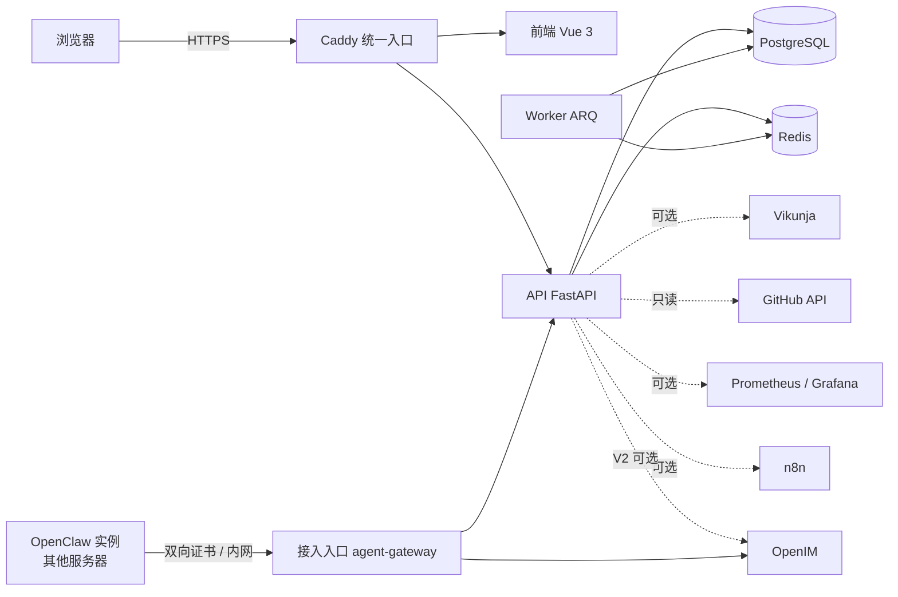

# My Workspace（WorkspaceCore）

自托管的混合型个人工作台：一个首页汇总任务、文档、日历、GitHub、服务状态与通知，并可接入部署在其他服务器上的
OpenClaw AI 实例——管理员在工作台里和实例聊天，实例的每一次写操作都要在工作台审批。

- **第三方系统各管各的数据**：任务以 Vikunja 为准，文档留在 AFFiNE（只收藏链接），GitHub 只读；工作台只保存投影与自己的数据，
  第三方服务出故障时对应模块降级，其余照常可用。
- **可配置的首页**：拖拽布局的组件（今日任务、项目进度、近期日程、GitHub 动态、服务状态、API 延迟、通知、快捷提问等），可导入 / 导出。
- **多人与权限**：工作空间 + 角色（owner / admin / member / viewer），所有读写都在服务端校验工作空间与角色；关键操作写审计日志。
- **安全默认值**：首次安装需要部署时生成的安装凭据；第三方凭证加密保存；防 SSRF；镜像锁定 tag + digest；加密异地备份与恢复演练。

设计与范围见 [`docs/DEVELOPMENT_SPEC.md`](docs/DEVELOPMENT_SPEC.md)；V2 的 AI 部分见 [`docs/v2/TRANSFORMATION_PLAN.md`](docs/v2/TRANSFORMATION_PLAN.md)。

> **状态**：Sprint 0 ~ 6 全部验收（[`docs/acceptance/`](docs/acceptance/)），包括 V2 的 OpenClaw 多实例接入与基于 OpenIM 的管理员端 IM。

## 功能一览

| 模块 | 能做什么 |
|---|---|
| 首页 | 统一入口；组件按模块独立加载与降级；布局导入 / 导出 JSON |
| 任务与项目 | 读写 Vikunja 的任务（列表 / 看板、筛选、新建与编辑）；Webhook + 周期对账保持一致；写操作带幂等键 |
| 知识库 | 收藏 AFFiNE 文档链接，与项目、任务互相关联（不读取文档正文） |
| 日历 | 工作空间共享日程（全天 / 定时、时区）；按天显示 Vikunja 任务的截止时间 |
| 开发者 | 指定 GitHub 仓库的 Issue、PR、Actions 最近运行（只读、限流感知） |
| 搜索 | 跨任务、项目、仓库、Issue / PR、收藏、日程搜索，只返回你有权看到的内容 |
| 运维 | 服务状态、Prometheus 预设指标、Grafana 外链（监控为可选部署） |
| 自动化 | 白名单内的 n8n 工作流：确认后触发、查看运行记录（可选部署） |
| 通知 | 通知中心与实时推送（SSE），首页通知组件 |
| 设置 | 个人资料、工作空间、成员管理、集成、安全（密码与会话）、审计日志 |
| 全局创建 | 顶栏“创建”菜单：按角色列出新建任务、日程、文档收藏、群聊、成员、OpenClaw 实例，选中后直接打开对应页面的新建表单 |
| 右侧抽屉 | 顶栏“AI 助手”打开：宽屏停靠在页面右侧、窄屏为侧滑面板；在里面与 OpenClaw 实例对话，任务的新建与编辑也在这里（Task Drawer） |
| **V2：消息（IM）** | 管理员与 OpenClaw 实例单聊、群聊（@、置顶、免打扰、分组、导出）；浏览器不直连 OpenIM |
| **V2：OpenClaw 实例** | 登记实例、生成接入包（凭证只出现一次）、内网 / 外网两种接入方式、在线状态与到期提醒 |
| **V2：密钥库** | 集中保存模型 API Key 等密钥，按实例授权，记录每次取用；只写不读 |
| **V2：AI 审批** | 实例经 MCP 调用工作台工具；写操作生成待审批，在审批中心或 IM 的审批卡片上批准，高危操作要重新输入密码 |

## 架构



- 后端是模块化单体（BFF）：FastAPI + Pydantic 2 + SQLAlchemy 2（async）+ Alembic，后台作业用 ARQ（Redis）。
- 前端：Vue 3 + TypeScript + Vite，Tailwind CSS 4 + shadcn-vue（reka-ui），TanStack Query、Pinia、GridStack、Zod；接口类型由 OpenAPI 生成。
- 部署：Docker Compose。core 6 个服务；Vikunja、n8n、OpenIM 各自独立的 Compose 项目；监控是可选 profile。

更多见 [`docs/architecture.md`](docs/architecture.md)。

## 快速开始（本机试用）

需要：Docker（含 Compose v2）、GNU Make、Python 3。

```bash
make up        # 首次自动生成 .env（随机密码），构建并启动全部服务
```

```bash
make migrate   # 首次启动后执行数据库迁移
```

```bash
make smoke     # 检查健康、就绪、前端页面与安全响应头
```

打开 http://localhost:8080 。第一次使用会进入安装页创建管理员，需要的安装凭据用 `make setup-token` 查看。
停止用 `make down`（保留数据）；`make help` 列出全部命令。

## 部署到服务器

一条命令部署（Debian / Ubuntu；只问域名、证书邮箱与访问地址三个参数，之后同一脚本可以升级、清空、查看状态）。
以 root 登录时运行下面的命令；普通用户把最后的 `bash` 换成 `sudo bash`：

```bash
curl -fsSL https://raw.githubusercontent.com/brianabc121/WorkspaceCore/main/scripts/deploy.sh | bash
```

按步骤的教程：**[`docs/deploy-guide.md`](docs/deploy-guide.md)**——准备服务器、安装 Docker、生成 `.env`、域名与自动 HTTPS、
创建管理员、接入 Vikunja / GitHub / 监控 / n8n / OpenClaw、配置异地备份与恢复演练、升级与回滚、常见问题。

要点：

- 用域名对外提供服务时，在 `.env` 里设置 `COMPOSE_FILE=compose.yaml:compose.https.yaml`、`SITE_DOMAIN`、`ACME_EMAIL`，
  Caddy 会自动申请并续期 Let's Encrypt 证书；
- `.env` 里的加密密钥与备份密码要另外保存到服务器以外的地方，丢了就无法解密凭证或打开备份；
- 生产环境用 `APP_ENV=production`，把 `BACKUP_REPOSITORY` 配成异地仓库并定时 `make backup`。

## 文档

| 文档 | 内容 |
|---|---|
| [`docs/deploy-guide.md`](docs/deploy-guide.md) | 部署教程（从零开始，按步骤） |
| [`docs/deployment.md`](docs/deployment.md) | 运行手册：全部变量、组件接入细节、升级与回滚、备份恢复、扫描与基准 |
| [`docs/release-checklist.md`](docs/release-checklist.md) | 发布前逐项检查 |
| [`docs/versions.md`](docs/versions.md) | 所有镜像与关键依赖的锁定版本（tag + digest）、许可证与核验来源 |
| [`docs/threat-model.md`](docs/threat-model.md) | 风险与防护措施 |
| [`docs/architecture.md`](docs/architecture.md) | 运行组件、数据流、后端分层、部署拓扑 |
| [`docs/api-contract.md`](docs/api-contract.md)、[`docs/data-dictionary.md`](docs/data-dictionary.md) | 接口约定与数据库对象 |
| [`docs/decisions/`](docs/decisions/) | 技术决策与第三方版本核验（ADR） |
| [`docs/acceptance/`](docs/acceptance/) | 各 Sprint 的验收报告 |
| [`docs/DEVELOPMENT_SPEC.md`](docs/DEVELOPMENT_SPEC.md)、[`docs/TASKS.md`](docs/TASKS.md) | 开发规范与路线图（人类制定） |

常用运维命令：`make backup`（加密备份）、`make restore-verify`（隔离环境恢复演练）、`make smoke-full`（完整端到端冒烟）、
`make scan`（安全扫描）、`make perf`（性能基准）。

## 本机开发

需要：Python 3.12 + [uv](https://docs.astral.sh/uv/)、Node.js 22、PostgreSQL 16、Redis 7。

```bash
make setup         # 生成 .env、安装前后端依赖
export DATABASE_URL=postgresql+asyncpg://workspace:<密码>@localhost:5432/workspace
export REDIS_URL=redis://localhost:6379/0
export PUBLIC_BASE_URL=http://localhost:5173 SETUP_TOKEN=$(make -s setup-token)
make migrate-local # 迁移本机数据库
make dev           # API（:8000）+ 前端（:5173，/api 等路径代理到 API）
```

```bash
make lint          # ruff、mypy、ESLint、vue-tsc
```

```bash
make test          # pytest、Vitest
```

- 设置 `TEST_DATABASE_URL`（有建库权限）和 `TEST_REDIS_URL` 后，`make test` 还会运行连接真实 PostgreSQL / Redis 的集成测试。
- 改了后端接口后运行 `make openapi` 重新生成 `services/api/openapi.json`，再在 `apps/web` 里 `npm run generate:api` 生成前端类型（CI 会检查两者是否最新）。
- 全栈验收与浏览器验收脚本在 `tests/e2e/`（Playwright 版本由该目录的锁文件固定），CI 见 `.github/workflows/`。

## 目录结构

| 路径 | 内容 |
|---|---|
| `services/api/` | FastAPI 后端（BFF）、Alembic 迁移、ARQ Worker、OpenClaw 接入包模板 |
| `apps/web/` | Vue 3 前端 |
| `compose.yaml`、`compose.https.yaml` | core 服务编排（可选监控 `--profile monitoring`、接入入口 `--profile agents`）；HTTPS 域名模式 |
| `infra/caddy/` | 统一入口与 OpenClaw 接入入口的 Caddy 配置 |
| `infra/vikunja/`、`infra/n8n/`、`infra/openim/`、`infra/monitoring/` | 独立部署的 Vikunja、n8n、OpenIM 与监控配置 |
| `infra/openclaw/` | OpenClaw 服务器端的说明 |
| `scripts/` | 冒烟、备份恢复、安全扫描、`.env` 生成等脚本 |
| `tests/e2e/`、`tests/perf/` | 全栈验收、浏览器验收、完整冒烟与性能基准 |
| `docs/` | 规范、任务清单、工程文档、技术决策 |
| `.collab/`、`scripts/collab*.py` | AI 代理协作的任务、交接与决策记录 |

## 协作方式

本仓库由 AI 代理（Claude Code、OpenAI Codex）在人类的指派与审批下开发，任务、交接和决策都记录在仓库里。
2026-10-31 起 Codex 暂停，全部任务由 Claude 独立完成（[`.collab/decisions/D-0007-claude-solo.md`](.collab/decisions/D-0007-claude-solo.md)）。

- 代理规则：[`docs/AGENTS.md`](docs/AGENTS.md)
- 方案说明与操作手册：[`.collab/README.md`](.collab/README.md)
- 查看进度：GitHub 上的「📋 协作看板」issue（CI 自动更新），或 `python3 scripts/collab.py status`

## 许可证

本仓库代码以 [Apache License 2.0](LICENSE) 发布。部署时用到的第三方组件各有许可证（例如 Grafana、Vikunja 为 AGPL-3.0，n8n 为 Sustainable Use License，
Redis 7.4 为 RSALv2 / SSPLv1）：自托管自用没有问题，对外提供服务或分发前请先看 [`docs/versions.md`](docs/versions.md) 第 5 节。
