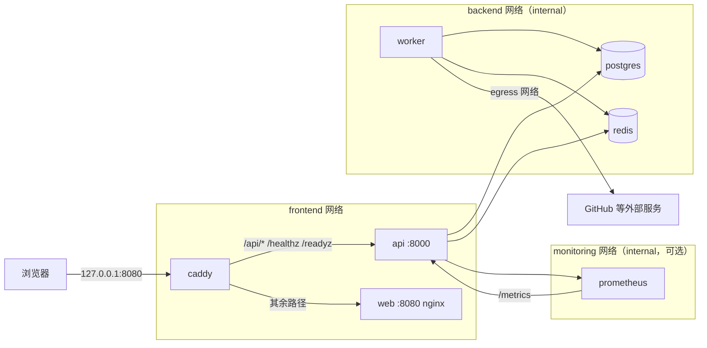
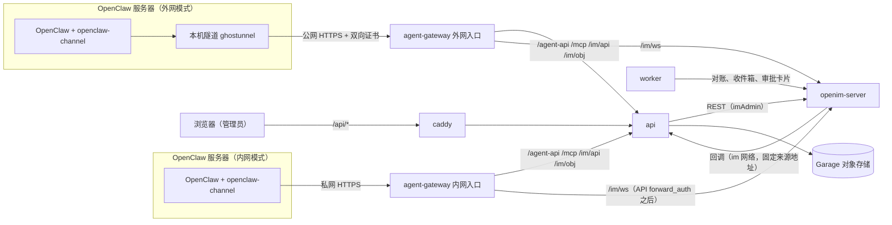

# 架构说明

> 状态：Sprint 6（2026-11-01，含 V2 的 OpenClaw / OpenIM）。目标架构见 `docs/DEVELOPMENT_SPEC.md` 第 3、4 节与 `docs/v2/TRANSFORMATION_PLAN.md` 第 3 节；本文记录**已经实现**的部分，随 Sprint 推进补充。
> 接口约定见 `docs/api-contract.md`，数据库对象见 `docs/data-dictionary.md`，运行与部署见 `docs/deployment.md`，版本见 `docs/versions.md`。

## 运行组件

| 组件 | 位置 | 当前状态 |
|---|---|---|
| API（FastAPI BFF） | `services/api/app/main.py` | 认证与会话、工作空间与角色、仪表盘与组件、项目与任务（工作台自己管理，T-0082）、知识库收藏与关联、日历、GitHub 只读视图、跨资源搜索、运维状态与指标、通知、SSE 事件流、审计；V2：OpenClaw 实例与接入包、密钥库、IM（经 OpenIM 中转）、MCP 工具与审批；`/healthz`、`/readyz`、`/metrics`（只在内部网络，Caddy 不转发）。实例只能经接入入口到达 `/agent-api/*`、`/mcp`、`/internal/gateway/*` |
| Worker（ARQ） | `services/api/app/jobs/worker.py` | 心跳（每分钟）、GitHub 增量与全量对账、服务状态检查、过期数据清理；V2：OpenIM 回调收件箱处理、IM 增量（30 秒）与全量（每天）对账、实例 IM 账号补注册、审批卡片发送、待审批过期 |
| 数据库迁移（Alembic） | `services/api/migrations/` | `0001` ~ `0047`，都有 downgrade（`docs/data-dictionary.md`）；`0020` 移除 Vikunja 并转换原生项目与任务；`0047` 删除退役的工作流与登录账号表，这两次移除的降级只恢复结构 |
| 前端（Vue 3） | `apps/web/` | 首页（GridStack 拖拽布局、组件库）、任务与项目、知识库、日历、开发者、运维、设置、集成设置、安全设置、审计日志、通知中心；V2：IM（独立的消息页，聊天应用式布局：电脑端三栏、手机单栏，T-0095；单聊、群聊、置顶、免打扰、分组、@）、通讯录、OpenClaw 实例、密钥库、AI 审批与活动记录；右侧可收起的 AI / 详情抽屉（AI 助手、Task Drawer）。UI 组件：Tailwind 4 + shadcn-vue（`src/components/ui`，`2026-11-01-shadcn-vue-and-drawer.md`） |
| 统一入口（Caddy） | `infra/caddy/Caddyfile`、`https.Caddyfile`、`routes.caddy` | 路由、安全响应头、压缩（SSE 除外）、请求体限制；`/readyz` 仅内网。默认 HTTP :8080；HTTPS 域名模式（`compose.https.yaml`）自动申请证书并加 HSTS |
| core 编排 | `compose.yaml` | web、api、worker、postgres、redis、caddy，全部带健康检查；可选监控（`--profile monitoring`：Prometheus、Grafana） |
| 独立部署的组件 | `infra/openim/` | OpenIM（V2 的 IM 后端：打过补丁的 openim-server、MongoDB、Redis、etcd、Kafka、Garage 对象存储），独立 Compose 项目，通过 `im` / `agent-im` 网络与工作台互通 |
| 接入入口（V2，`--profile agents`） | `infra/caddy/agent.Caddyfile` | agent-gateway：内网入口与外网入口（双向证书）两个站点，只放行实例要用的路径；`/im/ws` 经 API 的 forward_auth 校验后透传到 OpenIM 消息网关 |
| OpenClaw 实例（V2，别的服务器） | 接入包（`services/api/app/agent_bundle/`） | 每台一份接入包：OpenClaw（锁定版本）+ `openclaw-channel` 插件、取密钥小程序、启动包装脚本；外网模式另有本机隧道（ghostunnel） |
| 运维脚本 | `scripts/` | 冒烟、备份与隔离恢复（restic）、安全扫描 |

## 数据流要点

- **项目与任务由工作台自己管理**（T-0082 移除了 Vikunja，`docs/decisions/2026-11-02-remove-vikunja.md`）：存在 `workspace.projects` / `workspace.tasks`；
  任务写接口带 `Idempotency-Key`，幂等检查、写入、记下结果在同一个事务里完成；项目与任务的搜索文档由触发器维护。
- **AFFiNE 只做深链接**与收藏，不读写文档内容；**GitHub 只读**投影（ETag、限流感知）。
- **首页聚合**只读本地投影与缓存，各模块并发、有各自的超时与总时限；单个模块失败只让它自己降级。
- **实时更新**：数据变化在事务提交后发布到 Redis Stream，SSE 只发“数据失效”提示，前端据此重新拉取。
- **第三方故障可降级**：出站 HTTP 有超时、有限次重试、按集成计数的熔断，防 SSRF 与 DNS 重绑定（`docs/threat-model.md`）。

## 后端分层（`services/api/app/`）

| 目录 | 职责 | 约束 |
|---|---|---|
| `api/` | HTTP 路由 | 不写业务逻辑；业务逻辑不依赖路由函数 |
| `domain/` | 领域服务、实体、权限策略 | 所有读写都做 workspace scope + role 校验 |
| `repositories/` | SQLAlchemy 数据访问 | SQL 集中在这里 |
| `integrations/` | Connector 协议与实现 | 只处理外部协议与归一化；外部 HTTP 必须有 timeout |
| `jobs/` | Worker、对账 | 关键作业状态先写 PostgreSQL |
| `models/` | ORM 模型 | 表放在 `workspace` schema，主键 UUID |
| `schemas/` | Pydantic 请求 / 响应 | API schema 先行 |
| `core/` | 配置、日志、错误、中间件、共享资源 | 密钥类配置用 `SecretStr` |

## 请求处理

1. `request_context` 中间件分配 `request_id`（接受合法的 `X-Request-ID`，否则生成 `req_<uuid>`），并写入响应头和每条日志。
2. 路由处理请求；`HTTPException` 与参数校验错误转换为统一错误格式。
3. 未处理异常在中间件内兜底为 500，响应中不包含异常细节。
4. 访问日志只记录方法、路径（不含查询参数）、状态码和耗时；`/healthz`、`/readyz` 成功的请求记为 DEBUG，避免容器健康检查刷屏。

## 部署拓扑（`compose.yaml`）

- 对外只有 caddy 一个端口（默认只绑定 127.0.0.1）；postgres、redis 只在内部网络，不映射宿主机端口。
- `integrations` 是 api、worker 的受控内网连接网络；内网 Connector 的主机名必须显式加入允许列表，默认列表为空。
- worker 经 `egress` 网络访问外部服务；api 访问 GitHub 等外部服务时同样受出站策略限制（SSRF 防护、DNS 固定）。
- Grafana（可选）另有 `monitoring-public` 网络，用于浏览器访问它自己的端口；工作台只生成外链。
- api 与 worker 使用同一个镜像（`services/api/Dockerfile`），以非 root 用户、只读文件系统运行。
- web 镜像（`apps/web/Dockerfile`）用 Node 22 构建，nginx（非 root，slim 变体）提供静态文件与 history 回退。
- 所有镜像按 tag + digest 锁定（`docs/versions.md`）。

## V2：OpenClaw 与 OpenIM（`docs/v2/TRANSFORMATION_PLAN.md`）

- **工作台是唯一的权限来源**：实例经 MCP 调工作台工具，写操作一律先生成待审批记录，管理员批准（高危要二次认证）后才执行；
  OpenClaw 智能体只开工作台工具与 IM 发消息工具。
- **浏览器不直连 OpenIM**：管理员的 IM 全部经 API 代理；实例的 REST 请求经接入网关的白名单与参数校验（`app/domain/im_gateway.py`），
  WebSocket 透传到消息网关前先由 API 校验 IM 令牌。
- **消息投影 + 双保险**：OpenIM 的 after 回调写收件箱，Worker 处理后拉取消息写进 `im_messages`；30 秒一次的增量对账和每天的全量对账补上丢失的回调。
  before 回调同步把关（实例之间的单聊、群聊防刷屏、停用的实例），工作台不可用时 IM 消息直接发送失败。
- **密钥**：实例启动时由取密钥小程序经接入入口取用授权给它的密钥（OpenClaw 的 exec SecretRef），每次取用都有记录；
  密钥库的密文用可轮换的凭证加密密钥保存。
- **运维**：运维页显示 OpenIM 与各实例的状态；`/metrics` 输出实例、取密钥、MCP、回调积压、对账补齐、防刷屏、待审批的指标（`docs/deployment.md` 第 12.2 节）。

## 知识库（`docs/v2/KNOWLEDGE_PLAN.md`，T-0097 ~ T-0100）

- **三类知识库**：公共库（每个工作空间一个）、项目库（跟随项目自动建）、智能体库（跟随 OpenClaw 实例自动建）。笔记是 Markdown，用 `[[标题]]` 互相链接，也能链接任务、项目、书签。
- **后端**：`app/domain/knowledge_base.py`（写入路径：权限 → 大小与密钥扫描 → 保存与版本 → 解析链接 → 写回纠正）、`knowledge_views.py`（列表、图谱、变更记录、指标与每周趋势）、`knowledge_tools.py`（MCP 工具 `knowledge_*`）。迁移 0024。
- **智能体直接读写删、不审批**：仍经工作台的权限与策略校验；版本、回收站、限流、删除超限自动暂停、密钥拦截兜底（威胁模型“知识库”各行）。
- **认知对齐**：项目简报只有人能改；智能体用 `knowledge_brief` 读，工作台记下读到的版本。工具结果的 `notices` 和 `get_task` 的 `brief` 提醒它读最新版，管理员也可以用 IM 直接提醒。
- **自我提升**：
  - 人修改或撤销智能体写的内容时，原因写回它自己知识库里的《收到的纠正》；
  - 每晚的 OpenClaw 定时任务（`setup-reflection.sh`，独立会话、不投递）让智能体复盘当天的工作，把值得记住的写进知识库；
  - 智能体主页显示近 30 天的指标与近 8 周的趋势。
- **前端**：独立页面 `/knowledge`（`apps/web/src/features/kb/`），包括：
  - 知识图谱（d3-force）、笔记阅读与 CodeMirror 6 编辑器（`[[` 补全、版本冲突三方合并）；
  - 变更记录与回收站；
  - 项目 / 公共知识库主页与智能体主页；
  - 手机上换成底部导航。

## 知识库图片与任务时间轴（`docs/v2/TIMELINE_PLAN.md`，T-0101 ~ T-0106）

- **知识库图片**（T-0103）：笔记里的图片存到本地卷 `kb-files`、Cloudflare R2 或阿里云 OSS（`FILE_STORAGE`），可以再配一个副本（`FILE_STORAGE_REPLICA`）。
  - 后端：`app/integrations/object_storage.py`（本地存储与自写 SigV4 的 S3 兼容客户端；R2 用路径风格，OSS 用虚拟主机风格）、`app/domain/knowledge_files.py`（上传、读取、引用、副本复制、清理、自检）。迁移 0026。
  - Worker：每分钟复制待复制的图片，每天清理没有引用、超过 24 小时的图片，启动时与每天自检一次。
  - 前端：编辑器插入 / 粘贴 / 拖入，阅读页放大，图谱的“显示图片”，运维页的存储面板。
- **任务时间轴**（T-0104、T-0105）：任务有执行者（成员或 OpenClaw 实例）和计划开始；每一段执行记在 `task_runs`。
  - 后端：`app/domain/task_runs.py`（开段 / 结段、中断、token 按时间归属）、`app/domain/timeline.py`（时间轴、执行记录、交给智能体执行、用量上报）。迁移 0027。
  - 交给智能体执行：用管理员自己的 IM 账号给实例发一条任务消息，同时开一段；智能体用 `complete_task` 标完成（T-0111 起直接生效，管理员可以打回）。
  - 自由接取（T-0111）：管理员把任务设为可自由接取，工作台通知空闲的智能体；智能体用 `claim_task` 领取（先到先得、空闲才能领），可以 `release_task` 放弃；动态记在 `task_events`。
  - 用量：接入包里的 `usage-report.mjs` 每分钟（crontab）调本机 OpenClaw 网关的 `sessions.usage`，把每个会话的累计 token 报给 `POST /agent-api/v1/usage`；工作台按分钟记增量，再按时间归属到当时在执行的段。
  - Worker：每分钟把停用、删除、离线超过 10 分钟的实例正在执行的段记为中断；每天删除 90 天前的用量。
  - 前端：`/tasks/timeline`（`apps/web/src/features/timeline/`），任务页、项目页、任务详情都有入口；SSE 主题 `timeline` 让页面及时刷新。
- **服务器状态**（T-0113）：接入包的 `host-report.mjs` 每分钟（crontab）在 OpenClaw 容器里读宿主机的 `/proc` 与磁盘统计，只报数字，发给 `POST /agent-api/v1/host-metrics`。
  - 后端：`app/domain/host_metrics.py`（两次之差算 CPU 使用率与网速、每分钟样本、每小时平均与峰值、告警）。迁移 0031（`agent_host_samples`、`agent_host_state`）。
  - Worker：每分钟检查告警（磁盘、内存、负载、未上报；恢复前只提醒一次），每天删除 30 天前的样本。
  - 智能体：只读工具 `get_host_status` 只返回调用它的实例自己的状态。
  - 前端：实例卡片的 CPU / 内存 / 磁盘小指示与“服务器状态”（当前值、24 小时 / 7 天 / 30 天趋势、表格视图，`apps/web/src/features/agents/HostStatus.vue`）。
- **远程运维动作**（T-0114）：经 SSH 部署时的通道（确认过的主机指纹 + 专用密钥）执行写死的六个动作（查看状态、查看日志、立即上报、重启 OpenClaw、重新拉起、清理镜像）。
  - 后端：`app/domain/agent_ops.py`（命令、脱敏、后台执行，与 SSH 部署共用进程内的 `SshJobRunner`）、`app/domain/step_up.py`（二次认证，与审批共用）。迁移 0032（`agent_ops_actions`）。
  - 前端：实例卡片的“运维”面板（`OpsPanel.vue`）。
- **验收**：Compose CI 的 `timeline_browser.cjs`、`knowledge_browser.cjs`；agents CI 的场景 16（真实 OpenClaw 上报用量、交给智能体执行到审批完成）；ci-api 在锁定的 Garage 上验证 S3 兼容存储；A15 备份恢复核对本地图片。

