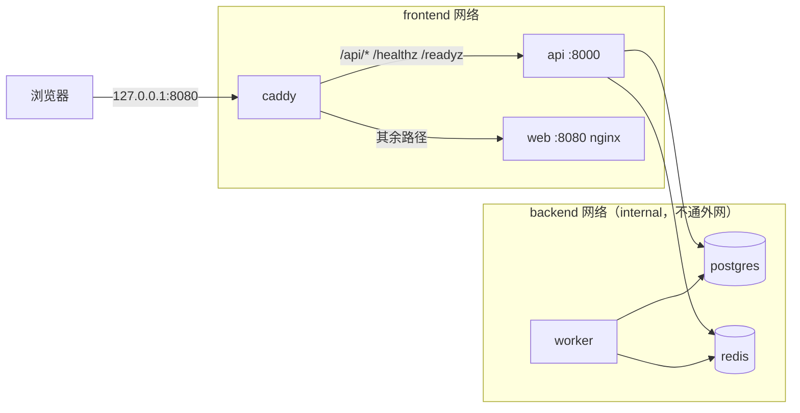

# 架构说明

> 状态：Sprint 0 完成。目标架构见 `docs/DEVELOPMENT_SPEC.md` 第 3、4 节；本文记录**已经实现**的部分，随 Sprint 推进补充。

## 运行组件

| 组件 | 位置 | 当前状态 |
|---|---|---|
| API（FastAPI BFF） | `services/api/app/main.py` | `/healthz`、`/readyz`、统一错误格式、JSON 日志 |
| Worker（ARQ） | `services/api/app/jobs/worker.py` | 最小入口，每 5 分钟一次心跳作业 |
| 数据库迁移（Alembic） | `services/api/migrations/` | `0001`：workspace schema 与 pgcrypto、pg_trgm 扩展 |
| 前端（Vue 3） | `apps/web/` | 布局、12 个导航入口、占位页、亮暗主题（codex，T-0004） |
| 统一入口（Caddy） | `infra/caddy/Caddyfile` | 路由、安全响应头、请求体限制；`/readyz` 仅内网 |
| core 编排 | `compose.yaml` | web、api、worker、postgres、redis、caddy，全部带健康检查 |

## 后端分层（`services/api/app/`）

| 目录 | 职责 | 约束 |
|---|---|---|
| `api/` | HTTP 路由 | 不写业务逻辑；业务逻辑不依赖路由函数 |
| `domain/` | 领域服务、实体、权限策略 | 所有读写都做 workspace scope + role 校验 |
| `repositories/` | SQLAlchemy 数据访问 | SQL 集中在这里 |
| `integrations/` | Connector 协议与实现 | 只处理外部协议与归一化；外部 HTTP 必须有 timeout |
| `jobs/` | Worker、对账 | 关键作业状态先写 PostgreSQL |
| `models/` | ORM 模型 | 表放在 `workspace` schema，主键 UUID |
| `schemas/` | Pydantic 请求 / 响应 | API schema 先行 |
| `core/` | 配置、日志、错误、中间件、共享资源 | 密钥类配置用 `SecretStr` |

## 请求处理

1. `request_context` 中间件分配 `request_id`（接受合法的 `X-Request-ID`，否则生成 `req_<uuid>`），并写入响应头和每条日志。
2. 路由处理请求；`HTTPException` 与参数校验错误转换为统一错误格式。
3. 未处理异常在中间件内兜底为 500，响应中不包含异常细节。
4. 访问日志只记录方法、路径（不含查询参数）、状态码和耗时；`/healthz`、`/readyz` 成功的请求记为 DEBUG，避免容器健康检查刷屏。

## 部署拓扑（`compose.yaml`）

- 对外只有 caddy 一个端口；postgres、redis 只在内部网络。
- api 与 worker 使用同一个镜像（`services/api/Dockerfile`），以非 root 用户、只读文件系统运行。
- web 镜像（`apps/web/Dockerfile`）用 Node 22 构建，nginx（非 root）提供静态文件与 history 回退。
