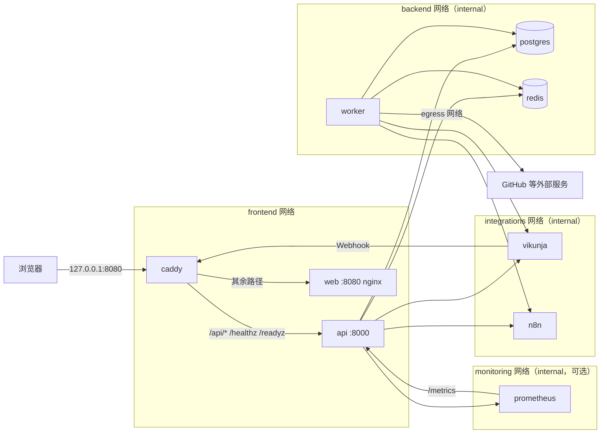

# 架构说明

> 状态：Sprint 6（2026-10-31）。目标架构见 `docs/DEVELOPMENT_SPEC.md` 第 3、4 节；本文记录**已经实现**的部分，随 Sprint 推进补充。
> 接口约定见 `docs/api-contract.md`，数据库对象见 `docs/data-dictionary.md`，运行与部署见 `docs/deployment.md`，版本见 `docs/versions.md`。

## 运行组件

| 组件 | 位置 | 当前状态 |
|---|---|---|
| API（FastAPI BFF） | `services/api/app/main.py` | 认证与会话、工作空间与角色、仪表盘与组件、任务（Vikunja）、知识库收藏与关联、日历、GitHub 只读视图、跨资源搜索、运维状态与指标、通知、SSE 事件流、n8n 白名单触发、审计；`/healthz`、`/readyz`、`/metrics`（只在内部网络，Caddy 不转发） |
| Worker（ARQ） | `services/api/app/jobs/worker.py` | 心跳（每分钟）、Webhook Inbox 处理、增量与全量对账（Vikunja、GitHub）、服务状态检查、自动化执行记录对账、过期数据清理 |
| 数据库迁移（Alembic） | `services/api/migrations/` | `0001` ~ `0010`，都只新增对象、都有 downgrade（`docs/data-dictionary.md`） |
| 前端（Vue 3） | `apps/web/` | 首页（GridStack 拖拽布局、组件库）、任务与项目、知识库、日历、开发者、运维、自动化、设置、集成设置、安全设置、审计日志、通知中心；AI 助手页是占位 |
| 统一入口（Caddy） | `infra/caddy/Caddyfile` | 路由、安全响应头、压缩（SSE 除外）、请求体限制；`/readyz` 仅内网 |
| core 编排 | `compose.yaml` | web、api、worker、postgres、redis、caddy，全部带健康检查；可选监控（`--profile monitoring`：Prometheus、Grafana） |
| 独立部署的组件 | `infra/vikunja/`、`infra/n8n/` | Vikunja（任务主源）、n8n（自动化，可选），各自的 Compose 项目，通过 `integrations` 网络与工作台互通 |
| 运维脚本 | `scripts/` | 冒烟、备份与隔离恢复（restic）、安全扫描 |

## 数据流要点

- **任务以 Vikunja 为主源**（规范第 4 节）：工作台的写入经 Connector 发给 Vikunja（带 `Idempotency-Key`，结果未知时不自动重试），
  成功后更新本地投影；读取走本地投影。Vikunja 的 Webhook 进 Inbox 由 Worker 处理，周期对账兜底。
- **AFFiNE 只做深链接**与收藏，不读写文档内容；**GitHub 只读**投影（ETag、限流感知）。
- **首页聚合**只读本地投影与缓存，各模块并发、有各自的超时与总时限；单个模块失败只让它自己降级。
- **实时更新**：数据变化在事务提交后发布到 Redis Stream，SSE 只发“数据失效”提示，前端据此重新拉取。
- **第三方故障可降级**：出站 HTTP 有超时、有限次重试、按集成计数的熔断，防 SSRF 与 DNS 重绑定（`docs/threat-model.md`）。

## 后端分层（`services/api/app/`）

| 目录 | 职责 | 约束 |
|---|---|---|
| `api/` | HTTP 路由 | 不写业务逻辑；业务逻辑不依赖路由函数 |
| `domain/` | 领域服务、实体、权限策略 | 所有读写都做 workspace scope + role 校验 |
| `repositories/` | SQLAlchemy 数据访问 | SQL 集中在这里 |
| `integrations/` | Connector 协议与实现 | 只处理外部协议与归一化；外部 HTTP 必须有 timeout |
| `jobs/` | Worker、对账 | 关键作业状态先写 PostgreSQL |
| `models/` | ORM 模型 | 表放在 `workspace` schema，主键 UUID |
| `schemas/` | Pydantic 请求 / 响应 | API schema 先行 |
| `core/` | 配置、日志、错误、中间件、共享资源 | 密钥类配置用 `SecretStr` |

## 请求处理

1. `request_context` 中间件分配 `request_id`（接受合法的 `X-Request-ID`，否则生成 `req_<uuid>`），并写入响应头和每条日志。
2. 路由处理请求；`HTTPException` 与参数校验错误转换为统一错误格式。
3. 未处理异常在中间件内兜底为 500，响应中不包含异常细节。
4. 访问日志只记录方法、路径（不含查询参数）、状态码和耗时；`/healthz`、`/readyz` 成功的请求记为 DEBUG，避免容器健康检查刷屏。

## 部署拓扑（`compose.yaml`）

- 对外只有 caddy 一个端口（默认只绑定 127.0.0.1）；postgres、redis 只在内部网络，不映射宿主机端口。
- `integrations` 网络连接独立部署的 Vikunja、n8n；Vikunja 的 Webhook 经 caddy 回到 api。
- worker 经 `egress` 网络访问外部服务；api 访问 GitHub 等外部服务时同样受出站策略限制（SSRF 防护、DNS 固定）。
- Grafana（可选）另有 `monitoring-public` 网络，用于浏览器访问它自己的端口；工作台只生成外链。
- api 与 worker 使用同一个镜像（`services/api/Dockerfile`），以非 root 用户、只读文件系统运行。
- web 镜像（`apps/web/Dockerfile`）用 Node 22 构建，nginx（非 root，slim 变体）提供静态文件与 history 回退。
- 所有镜像按 tag + digest 锁定（`docs/versions.md`）。
