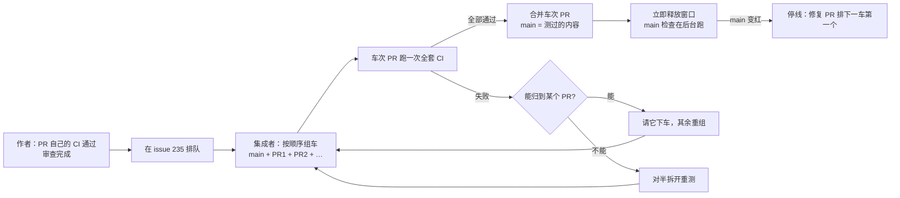

# 版本更新执行手册：把开发好的 PR 合进 main

> **生效状态**：本手册按 [D-0009](../../.collab/decisions/D-0009-batch-integration-train.md)（批量“车次”集成，**proposed**）写成。
> 标着“**D-0009 批准后适用**”的章节，要等人类把 D-0009 改成 accepted 才执行；
> 在那之前仍按 [D-0008](../../.collab/decisions/D-0008-stable-pr-integration.md) 一次合一个 PR，批准前怎么做见第 7 节。
> 第 2 节（作者的就绪清单）和第 8.1 节（排队模板）与 D-0008 一致，现在就能用。
>
> 为什么这样做、业内是怎么做的，见 [合并主干的业内做法调研](../decisions/2026-11-18-merge-queue-research.md)。

## 0. 一句话

**已就绪的 PR 攒成一车，一起测一次，测过的内容原样合进 main，合完马上放下一车；哪个 PR 让车失败，就只把它请下车。**



## 1. 角色

| 角色 | 是谁 | 做什么 |
|---|---|---|
| 作者 | 写 PR 的 Claude / Codex 会话 | 开发、让自己 PR 的 CI 通过、回应审查、在 #235 排队 |
| 集成者 | #235 里登记的**唯一**集成会话（默认是一个 Claude 会话） | 审查、组车、看车次 CI、合并、释放窗口、停线 |
| 人类 | 仓库所有者 | 批准规则、调整优先级、指定“单独发车”、决定要不要迁到组织仓库 |

集成者不在线时，由人类指定另一个会话接手，接手的会话在 #235 写明“领取集成职责”并引用人类的指派。

## 2. 作者：PR 怎样才算“就绪”

全部满足才能在 #235 排队：

- [ ] 从最新的 main 开工，PR 标题 `[T-xxxx] 简述`，正文按模板填写。
- [ ] 固定 head：之后要改就是新的 head，旧 head 的 CI 结果作废。
- [ ] 这个 head 上的相关必需检查都已成功（按 D-0008 第 4 节的改动类别）。偶发失败只重跑失败的 job 一次。
- [ ] 审查已完成，没有未处理的阻塞意见（Codex 的 PR 由 Claude 审查；安全类 PR 由集成者做独立安全审查，**在上车前做**）。
- [ ] `python3 scripts/collab.py check` 通过，任务文件和进度日志已更新。
- [ ] 在 #235 用第 8.1 节的模板排队。

排队之后：

- **不要再往这个 PR 推送**。要改就先在 #235 说“#xxx 下车”，改完重新排队。
- main 有无关的新提交时不用合 main（D-0008）。集成者组车时发现冲突，会请你合入新的 main。

## 3. 集成者：一车的完整步骤（D-0009 批准后适用）

### 3.1 发车前检查

1. main 是不是绿的？正在停线（第 5 节）就只发带修复的车。
2. 看 #235 里已就绪、还没上车的 PR，按排队顺序挑：
   - 最多 **6** 个；
   - 迁移、安全、共享基础设施、依赖、运行时接入包这几类合计最多 **2** 个；
   - 人类指定“单独发车”的 PR 单独一车；
   - 不为凑满而等：窗口空闲且有 1 个以上就绪 PR 就发车。
3. 核对每个 PR 的当前 head 仍是登记的固定 head：

   ```bash
   # 每个 PR 一行：PR 号 固定 head
   git fetch origin "pull/258/head" && git rev-parse FETCH_HEAD
   ```

4. 在 #235 用第 8.2 节的模板写“发车”。从这一刻起窗口被本车占用，其他人不更新 main。

### 3.2 组车

```bash
git fetch origin main
BASE=$(git rev-parse origin/main)
TRAIN=train/20261118-1          # 日期-序号；环境不允许时用集成会话自己的分支
git checkout -B "$TRAIN" "$BASE"

# 按排队顺序合入每个 PR 的固定 head；head 变了或有冲突的，不上本车
while read -r PR SHA; do
  if ! git fetch -q origin "pull/$PR/head"; then
    echo "#$PR 取不到，不上本车"; continue
  fi
  if [ "$(git rev-parse FETCH_HEAD)" != "$SHA" ]; then
    echo "#$PR 的 head 已变化，不上本车"; continue
  fi
  if ! git merge --no-ff --no-edit -m "车次 $TRAIN：合入 #$PR（固定 head ${SHA:0:7}）" "$SHA"; then
    git merge --abort; echo "#$PR 与车上其他改动冲突，不上本车"
  fi
done <<'EOF'
258 41c43e159f5e1b5db201bea5b5c58c3297e6af47
EOF
```

冲突的处理细则见第 6 节。

### 3.3 本地预检（几分钟，挡掉明显问题）

```bash
python3 scripts/collab.py check
(cd services/api && uv run alembic heads)                          # 只能有一行
(cd services/api && uv run python -m scripts.export_openapi --check)
(cd apps/web && npm ci && npm run check:api)                       # 前端类型和 openapi.json 一致
```

有后端或前端改动时，再跑和车上 PR 相关的测试文件，不必跑全套（全套由 CI 跑）。

### 3.4 推送并开车次 PR

```bash
git push -u origin "$TRAIN"
TRAIN_HEAD=$(git rev-parse HEAD)
```

- 车次 PR：base 为 main，标题 `[车次 20261118-1] 合入 #258、#260、#261`，
  正文列出每个 PR 的任务号、固定 head、改动类别、需要重新部署的部分。
- 在 #235 的“发车”留言后补上车次 PR 链接和 `TRAIN_HEAD`。
- 用 PR 订阅等 CI 结果，不要轮询。等待期间可以审查下一批 PR，但不要动 main。

### 3.5 看结果

- **全部必需检查成功** → 第 3.6 节发布。
- **有失败** → 第 4 节。

### 3.6 发布并释放窗口

1. 确认 main 仍是 `BASE`（窗口期间没人动过 main，正常一定相等；不相等就不合并，重新组车）。
2. 用 merge commit 合并车次 PR，**指定 expected head SHA = `TRAIN_HEAD`**。合并说明写清车上的 PR 和 CI 结果。
3. 核对：

   ```bash
   git fetch origin main
   git diff --quiet "$TRAIN_HEAD" origin/main && echo "main 的内容就是测过的内容"
   ```

4. 确认车上每个 PR 在 GitHub 上都显示为已合并（它们的提交已经在 main 里）。
5. main 的 collab 检查通过后，在 #235 用第 8.3 节的模板写“发布”，**立即释放窗口**。
   main 的其他推送检查在后台跑，结果出来后补一句；失败就进入第 5 节。
6. 删除车次分支。

## 4. 车次失败怎么办（D-0009 批准后适用）

按顺序判断：

1. **已知偶发**：失败的测试在附录 A 里，并且同一处失败在 main 或别的分支上出现过 → 只重跑失败的 job 一次。
   通过就继续；再失败按下面处理。
2. **能归到某个 PR**：失败的测试、页面或镜像只和某个 PR 改的区域有关 →
   把它请下车（#235 写明原因，PR 上留评论，交还作者，标为 blocked），其余 PR 用**新的**车次分支重新组车。
3. **归不清楚**：把车上的 PR 按排队顺序对半分成两车分别测；失败的那一半继续对半，直到找到问题 PR。
4. 每次重组都用新的车次分支和新的车次 PR，旧的关闭，不改写已推送的车次分支。

参考 Chromium 的做法：先确认“不带这个 PR 的 main 上这个测试会不会失败”，再怪 PR。

## 5. main 变红：停线（D-0009 批准后适用）

批准前按 D-0008：发现 main 相关失败时停止后续集成并排查，修好后再继续。

1. main 的推送检查失败 → 在 #235 写“停线”（模板 8.4），写清失败的 job、测试和初步原因。
2. 判断：
   - **已知偶发**：重跑失败的 job 一次，不停线；确认附录 A 里有对应任务。
   - **真实问题**：保持停线。
     - 修复 PR 作为下一车的**第一个** PR，可以和其他就绪 PR 同车；
     - 修复预计要超过一个车次的时间，可以先在下一车里 revert 引入问题的合并，原作者另开 PR 修好再上车。
3. 停线期间不发不含修复的车。
4. main 恢复绿色后写“解除停线”。

## 6. 冲突处理细则

“不上本车”“在车次分支上重新生成”这些说法 D-0009 批准后适用；批准前同样的处理放在 D-0008 第 2.3 条的单个候选上做。

| 冲突类型 | 处理 |
|---|---|
| 手写代码冲突 | 后排队的 PR 不上本车，请作者合入新的 main 后重新排队 |
| 生成文件（`services/api/openapi.json`、`apps/web/src/services/schema.d.ts`） | 在车次分支上重新生成：`make openapi`，再 `cd apps/web && npm run generate:api`；单独一个提交并写明原因，CI 的一致性检查负责核对 |
| 迁移链（`alembic heads` 不止一行） | 后排队的 PR 不上本车，请作者把迁移接到 main 最新的迁移之后，重新排队 |
| 任务编号、任务日志等元数据 | 按 D-0008 第 2.5 条在车次分支上处理，保留双方的历史日志 |
| 文档 | 能直接合就合；两边意思冲突时请后排队的作者处理 |

## 7. D-0009 批准前怎么做

仍按 D-0008：一次一个候选，合并后按集成会话现在的做法核对 main 的推送检查，再释放窗口。下面几条 D-0008 写明了，可以照做：

1. **就绪才排队**：CI 还在跑或被打回的 PR 不占队列位置，后面已就绪的照常合（D-0008：“blocked 候选不阻塞其他已就绪 PR”）。
2. **偶发失败只重跑失败的 job 一次**；再失败先查原因。同时在附录 A 登记并开任务修。
3. **候选需要补测时只补受影响的范围**，已有的同 SHA、同输入的成功结果保留（D-0008 第 2.6、4 节）。

**需要人类确认的一条：测过即释放。**
D-0008 第 3 节写了“同一代码输入的重复全量运行可在后台继续”，可以理解为 PR 基线就是当前 main 时，合并后不必等全套检查跑完；
但集成会话一直按“等 main 的推送检查全部跑完再释放”执行。为了不各自理解，这一条按 D-0009 第 5 条处理，
**人类批准 D-0009，或单独确认这一条之后才执行**。它单独就能给基线就是当前 main 的 PR 省掉约 1 小时。

## 8. #235 留言模板

### 8.1 作者：排队

```markdown
**排队：PR #xxx（T-xxxx）准备就绪，固定 head `abcdef1`**（作者 <身份> 会话 `<会话>`，分支 `<分支>`）
- 基线 main：`1234567`；GitHub 显示有无冲突：
- 检查：xx 项全部成功（列出长的几项和完成时间）；重跑过的写明原因
- 审查：谁审的、阻塞意见是否都处理了
- 类别：前端 / 后端 / 迁移 / 安全 / 共享基础设施 / 依赖 / 运行时接入包 / 文档
- 需要重新部署：无 / 工作台 / MCP 管理器 / 接入包 …
- 关联风险：和哪些 PR 改了同样的文件
```

### 8.2 集成者：发车

```markdown
**发车：车次 20261118-1**（集成会话 `<会话>`）
- 基线 main：`1234567`
- 车上（按排队顺序）：#258（T-0296，`41c43e1`）、#260（T-xxxx，`…`）
- 没上车：#261（迁移链冲突，已请作者改迁移号）
- 车次 PR：#xxx，head `…`
- 窗口：本车占用，验证期间其他人不更新 main
```

### 8.3 集成者：发布

```markdown
**发布：车次 20261118-1 已合并，main `89abcde`，窗口释放**
- 车次 PR #xxx 的 head `…` 上 xx 项检查全部成功；main 的内容与它相同（`git diff` 为空）
- 已合并：#258、#260（GitHub 显示已合并）
- 需要重新部署：…
- main 的推送检查在后台运行，结果出来后补在这里
```

### 8.4 集成者：停线 / 解除停线

```markdown
**停线：main `89abcde` 的 <workflow / job> 失败**
- 失败的测试：…；初步原因：…
- 判断：已知偶发（附录 A 第 x 条，已重跑一次）/ 真实问题
- 处理：修复 PR #xxx 排下一车第一个 / 下一车 revert #xxx
```

## 9. 时间预算

| 情况 | 十几个 PR 要多久 |
|---|---|
| 现在（一次一个、合并后等 main 全套 CI） | 每个约 1 ~ 2.5 小时，12 个约 12 ~ 24 小时 |
| 只确认“测过即释放”（第 7 节） | 基线就是当前 main 的 PR 几分钟就能合完；其余的每合一个 main 就变一次，后面的仍要补测约 1 小时，12 个约 10 ~ 12 小时 |
| 车次（每车 6 个，CI 约 1 小时） | 2 ~ 3 车，约 2.5 ~ 3.5 小时 |
| 车次 + pytest 提速 + 拆分 `agents` | 每车可望降到 30 分钟以内（要实测） |

## 10. 后续工具化（D-0009 第 9 条，分别开任务）

1. pytest 用模板库（迁移只跑一次，每个测试 `CREATE DATABASE … TEMPLATE …` 复制）和多进程，`api` 目标 15 分钟以内。
2. 拆分 `ci-infra / agents`（多实例端到端约 22 分钟、SSH 验收约 8 分钟可以分到不同 job），缓存 OpenIM 镜像构建。
3. 修复附录 A 的偶发问题。
4. 同一 PR 推新提交时自动取消旧的 CI（`concurrency` + `cancel-in-progress`，只对 pull_request）；始终运行的 `ci-gate`。
5. 用 GitHub Actions 自动组车：读取 #235 或标签里的就绪 PR，建车次分支、开车次 PR、全绿后合并。
6. 迁到组织仓库后改用 GitHub 原生合并队列（`merge_group` 触发、分组大小 6），由人类决定。

## 附录 A 已知偶发与待加固清单（截至 2026-11-18）

只有集成者更新这张表；每一条都要有修复任务。第 4 节说的“已知偶发”只指这张表里标为偶发的条目。

| # | 位置 | 现象 | 最近出现 | 修复任务 |
|---|---|---|---|---|
| 1 | `ci-api`：`services/api/tests/conftest.py:114` 的 `flushdb()` 等处 | 测试夹具连 CI 的 Redis 超时（`Timeout connecting to server`），每次是不同的测试 | 2026-11-17 至少 5 次；2026-11-18 3 次（main `51e8cd7` 的 `test_news_api.py`、#259 head `f6b9277` 的 `test_runner_network.py` 等） | 待开 |
| 2 | `ci-api`：`test_dashboard_api.py::test_concurrent_overviews_queue_instead_of_timing_out` | 机器忙时排队超过 1 秒时限，某个模块显示 `unavailable` | main `51e8cd7`（2026-11-18） | 待开 |
| 3 | `ci-infra / compose`：`tests/e2e/sprint5_acceptance.py` A16 | 重连后只读第一个补发事件，被 worker 每分钟一次的“服务已恢复”通知撞上 | main `5c3dbd8`（2026-11-17） | 待开 |
| 4 | `ci-infra / agents` | 实例刚上线时“立即上报一次”或用量上报失败 | main `c6d0473`；#255 的 head | 待开 |
| 5 | `ci-llm-bridge`：`infra/llm-bridge/smoke.sh` 的健康检查例外 | 不是偶发，是加固：健康检查进程目前按命令行特征认出，#259 上 Codex 的 P2 意见建议改成和完整命令行逐字比较 | #259（2026-11-18） | 待开 |

## 附录 B 相关文件

- 协作规则：[D-0008](../../.collab/decisions/D-0008-stable-pr-integration.md)、[D-0009](../../.collab/decisions/D-0009-batch-integration-train.md)（proposed）
- 通知与集成队列：[issue #235](https://github.com/brianabc121/WorkspaceCore/issues/235)
- 代理规则：[`docs/AGENTS.md`](../AGENTS.md)
- 部署的发布前检查（不是合并流程）：[`docs/release-checklist.md`](../release-checklist.md)
