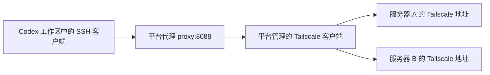

# Tailscale 部署与开发使用手册

适用：WorkspaceCore 的 Linux 测试服务器、Codex Cloud 接入，以及通过 Tailscale 开发和验证跨节点服务。最后核对官方文档：**2026-11-14**。人工时间使用北京时间，原始日志保留其 UTC/ISO 时区。

本文用于避免重复踩坑。安装、注册、修改策略和重启属于有副作用的步骤，只在已批准的目标与维护范围内执行。代码块是操作模板，不表示本文编写时重新执行过这些操作。

## 先看这十条

1. **Connected 只证明设备在线，不证明当前客户端有访问权限。** TCP、SSH 登录、TLS 和应用授权要分别验证。
2. **Reusable 复用注册凭据；持久状态复用设备身份；Ephemeral 回收离线短期设备。** 三者作用不同。
3. Codex 使用带 **`tag:codex-cloud` 的注册密钥**，不能依赖给某一次临时节点手动打标签。`tagOwners` 不会自动赋标签。
4. 每次恢复会话，先核对当前设备及标签；不能因为旧 `codex-environment` 有标签，就认为新的 `-1/-2/-3` 也有。
5. Codex Cloud 的 VPN 在平台代理侧。工作区有文件，不代表 VPN 状态、临时目录或容器进程也保留；当前工作区无需再安装一套 Tailscale 来修复平台代理。
6. SSH 保持严格主机公钥校验。`ssh-keyscan` 用于发现公钥，**不是公钥可信的证明**。
7. 先读已有执行与资源回执，再部署；保护现有服务、网络、卷和数据。公网及完整验收未完成前，生产网络开关保持关闭。
8. 每个结果附时间、目标、执行路径、命令、退出码和代码版本；历史 PASS、当前失败、推断原因和未执行项目分开记录。
9. **Codex Cloud 每次更新 Tailscale 密钥后：保存 → Publish/Republish → 从更新后的环境新开 Cloud 会话 → 实测。** 继续旧会话、刷新界面或只保存草稿，不等于替换旧运行实例的 VPN 配置；不要在旧会话反复改服务器来等待新密钥生效。
10. **本项目访问策略的 `src`、`dst` 都用角色标签。** 云端来源用 `tag:codex-cloud`，SSH 目标用 `tag:workspace-test`；节点互联用 `tag:workspace-test-a/b` 区分方向。IP 用于连接与盘点，不作为会变动的客户端身份，也不把设备显示名称当标签。

## 目录

- [1. 先分清四个管理层](#layers)
- [2. 注册密钥、标签与设备身份](#keys)
- [3. Linux 服务器从零部署](#deployment)
- [4. 最小网络与 SSH 策略](#policy)
- [5. Codex Cloud 接入与恢复](#cloud)
- [6. 严格 SSH 与公钥缓存](#ssh)
- [7. 每次开发前后的固定流程](#daily)
- [8. 按层定位故障](#troubleshooting)
- [9. K3s/Cilium 与应用网络的额外门槛](#runtime)
- [10. 轮换、回收和交接](#maintenance)
- [11. 本项目已发生的案例与证据](#evidence)
- [12. 官方参考](#references)

<a id="layers"></a>
## 1. 先分清四个管理层

|管理层|负责什么|到这一层成功，仍不能证明什么|
|---|---|---|
|Tailscale 管理端|设备登记、标签、注册密钥、网络 grants、Tailscale SSH 规则|目标端口在监听、应用可用|
|Codex Cloud 平台|VPN 客户端、注册凭据绑定、运行实例恢复、HTTP/TCP 代理|当前节点标签正确、目标可达|
|A/B 服务器|Tailscale 服务、SSH 服务、主机身份、防火墙、现有服务和数据|容器策略已生效、跨实例访问已授权|
|WorkspaceCore/集群|工作空间和实例权限、Pod 身份、NetworkPolicy、网关租约、应用回执|真实数据面和公网来源已经验收|

当前云端访问路径：



本地开发电脑如果自己运行 Tailscale，可直接使用本机 VPN 网络。Codex Cloud 的工作区则可能没有 Tailscale 网卡、CLI 或普通私网路由，需使用平台提供的连接方式。两种环境的命令不能混用。

## 身份速查

|名称|用途|常见误解|
|---|---|---|
|Auth key / 注册密钥|让设备首次注册或重新认证|相同密钥不等于相同设备|
|设备状态及其中的私钥|维持设备身份|复制给多个同时运行的实例，会造成重复身份|
|设备名称|帮助人识别机器|同名、相似后缀不证明是同一个设备|
|Tailscale IP|连接已登记设备|IP 本身不授予访问权限|
|标签|作为策略中的设备身份|名称含 codex 不会自动拥有 codex 标签|
|SSH 主机公钥|让客户端确认目标 SSH 服务|与用户登录私钥、注册密钥不同|
|Linux machine-id|操作系统及本项目物理主机防重的身份来源|与 Tailscale IP、SSH 公钥不是同一个标识|

<a id="keys"></a>
## 2. 注册密钥、标签与设备身份

### 2.1 选定的注册方案（2026-11-14 新会话已验证 SSH）

下表是角色配置模板，不是已部署结果；实际确认状态见第11节。

|设置|Codex Cloud 短期开发客户端|A/B 长期服务器|
|---|---|---|
|身份标签|`tag:codex-cloud`|共同标签 `tag:workspace-test`，另按角色加 `tag:workspace-test-a` 或 `tag:workspace-test-b`|
|Reusable|开启，供后续实例注册|按部署需要；单次部署可使用一次性密钥|
|Ephemeral|开启，回收离线短期节点|关闭，保留长期服务器身份|
|Pre-approved|启用设备审批且界面提供时开启|按服务器审批流程配置|
|有效期|明确轮换周期，记录到期日|同样记录；不要和设备密钥有效期混淆|
|保存位置|平台凭据设置/密钥管理系统|批准的密钥管理系统或仅管理员可读文件|

在 Tailscale 管理端 Keys 页面生成 Codex 专用 Auth key，启用 Reusable、Ephemeral，并明确选择 `tag:codex-cloud`。将值填入所用 Cloud 环境的 Tailscale 凭据设置，保存并发布/重新发布，再从该环境新开会话，按第5.4节验收。不要把值写进仓库、命令历史或聊天。

**生成密钥、保存平台配置、发布环境、新会话采用新版本、目标连接成功，是五个独立步骤。** 必须逐项核验；新密钥不会自动给旧设备补标签，也不会追溯清理旧的普通设备。第11节已记录新会话两机登录成功，但没有读取平台保存的密钥值，也没有取得平台代理自身设备 IP；不据此编造当前节点映射或密钥属性核验结果。

官方依据：[Auth keys](https://tailscale.com/docs/features/access-control/auth-keys)、[Ephemeral nodes](https://tailscale.com/docs/features/ephemeral-nodes)。

### 2.2 为什么会出现 `codex-environment-1/-2/-3`

新设备登记时如果名称冲突，Tailscale 可生成带数字后缀的名称。[设备名称说明](https://tailscale.com/docs/concepts/machine-names)

先核对这些证据，再判断原因：

- 当前运行实例的启动时间、逻辑环境 ID 和配置版本。
- Tailscale 控制台中新设备的登记时间、设备身份、地址、标签及最后在线时间。
- 是否发生了重建、恢复、重新认证，或同时启动了其他任务。
- 平台是否持久保存 VPN 状态，还是有意使用短期节点。

仅凭后缀不能确定“谁创建了它”“发生了哪次恢复”或“平台一定有缺陷”。没有注册日志、也读不到平台代理自身设备身份时，要保留这一不确定性。

### 2.3 持久身份方案：仅用于自己可管理的 VPN 容器/平台

平台若要让同一个逻辑环境恢复为同一设备，应持久保存 Tailscale 状态，并在启动前恢复。官方容器参数是 `TS_STATE_DIR` 和 `TS_AUTH_ONCE`。[容器参数](https://tailscale.com/docs/features/containers/docker/docker-params)

以下只是**自管容器的状态存储片段**，不构成本项目完整代理部署，也不是已经开放给 Codex Cloud 用户的配置开关：

```yaml
services:
  tailscale:
    image: "${TAILSCALE_IMAGE:?设置已核验的固定版本及digest}"
    environment:
      TS_STATE_DIR: /var/lib/tailscale
      TS_AUTH_ONCE: "true"
      TS_AUTHKEY: "${TAILSCALE_AUTH_KEY:?从安全凭据来源注入}"
    volumes:
      - tailscale-state:/var/lib/tailscale
volumes:
  tailscale-state: {}
```

操作要求：

- 同一逻辑环境恢复时挂载同一份卷；不同并行实例使用独立身份，不能克隆共享私钥状态。
- 需要长期保留设备时使用非Ephemeral注册方案；离线设备被服务端回收后，仅有本地状态卷也不保证原设备仍可复用。
- 卷的真实名称和生命周期也要稳定；改变 Compose 项目名可能使用另一份卷，清理卷会丢失身份。
- 状态包含私钥，不能打进通用镜像、推送 GitHub，或作为共享测试 fixture。
- `TS_AUTH_ONCE=true` 不会替你持久化文件；仅保存 Auth key 或 hostname 也不够。
- 当前工作区没有控制平台代理状态卷的接口；不能通过修改项目文件或服务器 ACL，承诺改变托管平台的恢复机制。

本项目当前选择的是“新客户端自动带正确标签”的短期方案。它改善权限连续性与离线回收，不承诺永远只有一个设备条目或固定客户端 IP。

<a id="deployment"></a>
## 3. Linux 服务器从零部署

### 3.1 先建立变更边界

通过可信的服务器控制台或已有管理路径，记录目标主机、系统版本、现有监听端口、服务、容器、网络和卷。先检查是否已经安装或加入 Tailscale，避免重复初始化。

```bash
hostname
id
cat /etc/os-release
uname -srmo
command -v tailscale || true
systemctl is-active tailscaled || true
ss -lntup
```

这些是只读检查。安装、登录、改标签、启用 Tailscale SSH、改防火墙或重启应另有明确的执行范围；不要把“检查连接”扩展成自动重装。

### 3.2 Debian 11/12 安装示例

仅适用于尚未安装客户端、已批准安装的 Debian bullseye/bookworm。其他系统按[官方 Linux 安装说明](https://tailscale.com/docs/install/linux)选择来源。仓库地址依据[官方软件包站](https://pkgs.tailscale.com/stable/)。

```bash
set -euo pipefail
. /etc/os-release
test "$ID" = debian
case "$VERSION_CODENAME" in
  bullseye|bookworm) ;;
  *) echo '请按当前发行版选择官方安装步骤' >&2; exit 1 ;;
esac

TASK_SETUP_DIR="$(mktemp -d)"
curl -fsSL --connect-timeout 5 --max-time 30 \
  "https://pkgs.tailscale.com/stable/debian/${VERSION_CODENAME}.noarmor.gpg" \
  --output "$TASK_SETUP_DIR/keyring.gpg"
curl -fsSL --connect-timeout 5 --max-time 30 \
  "https://pkgs.tailscale.com/stable/debian/${VERSION_CODENAME}.tailscale-keyring.list" \
  --output "$TASK_SETUP_DIR/tailscale.list"
sudo install -m 0644 "$TASK_SETUP_DIR/keyring.gpg" \
  /usr/share/keyrings/tailscale-archive-keyring.gpg
sudo install -m 0644 "$TASK_SETUP_DIR/tailscale.list" \
  /etc/apt/sources.list.d/tailscale.list
sudo apt-get update
apt-cache policy tailscale
```

审阅实际可用版本后，设置 `TS_PACKAGE_VERSION`，再安装。下面没有提供一个未经验证的包版本号：

```bash
: "${TS_PACKAGE_VERSION:?填写已核验的apt包完整版本}"
sudo apt-get install -y "tailscale=$TS_PACKAGE_VERSION"
sudo systemctl enable --now tailscaled
tailscale version
```

把实际安装版本、仓库和安装日期记录下来。下载失败先检查代理、CA 和来源，不通过关闭 TLS 校验继续安装。

### 3.3 注册、标签和 SSH

先准备好第4节的标签权限和访问规则，再在新服务器上按批准方案注册。例如管理员交互登录：

```bash
sudo tailscale up --advertise-tags=tag:workspace-test
```

在受信浏览器完成认证，随后从控制台核验标签和设备地址。需要无人值守时，使用已批准的服务器注册凭据方案，密钥值通过安全来源传递。

然后明确选择 SSH 模式：

|模式|目标端认证与授权|要求|
|---|---|---|
|普通 OpenSSH，经 Tailscale 网络连接|目标 sshd、公钥/账号策略|网络允许 TCP22；保留正常主机公钥校验|
|Tailscale SSH|Tailscale 的 SSH 服务与 tailnet SSH 规则|目标启用该功能；网络 grants 和 `ssh` 规则都允许|

启用 Tailscale SSH 的命令是：

```bash
sudo tailscale set --ssh
```

它会接管 Tailscale 地址上的22端口，已有经该地址建立的 SSH 会话可能中断。先保留可信管理入口，再在批准窗口执行。它不等于修改原 sshd 的登录配置，也不证明原 sshd 的主机公钥就是当前 Tailscale SSH 服务的公钥。[官方说明](https://tailscale.com/docs/features/tailscale-ssh)

已有服务器不要每轮开发都重复 `up`、强制重新认证或切换 SSH 模式。调整标签时保留仍需要的已有标签，并检查身份变化对现有连接的影响。

<a id="policy"></a>
## 4. 最小网络与 SSH 策略

### 4.1 三种设置各司其职

- `tagOwners`：谁可以赋予标签。
- `grants`：谁可以访问哪些目的地址、协议和端口。
- `ssh`：Tailscale SSH 接受哪些来源、目标和目标 Unix 用户。

定义 tagOwners 不会给设备自动打标签；只写 ssh 规则也不会自动放通 TCP22。Tailscale SSH 需要两层均允许。[Grants说明](https://tailscale.com/docs/features/access-control/grants/grants-explained)

本项目统一按以下身份写 `grants`（或既有 ACL 的对应来源/目标）及 `ssh` 规则：

|角色|设备必须实际持有的标签|策略中的用途|
|---|---|---|
|Codex Cloud 临时客户端|`tag:codex-cloud`|云端 SSH 的 `src`|
|服务器 A|`tag:workspace-test`、`tag:workspace-test-a`|SSH 共同目标；节点互联 A 角色|
|服务器 B|`tag:workspace-test`、`tag:workspace-test-b`|SSH 共同目标；节点互联 B 角色|

**同时检查 `src` 和 `dst`，也同时检查网络规则和 SSH 规则。** 只改一端或只改一层仍可能不匹配。给设备命名为 `workspace-test-a` 不会自动赋予 `tag:workspace-test-a`；在 `tagOwners` 声明标签也不会自动分配。A/B 保留共同标签再补角色标签，避免替换标签时丢失已有 SSH 授权。

Tailscale 的网络 grants 语法本身支持 IP/CIDR；这里使用标签是本项目防止节点更换、临时 IP 和角色混淆的约定，不是声称官方禁止 IP 规则。IP 仍是 SSH 连接目标，不能把 `ssh root@tag:workspace-test` 当作标签选择器的用法。

同一 `src`/`dst` 数组里的多个选择器是“任一匹配”，不是“同时持有”。例如节点 A 的方向规则只选 `tag:workspace-test-a`；不要把共同标签也放进该数组，以免把范围扩大到所有测试服务器。

下面是**专用测试环境的最小策略示例**。它授予测试服务器 root 登录，生产环境应改为符合其角色的账号。应用到已有 tailnet 时合并相关条目，保留其他业务所需配置，并审查已有宽泛放行规则；新增窄规则不会抵销既有更宽的允许规则。

```json
{
  "tagOwners": {
    "tag:codex-cloud": ["autogroup:admin"],
    "tag:workspace-test": ["autogroup:admin"],
    "tag:workspace-test-a": ["autogroup:admin"],
    "tag:workspace-test-b": ["autogroup:admin"]
  },
  "grants": [
    {
      "src": ["tag:codex-cloud"],
      "dst": ["tag:workspace-test"],
      "ip": ["tcp:22"]
    }
  ],
  "ssh": [
    {
      "action": "accept",
      "src": ["tag:codex-cloud"],
      "dst": ["tag:workspace-test"],
      "users": ["root"]
    }
  ]
}
```

只给经过批准的设备赋这些标签。新客户端显示普通用户身份而没有 `tag:codex-cloud` 时，不能因它与旧设备同名就认为该规则匹配。

带标签的 Codex 来源连接带标签的服务器时，Tailscale SSH 使用 `action: "accept"`；官方不支持带标签来源使用 `check` 模式。不要照搬面向人工用户的 `autogroup:self`/`check` 规则，也不要为修复自动化登录扩大到所有成员 root。[Tailscale SSH 支持范围](https://tailscale.com/docs/features/tailscale-ssh)

### 4.2 SSH 和节点互联是不同方向

本次已核验 A=`100.72.60.100`、B=`100.121.210.36`，这些是连接地址；未来仍须从可信设备记录重新核对。下面将历史固定 IP 节点规则改为角色标签，**追加到 grants 数组**；先确认 A/B 的角色标签已实际赋予且没有误赋给其他设备。本次只修正文档，没有向管理端应用这些规则。

```json
[
  {
    "src": ["tag:workspace-test-b"],
    "dst": ["tag:workspace-test-a"],
    "ip": ["tcp:6443", "tcp:10250", "udp:8472"]
  },
  {
    "src": ["tag:workspace-test-a"],
    "dst": ["tag:workspace-test-b"],
    "ip": ["tcp:10250", "udp:8472"]
  }
]
```

这里分别用于 B访问A的集群 API、节点间 kubelet，以及跨节点 Cilium VXLAN。它们不会顺带允许云端客户端访问 API。云端通过 SSH 在受信节点上使用 kubectl，是另一条经过授权的路径。

如果确有 A/B 互相访问 TCP22 的需求，应另加经批准的角色标签网络规则；本段集群端口规则不包含 TCP22，云端 SSH 规则也不会自动允许 A→B。若还需要节点间 Tailscale SSH 登录，另配对应方向的 `ssh` 规则，不能把 TCP22 可达当作已经有 root 登录权限。

控制面、kubelet和overlay端口按实际架构最小放行；不要为调通测试开放所有节点端口。Tailscale 自身的底层传输与承载其中的 VXLAN UDP8472也不是同一层。

<a id="cloud"></a>
## 5. Codex Cloud 接入与恢复

### 5.1 每次恢复都重新建立事实

检查平台当前配置和观测状态：逻辑环境、配置版本、VPN配置、失败信息、网络策略是否已应用。具备工具时优先读取当前环境状态；`failure=null` 只表示没有报告失败，不是服务可达证明。

必要时在平台批准的外层执行器读取实时状态地址。只输出所需字段，不复制完整代理配置：

```bash
python3 - <<'PY'
import json
import urllib.request

opener = urllib.request.build_opener(urllib.request.ProxyHandler({}))
with opener.open('http://proxy:8099/status', timeout=5) as response:
    data = json.load(response)
state = data.get('tailscale', {})
print({key: state.get(key) for key in
       ('configured', 'observed_at', 'state', 'routing_ready')})
PY
```

这个直接连接例外仅用于平台代理的只读状态接口。字段缺失表示未知，不据此补出“正常”。不要把这个不经过 HTTP 代理的写法套用到远端服务。

随后核对**当前** Tailscale 设备的标签。逻辑环境 ID 未变、工作区文件仍在、设备名称相似，都不能替代这一步。平台没有暴露自身设备身份时，应结合控制台登记时间/状态和可用日志，避免把另一任务的节点误认成本任务。

### 5.2 选择正确传输

|用途|当前平台的路径|注意|
|---|---|---|
|HTTP/HTTPS|继承的 HTTP_PROXY/HTTPS_PROXY、NO_PROXY 与 CA|保留 TLS 验证，不随意清空代理变量|
|SSH、数据库等原始TCP|外层执行器访问 `proxy:8088`，使用HTTP CONNECT|应用自己认证；仍需核验目标身份|
|UDP/ICMP|不通过该TCP代理|在已授权节点或真实工作负载之间验证|

在此平台直接连接 sidecar 地址通常需要使用执行工具批准的外层路径。一次环境中的 localhost relay，不一定能从另一个沙箱的 localhost 访问。目的域名应交由代理解析；socat 使用 `resolve=0` 保留该域名。

平台拒绝的目标应通过受支持的策略设置处理；变更执行权限不会绕过目的访问策略，也不能通过换地址或关闭身份校验规避拒绝。

### 5.3 严格 SSH 示例

先完成第6节公钥固定。`SOCAT` 必须是当前镜像维护的、或按平台说明校验安装的可执行文件绝对路径；不要假定上一次 `/tmp/ensure-socat.sh` 仍存在。此模板只向目标执行 `hostname` 和 `id`：

```bash
: "${SOCAT:?设置已核验的socat可执行文件绝对路径}"
: "${TS_TARGET:?设置已授权的目标Tailscale地址}"
: "${TS_HOST_KEYS_FILE:?设置已核验的专用known_hosts文件}"
test -x "$SOCAT"
test -s "$TS_HOST_KEYS_FILE"

ssh -F /dev/null \
  -o BatchMode=yes \
  -o StrictHostKeyChecking=yes \
  -o GlobalKnownHostsFile=/dev/null \
  -o HostKeyAlgorithms=ssh-ed25519 \
  -o "UserKnownHostsFile=$TS_HOST_KEYS_FILE" \
  -o ConnectTimeout=10 \
  -o "ProxyCommand=$SOCAT - PROXY:proxy:%h:%p,proxyport=8088,resolve=0" \
  "root@$TS_TARGET" 'hostname; id'
```

示例按本项目 IPv4 地址、不含空格/特殊字符的 socat 路径和已核验的ED25519公钥使用。禁用全局known_hosts来源，避免其他系统记录替代本次专用公钥固定。不要把目标列表、路径或远端命令当作未校验的外部字符串拼接。

<a id="cloud-key-rotation"></a>
### 5.4 每次更新密钥后必须发布环境并新开会话

**固定操作：更新 Tailscale 密钥 → Save → Publish/Republish → 新建 Cloud 会话并选择更新后的环境 → 重新验证两机。** 旧会话继续发送“重连”“继续”不会自动把已发布配置应用到它的旧运行实例。新会话也必须选对环境，单纯新开聊天不足以保证使用新配置。

Codex 桌面端操作顺序（界面名称若变化，以当前环境编辑页为准）：

1. 打开 **Settings → Codex Cloud → Environments**，找到本任务实际使用的环境，进入 **Edit**。
2. 点击 **Tailscale 旁的铅笔**，更新安全凭据，确认注册方案为带 `tag:codex-cloud` 的 Reusable + Ephemeral。
3. **Save 后继续 Publish/Republish**，等发布完成；保存草稿不是发布。
4. **新建会话/任务，Work in 选择 Cloud，并选择刚发布的环境**。需要新配置的既有运行实例应按平台流程替换；保留旧聊天作记录，不再靠旧实例的失败判断新配置无效。
5. 读取新会话的环境 ID、`source_config_version_id` 和当前观测状态，与旧实例比较；`spec_revision=1` 本身不能识别是否换了环境或配置版本。具备可信设备映射时再核对来源 IP/标签；没有映射时明确写未知。
6. 通过 `proxy:8088` 对 A/B 的 TCP22 建立**新连接**，然后核验可信 ED25519 指纹；匹配后分别执行 `hostname`、`id`。两个命令退出0才算本轮 SSH 验收通过，不能只看 Connected、Running 或 CONNECT 200。

依据：[官方 Cloud environments 的 VPN 更新流程](https://developers.openai.com/codex/environments/cloud-environments#private-networking-vpn)。这条要求针对托管 Cloud VPN 配置更新；仅修改 Tailscale 访问策略，不等于每次都需要生成新密钥或重建所有会话。

**本次实证：** 旧会话到 A/B 的 CONNECT 均503超时；更新环境后，本新会话的实例 ID 和源配置版本均不同，2026-11-14 15:33起（UTC+8）两机 CONNECT 200、`SSH-2.0-Tailscale`，随后指纹匹配，`hostname/id` 均退出0。完整结果见第11.1节。此对照验证了新环境下连接恢复；没有单独证明旧实例内部超时的具体根因，也没有定位到某一个 Codex 设备 IP。

### 5.5 先核对角色与方向，再判断是否连接成功

- **不要把 Codex 来源节点当服务器目标。** 此次 A/B 为 `100.72.60.100`、`100.121.210.36`；历史截图中的 `100.107.25.64`、`100.113.142.22`、`100.123.123.71` 是 Codex 客户端，不能拿来替代 A/B。它们也不是当前实例已核实的来源 IP。设备清单至少记录“角色、地址、标签、核验时间”。
- **A→B 通，不等于 Codex→A/B 通。** 两条路径的来源标签、策略方向和平台代理不同，分别验证；不要用服务器之间的成功替代本会话成功。
- **DERP 是可用的中继方式。** `pong ... via DERP(...)` 后出现 `direct connection not established`，表示没有建立直连，不表示中继没有回复。中继可以承载 SSH；无需为追求直连先改公网防火墙。[官方连接类型](https://tailscale.com/docs/reference/connection-types)
- **Tailscale ping 不等于实际 TCP22/SSH 验收。** 探测协议与应用连接不同；必须走当前会话的目标 TCP 路径，再核对公钥和登录结果。CONNECT 200 后还要读到 SSH 服务响应，不能把普通 HTTP 代理的200单独报成 SSH 成功。
- **没有可用的 VPN 重连接口时如实说明。** 不要求用户寻找未核实存在的“重连 VPN”按钮，也不在工作区安装另一个 Tailscale 代替平台代理；按第5.4节更新环境并新开任务。

<a id="ssh"></a>
## 6. 严格 SSH 与公钥缓存

### 6.1 把发现与信任分开

`ssh-keyscan` 不验证目标真实性。先由管理员通过受信通道确认**实际 SSH 服务**的指纹，再与采集到的公钥比较。[OpenSSH手册](https://man.openbsd.org/ssh-keyscan.1)

- 原生 VPN 网络可直接采集候选；云端需通过同一批准的外层 TCP relay 采集，保存其 PID 并在使用后停止。
- 经localhost relay采集时，文件中的地址可能是 `[127.0.0.1]:端口`；比对公钥后固定到真实目标，而不是把relay地址当服务器身份。
- 注释/banner行不是known_hosts公钥记录，尤其不要把 `# ... SSH-2.0-...` 写入文件。
- 普通sshd与Tailscale SSH可能提供不同主机公钥；要核验这次真正连接的服务。
- 主机公钥变化时，先确认批准的重装/轮换事件；不要自动删除旧记录并盲目接受新公钥。

### 6.2 持久保存可信记录

使用用户私有、实际会持久保存的位置，不依赖 `/tmp`，并将该目录放在 Git 工作树之外：

```bash
TASK_SSH_STATE="${XDG_STATE_HOME:-$HOME/.local/state}/workspace-tailscale"
install -d -m 0700 "$TASK_SSH_STATE"
```

平台若连这个位置也不持久，应从已保存的可信记录恢复，或重新做可信核验。不要从“目录名看起来持久”推断平台已经保证保存。

下面将**已采集的候选公钥**与管理员给出的 SHA256 指纹精确比较。先设置 `TS_TARGET`（IPv4）、`TS_CANDIDATE_FILE`、`TS_EXPECTED_FP`（含`SHA256:`前缀）、`TS_HOST_KEYS_FILE`（本目标的专用文件）：

```bash
python3 - <<'PY'
import base64
import hashlib
import ipaddress
import os
from pathlib import Path

target = str(ipaddress.IPv4Address(os.environ['TS_TARGET']))
candidate = Path(os.environ['TS_CANDIDATE_FILE'])
expected = os.environ['TS_EXPECTED_FP']
output = Path(os.environ['TS_HOST_KEYS_FILE'])
keys = set()
for line in candidate.read_text().splitlines():
    fields = line.split()
    if len(fields) != 3 or fields[0].startswith('#'):
        continue
    if fields[1] != 'ssh-ed25519':
        continue
    blob = base64.b64decode(fields[2], validate=True)
    actual = 'SHA256:' + base64.b64encode(hashlib.sha256(blob).digest()).decode().rstrip('=')
    if actual != expected:
        raise SystemExit('主机公钥指纹不匹配，停止')
    keys.add(fields[1] + ' ' + fields[2])
if len(keys) != 1:
    raise SystemExit('没有唯一的已核验ED25519公钥，停止')
record = target + ' ' + keys.pop() + '\n'
if output.exists():
    if output.read_text() != record:
        raise SystemExit('已有固定记录不同，先核验轮换并保留原记录')
else:
    fd = os.open(output, os.O_WRONLY | os.O_CREAT | os.O_EXCL, 0o600)
    with os.fdopen(fd, 'w') as stream:
        stream.write(record)
os.chmod(output, 0o600)
print('公钥与可信指纹匹配，专用记录已就绪')
PY
```

这些变量须导出供Python读取；父目录先按上述方式创建。脚本不替你提供可信指纹，也不会采集或接受未核验的密钥。使用 `StrictHostKeyChecking=yes` 连接后仍要核对 hostname/id；相同公钥不证明两台机器是同一物理主机。

<a id="daily"></a>
## 7. 每次开发前后的固定流程

### 开始前

- [ ] 读任务、已有PR、主干合并状态和上次执行账本，确认没有其他部署/验收正在占用目标。
- [ ] 确认当前运行环境、配置版本、Tailscale当前设备和来源标签。
- [ ] 本轮若更新过密钥/VPN配置，确认已 Save + Publish/Republish，并从更新后的环境新开 Cloud 会话；旧会话不充当新配置验收。
- [ ] 核对目标地址/标签/端口、网络规则及实际SSH模式。
- [ ] 检查 `grants`/既有 ACL 与 `ssh` 的 `src`/`dst` 均使用正确角色标签，且设备真实持有标签；没有把 Codex 来源 IP 当 A/B 目标。
- [ ] 检查公钥缓存；对每台机器先严格SSH执行hostname/id。
- [ ] 做有界、只读资源盘点，记录既有服务、端口、Docker网络/卷和测试资源回执。
- [ ] 需要写操作时明确专用目录、凭据、非生产context、资源限额及清理范围。

已获盘点授权后可使用的只读命令示例：

```bash
date -u +%FT%TZ
hostname
id
sha256sum /etc/machine-id /var/lib/dbus/machine-id
nproc
free -m
df -hT
ss -lntup
```

机器标识文件只记录必要摘要。多机出现相同machine-id，应与其他可信主机信息交叉核对；如果确为克隆身份，制定备份、维护窗口、影响范围和恢复方案，再进行维护。不要为了通过物理身份防重检查而直接改库、放宽守卫或每次登录自动重生成身份。

### 开发及测试中

- [ ] 先验证依赖，再安装或应用；下载物核对固定版本/摘要。
- [ ] 区分网络不可达、认证拒绝、TLS拒绝、数据库迁移故障和应用失败。
- [ ] 捕获真实命令输出与退出码；用原始安全断言复现问题，不增加宽泛放行或关闭校验来取代修复。
- [ ] 涉及集群时明确kubeconfig/context；保留allocation/generation/UID回执与未知写入状态。
- [ ] 测试授权通过正常owner和必要审批流程；临时网络Pod不能冒充真实DB登记身份。

### 结束时

- [ ] 复核原服务与数据归属，撤销本次临时访问规则并等待撤下回执。
- [ ] 停止本次relay，按原UID清理明确属于本次的测试资源；未知结果留待核查。
- [ ] 保存代码版本、时间、目标、命令、退出码、报告和仍缺的验收项。
- [ ] 记录测试CA/注册密钥的到期与后续维护事项；生产开关只按真实验收门槛处理。

最小证据格式：

```text
时间/时区：
代码提交 / PR / 已有执行：
源运行实例 / 当前设备与标签：
目标 / 协议端口 / 执行路径：
实际命令（无密钥值）：
输出摘要 / 原始输出路径 / 退出码：
验证到的层次：
本次资源UID / 授权与撤销状态：
未执行或仍不确定的事项：
```

<a id="troubleshooting"></a>
## 8. 按层定位故障

按“环境/当前设备 → 策略 → TCP → SSH身份/认证 → TLS → 应用 → 数据面”推进。某层失败时先保存证据，不先修改后面几层。

|现象|先检查|处理边界|
|---|---|---|
|两台服务器Connected，SSH超时|当前来源是否换节点、是否仍有codex-cloud标签；目标规则是否匹配|在线与授权分别核验，不直接判断服务器宕机|
|旧Codex节点有标签，新后缀节点无标签|注册凭据是否自带tag；新设置是否真正应用|tagOwners不会自动赋标签，手工给旧节点加标签不会覆盖新节点|
|Reusable已开，仍产生新节点|平台是否丢失设备状态或按短期实例设计|Reusable不承诺复用设备身份；按需要选持久状态或Ephemeral|
|生成了新Key，旧节点仍没有标签|当前节点是否重新注册/认证，是否仍在使用旧凭据|新Key不追溯修改旧节点；先确认当前实例采用了什么|
|更新密钥后旧会话仍503，新会话可连|是否 Save 后 Republish，新任务是否选更新后的 Cloud 环境及配置版本|先按5.4节替换旧运行实例并在新会话实测；不反复改服务器或宣称保存即生效|
|规则只改了src或只改了grants，仍拒绝|dst是否仍为错误身份，设备共同/角色标签是否齐全，ssh规则是否也匹配|两端、两层一起检查；不扩大为所有成员/所有端口|
|新任务注册失败，旧设备仍在线|注册密钥是否过期/撤销；已有设备自己的认证状态|Key过期或撤销不等于所有旧设备立即注销|
|ping失败但TCP可达|ICMP是否在允许范围、诊断路径是否一致|用目标协议验证；不为ping开放所有流量|
|DERP有pong但显示direct connection not established|是否只是未建立直连；实际TCP/SSH是否成功|中继回复不等于断网，也不等于SSH已通过；按当前来源复测应用|
|A→B成功，Codex→A/B失败|来源角色、标签、方向与平台代理是否相同|服务器间成功不能替代云端实测，不拿Codex节点IP替代服务器IP|
|对端不在可见Peer里|tailnet、共享方式、访问策略和节点标签|不凭缺少Peer就修改主机路由或重装客户端|
|HTTP CONNECT 403|目的授权、平台明确错误码、执行路径|不要换受保护地址绕过策略|
|HTTP CONNECT 503超时|平台代理当前状态、目标在线/标签、实际端口与防火墙|通用503不单独证明是ACL、平台故障或服务器离线|
|平台VPN Running/路由就绪但服务失败|实际目标请求、协议与认证|平台就绪只证明平台观测，仍需端到端验证|
|TCP22已通但登录被拒|实际SSH模式、Unix账号、来源标签、ssh规则及是否要求check交互|普通sshd核对其认证配置；自动化无法完成交互时，不扩大成全员root权限|
|SSH主机校验失败|实际服务的可信公钥、专用known_hosts是否恢复|不关闭StrictHostKeyChecking，不盲目覆盖旧记录|
|known_hosts格式错误|是否误写注释/banner、是否误用localhost relay地址|解析真实公钥并比对可信指纹后再固定到目标|
|恢复会话后脚本/缓存丢失|哪些目录/进程/卷实际持久化|工作区保留不表示/tmp、VPN状态或Docker容器也保留|
|本机DNS失败，代理域名可达|是否由代理解析，是否保留原服务名|使用支持的代理解析方式，保持TLS主机名/SNI校验|
|原生VPN路径与平台代理表现不同|本机路由重叠、其他VPN、DNS及网络命名空间|先只读检查各自路径，不把sidecar状态当作本机路由，不盲目删除路由|
|TLS证书失败|CA、SAN、有效期、系统时间和访问的原始主机名|把必要CA加入正确信任来源；不使用curl -k或insecure-skip-tls-verify|
|UDP客户端“连接成功”但无流量|目标是否收到并返回正确应用数据|UDP没有TCP握手；nc -u退出成功不能当作应用互通|
|SSH可用但应用报错|服务健康、迁移、版本、权限与依赖|例如Alembic多head不是VPN错误，不用改ACL修数据库|
|CI通过但实机失败|提交、真实目标、测试环境和当前运行版本是否一致|CI成功不替代当前两机、公网或满负载结果|

HTTP代理中的远端HTTPS使用所需CA且保持平台信任。若用显式TCP relay做本地转发，客户端可仅对这个relay路径按平台说明绕过HTTP代理，但URL、Host/SNI和证书验证仍保持真实服务名；这不是直接绕过VPN访问远端。

<a id="runtime"></a>
## 9. K3s/Cilium 与应用网络的额外门槛

Tailscale只提供节点间承载网络；跨OpenClaw实例的隔离、来源授权和撤销由WorkspaceCore/集群继续执行。放通节点overlay不等于放通所有容器相互访问。

以下来自本项目固定版本专用测试集群的实际诊断，不应未经核对推广到其他生产集群：

|问题|本次证据与处理|必须保留|
|---|---|---|
|日志/exec代理EOF|kubelet只绑定Tailscale地址，而K3s默认egress代理假设loopback；专用server采用egress-selector-mode=disabled后直连恢复|精确节点ACL、集群CA/TLS，不以关闭证书校验代替修复|
|网关到节点控制面被拒|Cilium monitor记录精确端口Policy denied；使用policyCIDRMatchMode=nodes匹配节点身份|原来的精确CIDR/端口，不改成无限制宿主访问|
|网关kubectl回退localhost:8080|实际SA投射未被原生CLI自动采用，增加只读显式kubeconfig|HTTPS API、CA路径、tokenFile引用、最小RBAC；ConfigMap不含token值|
|已有ACK但需要数据面证明|资源UID及ACK只证明对象观测，不能证明Cilium正在允许/拒绝目标流量|真实TCP/UDP、DNS、来源/目标UID和允许/拒绝对照|
|撤销后需要证明断连|通过正常API撤销专用规则/来源能力，再观察既有流与新连接|目标/网关仍健康及原UID，防止靠重启冒充撤销成功|
|全局版本看似重复更新|新版本围栏用于防止另一节点的旧快照重新开放权限|不直接去掉版本校验；性能与安全一起验收|
|轮询/续期压力|默认连接数或配置数量上限不等于已验证容量|明确真实负载、周期、资源、超时与失败即关闭行为|

本项目还遇到重复0066迁移和本地数据库用户名与workspace schema同名产生的反射差异。这些应通过真实迁移/原测试复现核对，不能手工stamp、删除数据或削弱测试来“解决网络”。最终0068历史核对的事实以执行账本为准。

生产启用前至少还要验证：

- 同实例跨真实节点双向TCP/UDP与DNS；跨实例直达拒绝。
- 正常来源能力与目标入站授权；规则撤销、来源能力撤销后的存量断流和新连接拒绝。
- 节点、平台、私有数据库、元数据及未授权公网出站拒绝，并与实际策略证据对应。
- 公网真实LB、两个独立外部来源、原始socket来源、TLS和撤销；不能靠手填LB状态或不保留来源的转发替代。
- 容量、存储配额、可信资源采集及所需完整运行适配。

本仓库的实际harness、明确context与UID清理要求见[Runtime v2部署说明](../infra/runtime-v2/README.md)。局部PASS或harness因缺少公网产物而exit2，应按原义记录，生产 `RUNNER_NETWORK_VERIFIED` 继续关闭。

<a id="maintenance"></a>
## 10. 轮换、回收和交接

### 注册密钥轮换

1. 生成作用域相同的新凭据，确认标签、Reusable/Ephemeral、有效期与审批设置。
2. 在正确 Cloud 环境的 Tailscale 安全设置更新，Save 后 Publish/Republish，等发布完成。
3. 从更新后的环境**新开 Cloud 会话**，替换需要采用新配置的旧实例；按第5.4节核对版本、标签及两机严格 SSH，再退役旧注册凭据。不能在旧会话重试几次就算新凭据已采用。
4. 撤销Auth key不会自动注销其登记过的所有设备；若需要撤销已登记设备的访问，还须按设备/策略流程处理。

### 设备与状态回收

- Ephemeral用于新短期节点离线后的自动回收；不能假定它会清理之前登记的普通设备。
- 普通离线节点删除前，确认设备身份、最后使用时间及是否属于其他任务；不要按同名后缀批量删除。
- 同一持久身份迁移时保留原始状态的安全备份，并确保没有两个活跃副本。
- 清理测试资源按本次UID/创建回执进行；不清空整机iptables，不执行全局Docker prune或删除既有业务卷。

### 给下一次会话留下什么

保留目标与身份核验记录、来源标签方案、平台设置是否已应用、证书/密钥到期信息、专用context、UID/journal与上次真实输出。说明哪些已完成、哪些只是推断，哪些需要管理端操作；不能只写“下次继续调网络”。

特别记录密钥/VPN配置最后更新及发布的时间、已发布配置版本、哪一个**新会话**完成验证。新会话交接提示应带 A/B 角色与地址、可信指纹、只读命令范围及本手册链接，不带密钥值。

<a id="evidence"></a>
## 11. 本项目已发生的案例与证据

下面按**发生当时**记录，不把它们当作每次恢复后的当前状态：

|案例|真实事实|避免重犯|
|---|---|---|
|2026-11-13初次SSH|没有可信known_hosts时严格拒绝；管理员确认指纹后才认证|首连接先建立可信公钥，候选扫描不替代确认|
|A/B克隆身份|machine-id摘要重复；经授权仅B备份、维护并重启，随后复核|不禁用身份防重，不批量改机器标识|
|节点互联不通|最初对端不可见/双向TCP22失败，管理端调整后实测恢复|来源与节点间访问分别检查，不凭在线猜测|
|私网授权与撤销|真实两节点/登记Pod完成互通、隔离、授权，两类撤销8秒内断开原流|保留真实UID和对照，公网缺项仍不报完整PASS|
|后续完整CI|代码7f4a591的API1774通过/16跳过，Web811项及六组工作流通过|按提交号陈述结果；新文档提交或新实例不自动继承当前实机结论|
|2026-11-14会话恢复|执行器北京时间10:25:57启动，逻辑配置未变；平台VPN Running/路由就绪，但A/B22经CONNECT503超时|区分逻辑环境与运行实例，先验证当前来源与标签|
|新Codex设备缺标签|用户截图显示A/B在线，新-3无codex-cloud标签；缺少平台注册历史/自身设备映射|与ACL不匹配相符，但具体注册触发及标签修正后的结果仍待验证|
|选择新注册方案|已选带codex-cloud标签的Reusable/Ephemeral方案；最初尚未确认应用，后续新会话已登录成功|方案、发布与实际服务验证分开；不根据登录成功补写未观测的密钥属性/设备映射|
|密钥更新后仍在旧会话重试|旧会话到A/B均503；本新会话使用不同运行实例及不同源配置版本，两机SSH均成功|每次密钥更新后Save→Republish→从更新后环境新开Cloud会话，不能只保存或刷新旧聊天|
|src/dst仍按固定IP或错误身份匹配|手册旧节点互联示例使用A/B固定IP；本轮统一改为角色标签，SSH保留共同目标标签|定义tagOwners并实际赋标签；同时检查两端及网络/SSH两层，本轮未向管理端应用策略|
|把Codex IP认成服务器/把DERP回复认成失败|历史客户端地址曾被误当A/B目标；A能收到客户端DERP回复，但旧会话实际TCP22仍503|建立带角色的设备清单；区分直连、中继、方向与应用端口，不由ping代替SSH|

### 11.1 2026-11-14 新会话只读复测（已成功）

时间：**2026-11-14 15:33起（UTC+8）**，TCP代理原始响应时间 `2026-11-14 07:33:34 GMT`，随后完成SSH指纹和命令验证。路径：本新会话外层执行器 → `proxy:8088` HTTP CONNECT → A/B Tailscale TCP22。平台代理实时观测：`configured=true`、`state=Running`、`routing_ready=true`。

|目标角色/地址|CONNECT / SSH banner|可信ED25519比对|`hostname`|`id`|SSH退出码|
|---|---|---|---|---|---|
|A / `100.72.60.100`|200 / `SSH-2.0-Tailscale`|匹配|`s1348279`|`uid=0(root) gid=0(root) groups=0(root)`|0|
|B / `100.121.210.36`|200 / `SSH-2.0-Tailscale`|匹配|`s8006604`|`uid=0(root) gid=0(root) groups=0(root)`|0|

两台实际服务均匹配管理员此前可信确认的指纹：

```text
SHA256:vbzwuvOu30pbIyANTCFBC/b4/At+uvpTB8kvl1QpKJE
```

公钥经同一路径采集、精确比对后写入本次临时专用 known_hosts；SSH 使用 `StrictHostKeyChecking=yes` 和 `HostKeyAlias=真实目标IP`，仅执行 `hostname; id`，两机标准错误均为空。临时 relay 随本地验证进程退出，未留常驻转发；未修改服务器、ACL、注册密钥或生产开关。相同SSH指纹不替代两机各自的hostname/id核验。

配置来源相同，源配置版本从旧 `cecfgver_6af72486b7a0819b844f25d63c73155f` 变为新 `cecfgver_6af7dbc68128819b8c94f2509863de6a`；完整环境 ID/配置引用及输出见[新会话复测记录](verification/2026-11-14-runtime-network-followup/SSH-NEW-SESSION.md)。新旧 `spec_revision` 都为1，不把这个数字当成同一实例或未更新的证明。

这是已发生的只读 SSH 结果，不等于每次恢复都可直接信任旧结果，也不代表集群、公网、容量或完整运行适配已验收。后续会话仍按第7节检查。

原始证据：

- [双服务器验收执行账本](verification/2026-11-13-two-server-acceptance/EXECUTION.md)：身份维护、固定版本、失败修复、私网测试、授权撤销、0068升级及文件摘要。
- [后续CI与恢复诊断](verification/2026-11-14-runtime-network-followup/README.md)：CI输出、平台代理状态、503响应、注册原因的不确定性和负载边界。
- [双机只读盘点命令](verification/2026-11-13-two-server-acceptance/INVENTORY-COMMANDS.md)：先盘点再部署的实际命令范围。

<a id="references"></a>
## 12. 官方参考

|主题|来源|
|---|---|
|Linux安装与签名软件源|[Linux安装](https://tailscale.com/docs/install/linux)、[软件包站](https://pkgs.tailscale.com/stable/)|
|注册、标签、Reusable与有效期|[Auth keys](https://tailscale.com/docs/features/access-control/auth-keys)|
|短期节点及回收|[Ephemeral nodes](https://tailscale.com/docs/features/ephemeral-nodes)|
|容器状态与登录参数|[Docker参数](https://tailscale.com/docs/features/containers/docker/docker-params)|
|名称冲突|[Machine names](https://tailscale.com/docs/concepts/machine-names)|
|网络规则与SSH双层授权|[Grants说明](https://tailscale.com/docs/features/access-control/grants/grants-explained)、[Grants语法](https://tailscale.com/docs/reference/syntax/grants)、[Tailscale SSH](https://tailscale.com/docs/features/tailscale-ssh)|
|Cloud VPN更新、发布、新任务及TCP代理|[Cloud environments / Private networking](https://developers.openai.com/codex/environments/cloud-environments#private-networking-vpn)|
|直连与DERP中继|[Connection types](https://tailscale.com/docs/reference/connection-types)|
|SSH公钥采集的信任边界|[OpenSSH ssh-keyscan](https://man.openbsd.org/ssh-keyscan.1)|

平台的HTTP/TCP代理与设置应用流程以该平台当前运行时文档和实际工具为准，不能从Tailscale通用文档推断托管平台一定暴露某个管理接口。
