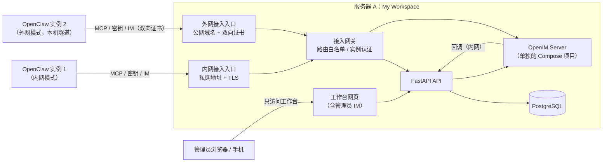

# My Workspace V2.0 优化方案（第 2 版）：OpenClaw 接替 AI，工作台内置 IM

> 状态：**论证记录**。人类已按第 12 节的推荐采纳（2026-10-31），**定稿见 [`TRANSFORMATION_PLAN.md`](TRANSFORMATION_PLAN.md)**，实施以定稿为准。
> 本文保留调研过程、上游源码核对和备选方案。
>
> **版本**：
> - 第 1 版（2026-10-31，PR #72）：一台 OpenClaw，工作台只提供 MCP 工具与审批。
> - 第 2 版（本文）：按人类 2026-10-31 的三项调整重写：
>   1. 工作台管理**多个 OpenClaw**，分布在不同服务器上；有的无法走内网，要同时支持**内网和外网**两种接入方式。
>   2. **密钥集中放在工作台**，OpenClaw 远程来取。
>   3. 与 OpenClaw 的交互放在工作台：用 **OpenIM** 搭一个 Web 端 IM（管理员端），每个 OpenClaw 作为一个 IM 用户，通过 `openimsdk/openclaw-channel` 插件接入。功能要求：
>      - 能拉群，让多个 OpenClaw 在群里互相沟通；
>      - 支持消息置顶、免打扰、分组；
>      - 不提供删除好友；
>      - OpenClaw 上线后，管理员端自动加它为好友。
>
> 人类随后补充确认：“AGPL 许可证没问题”（2026-10-31），见第 9 节。
>
> **依据**：上游源码和随仓库发布的文档。本会话的网络策略拦截了各家文档站，所以都从 GitHub 克隆核对。
>
> | 简写 | 来源 |
> |---|---|
> | `oc:` | OpenClaw v2026.10.9 的 `docs/` |
> | `openim:` | open-im-server v3.8.3-patch.18（提交 120cee6） |
> | `openim-docker:` | openim-docker 的 v3.8.3-patch.1 |
> | `channel:` | `@openim/openclaw-channel` v0.3.2 |
>
> 实施前，第 11 节的 OC-0 要在锁定版本的真实实例上逐项核验。核验不了的写成接口桩和 TODO，不标为完成（`docs/AGENTS.md` 第 8 节第 3 条）。

## 0. 总览

**分工**：
- **OpenClaw**：负责“想”和“做”，包括模型调用、记忆、智能体运行、定时任务。
- **工作台**：负责“管”，包括：
  - OpenClaw 实例登记和接入凭证；
  - 密钥库；
  - IM，也就是管理员和 OpenClaw 沟通的地方；
  - MCP 工具，以及工具调用的权限、审批和审计。

**所有连接都由 OpenClaw 主动连回工作台。** 每个 OpenClaw 实例只发起三类出站连接，工作台从不主动连 OpenClaw：

| 连接 | 用途 |
|---|---|
| MCP（HTTPS） | 调用工作台的工具，读写任务、日历等 |
| 密钥接口（HTTPS） | 启动和重新加载时取模型密钥等 |
| OpenIM（WSS + HTTPS） | 通过 `openclaw-channel` 插件收发 IM 消息 |

这样做的好处：
- OpenClaw 可以放在 NAT 或防火墙后面，不需要公网地址；
- 防护只需要集中做在工作台一侧的接入入口；
- 第 1 版里“工作台调用 OpenClaw 的 OpenAI 兼容接口或 hooks”的设计不再需要，因为对话通过 IM 进行。



## 1. 与第 1 版相比的变化

| 方面 | 第 1 版 | 第 2 版 |
|---|---|---|
| OpenClaw 数量 | 一台 | **多台**，在工作台里统一登记和管理 |
| 网络 | 两台服务器之间走私网 | **内网、外网两种模式**，按实例选择；都由 OpenClaw 主动连回工作台 |
| 模型密钥 | 放在 OpenClaw 服务器上 | **放在工作台密钥库**，OpenClaw 用 `exec` 类型的 SecretRef 远程取 |
| 和 OpenClaw 对话 | 用 OpenClaw 自己的 App、Telegram、网页聊天 | **工作台内置 IM**（基于 OpenIM）：单聊、群聊、置顶、免打扰、分组 |
| 手机 | OpenClaw App | 打开工作台网页（响应式），IM 和审批都在工作台里 |
| MCP 工具与审批 | 有 | 保留（第 6 节）；审批提醒还会出现在 IM 里 |

## 2. 多实例管理

### 2.1 登记与接入流程

1. **管理员登记**：在工作台“OpenClaw 实例”页面新建实例，填写名称、所在服务器说明，选择网络模式（内网或外网）、MCP 权限范围、可以取用哪些密钥。
2. **工作台自动完成**：
   - 生成实例 ID；
   - 签发一个**实例凭证**，明文只显示一次；外网模式还会签发一张客户端证书；
   - 在 OpenIM 注册这个实例的 IM 用户（第 5.2 节），并立即和管理员互加好友；
   - 生成**接入包**：OpenClaw 配置片段、取密钥小程序、环境变量模板，外网模式还有隧道配置。
3. **管理员部署**：在 OpenClaw 服务器上放好接入包，启动 OpenClaw。
4. **实例上线**：
   - OpenClaw 启动时通过取密钥小程序取到模型密钥，用 IM 令牌登录 OpenIM；
   - 工作台收到 OpenIM 的上线回调后，把状态改为“在线”，同时再补一次好友关系，这一步是幂等的。

**实例凭证是 OpenClaw 服务器上唯一一份本地凭证**，其他密钥都从工作台取（第 4 节）。OpenClaw 文档也说明，任何远程取密钥的方式都要在主机上留一份“引导凭证”（`oc:plugins/vault.md`、`oc:gateway/secrets/integration-examples.md`）。

### 2.2 两种网络模式

| | 内网模式 | 外网模式 |
|---|---|---|
| 适用场景 | OpenClaw 和工作台在同一私网中：Tailscale、WireGuard、同一机房或局域网 | 无法加入私网，只能经公网访问 |
| 工作台入口 | 只绑定私网地址的独立入口 | 单独的公网域名（例如 `agents.example.com`），和管理员网页分开 |
| 传输 | TLS（内部 CA 或 Tailscale 证书） | TLS（公网证书）**加双向证书**，证书每个实例一张 |
| 认证 | 实例凭证（Bearer） | 实例凭证加客户端证书，两者必须属于同一实例 |
| OpenClaw 那边 | 直接连工作台的私网地址 | 本机运行一个**隧道小程序**（例如 ghostunnel 客户端），在本机开端口，统一加上双向证书再连工作台 |
| 额外防护 | 来源网段限制 | 可选来源 IP 白名单；按实例限流；认证失败多次后临时封禁 |

为什么外网模式要用本机隧道：
- MCP 客户端支持客户端证书（`clientCert` / `clientKey`，`oc:gateway/config-extensions.md`）；
- 但 `openclaw-channel` 插件只接受 `wsAddr` / `apiAddr`，没有证书配置（`channel:openclaw.plugin.json`）。

用隧道小程序可以让三类连接统一走双向证书，插件不需要改。

**凭证和入口绑定**：内网实例的凭证在外网入口无效，外网实例的凭证在内网入口也无效。入口由 Caddy 打上标记，工作台只信任 Caddy 加的这个标记。

### 2.3 接入入口只放行这些路径

两个接入入口都是**默认拒绝**，只放行下面几类路径；管理员网页、`/api/v1/*` 等其他路径一律返回 404：

| 路径 | 转发到 | 说明 |
|---|---|---|
| `/mcp` | 工作台 API | MCP 工具（第 6 节） |
| `/agent-api/v1/secrets/resolve` | 工作台 API | 取密钥（第 4 节） |
| `/agent-api/v1/heartbeat` | 工作台 API | 实例上报版本和状态（可选） |
| `/im/ws` | OpenIM 消息网关（10001） | IM WebSocket。令牌在 URL 参数里，所以访问日志必须脱敏（第 5.5 节） |
| `/im/api/*` | **接入网关校验后**再转给 OpenIM REST（10002） | 只放行插件实际用到的接口（第 5.5 节） |

### 2.4 实例状态与管理

- **状态**：
  - `待接入`：已登记，还没连上；
  - `在线` / `离线`：根据 OpenIM 上线、下线回调，加上最近一次 MCP 调用或取密钥的时间判断；
  - `已停用`。
- **管理操作**：
  - 停用，也就是**单实例总开关**：凭证立即失效、强制退出 IM、拒绝取密钥；
  - 轮换实例凭证或证书；
  - 调整 MCP 权限和可取的密钥；
  - 查看取密钥和工具调用的记录；
  - 查看 OpenClaw 上报的版本。
- **全局总开关**：一键停用所有实例。

## 3. 部署

| 位置 | 内容 | 由谁维护 |
|---|---|---|
| 服务器 A | 现有工作台 Compose（不变）。另外新增：<br/>- **OpenIM 单独的 Compose 项目**（`infra/openim/compose.yaml`，做法和 `infra/vikunja/` 一样）；<br/>- Caddy 的两个接入入口 | claude 写配置，人类部署 |
| 各 OpenClaw 服务器 | OpenClaw（锁定 extended-stable 版本）、`openclaw-channel` 插件（锁定版本）、取密钥小程序；外网模式还有隧道小程序。参考配置放在 `infra/openclaw/` | claude 写参考配置和检查清单，人类部署 |

**OpenIM 要部署的组件**：
- openim-server，加上 MongoDB、Redis、Kafka（KRaft 模式）、etcd、MinIO（`openim-docker:docker-compose.yaml`、`.env`）；
- 不部署 openim-chat 业务服务：账号和登录由工作台负责。

**部署注意事项**：
- **改掉默认密码**：默认的 `secret` 和各组件的密码都是 `openIM123`（`openim:config/share.yml`、`openim-docker:.env`），部署时必须换成随机值。
- **锁定镜像 digest**：OpenIM 的发布流程会重推 tag，没有不可变保证。比如 `ghcr.io/openimsdk/openim-server:v3.8.3-patch.18` 的 digest 是 `sha256:71d5872b…`。
- **替换不再维护的镜像**：官方 compose 用的是 `bitnamilegacy/*`（Kafka、MinIO、etcd），已经不再更新。OC-0 评估换成各组件的官方镜像。
- **资源**：OpenIM 只会在可用内存低于 1 GB 时报错（`openim:tools/check-free-memory`），没有给出推荐配置。加上 Kafka、MongoDB、MinIO，服务器 A 的内存需求会明显增加，**在 OC-0 实测后写进部署文档**。
- **备份**：OpenIM 的 MongoDB 和 MinIO 纳入现有备份。restic 加一个 MongoDB 导出步骤，A15 恢复演练要覆盖。

## 4. 密钥集中在工作台

### 4.1 工作台密钥库

- **加密存储**：
  - 新增密钥库，存模型 API Key 等；
  - 只能写入、不能读回明文，页面只显示名称、类型、版本和最近轮换时间；
  - 加密用现有的凭证加密机制，但要**升级为可轮换**：每条密文记录加密密钥的版本，新增密钥版本后后台重新加密。现在的 `CREDENTIAL_ENCRYPTION_KEY` 不支持轮换（`docs/release-checklist.md` 第 5 节），而密钥库会集中所有 OpenClaw 的模型密钥，这个短板必须先补上。
- **按实例授权**：每个实例只能取到授权给它的那几项，例如实例 1 只能取 `openai_api_key`。
- **全程留痕**：每次取用都记录实例、密钥名、版本、来源 IP、时间、结果，限流，并进审计日志。
- **立即止损**：停用实例或撤销授权后，下一次取用立即失败。

### 4.2 OpenClaw 怎么取

OpenClaw 的 SecretRef 支持 `env`、`file`、`exec`、`store` 四种来源。**没有直接走 HTTP 的来源**，但 `exec` 来源会运行一个指定的程序（`oc:gateway/secrets/secretref-contract.md`）：
- 程序从标准输入读 `{"protocolVersion":1,"provider":"…","ids":[…]}`；
- 再往标准输出写 `{"protocolVersion":1,"values":{…}}`；
- 默认 5 秒超时，输出最多 1 MiB。

OpenClaw 的 Vault、1Password 集成也是这样做的（`oc:plugins/vault.md`、`oc:gateway/1password.md`）。

所以我们提供一个**取密钥小程序** `myworkspace-secret-resolver`：
- 放在 `infra/openclaw/resolver/`，只用标准库，体积很小；
- 它带着实例凭证调用工作台的 `POST /agent-api/v1/secrets/resolve`，把结果按上面的格式输出；
- 程序文件要求是绝对路径、属主是当前用户、其他人不可写，这是 OpenClaw 对 exec 程序的要求（同上）。

**哪些配置能直接引用远程密钥**（`oc:reference/secretref-credential-surface.md`）：

| 配置项 | 能否用 SecretRef | 做法 |
|---|---|---|
| 模型密钥：`models.providers.*.apiKey`、认证配置的 `keyRef` / `tokenRef` | 能 | 直接写 `{ source: "exec", provider: "myworkspace", id: "openai_api_key" }` |
| MCP 请求头：`mcp.servers.*.headers` | 不能，只支持 `${VAR}` | 直接用实例凭证：`Bearer ${MYWS_INSTANCE_TOKEN}`。它本来就在主机上，不需要再取 |
| IM 插件令牌：`channels.openim.accounts.*.token` | 插件没有声明密钥契约，不能 | 用环境变量 `${OPENIM_TOKEN}`。由启动包装脚本在启动 OpenClaw 前从工作台取到，再注入环境变量（第 4.3 节） |

- 取到的值只放在内存里，不会写回 `openclaw.json`（`oc:gateway/secrets/runtime-model.md`）。
- 取不到时，只有相关功能不可用，例如模型返回 `SECRET_SURFACE_UNAVAILABLE`，不会退回去用别的凭证（`oc:gateway/secrets/operations.md`）。

### 4.3 轮换

| 密钥 | 怎么生效 |
|---|---|
| 模型密钥 | 在工作台换新版本后，OpenClaw 执行 `openclaw secrets reload` 才会生效（`oc:gateway/secrets/operations.md`）。<br/>因为工作台不主动连 OpenClaw，所以在 OpenClaw 服务器上配一个定时器，每 10 分钟执行一次，接入包里提供 |
| IM 令牌 | 插件只在启动时登录一次，代码里没看到令牌刷新（`channel:src/clients.ts`）。OpenIM 用户令牌默认 90 天过期（`openim:config/openim-rpc-auth.yml` 的 `tokenPolicy.expire`）。<br/>做法：<br/>- 工作台签发令牌，到期前提醒；<br/>- 启动包装脚本每次启动都取新令牌；<br/>- 定时器每周重启一次 OpenClaw。<br/>以后如果给插件加上自动刷新，再取消定时重启（插件是 AGPL，改动要公开，第 9 节） |
| 实例凭证与客户端证书 | 在工作台轮换。新旧两份同时有效 24 小时，管理员在这段时间里替换主机上的文件 |

### 4.4 集中存放密钥的风险

- **工作台成为最高价值目标**：
  - 密钥加密存储，加密密钥可轮换；
  - 取密钥只能通过两个接入入口，并且必须带实例凭证；
  - 管理员网页的 API 永远拿不到密钥明文。
- **OpenClaw 主机被攻破**：攻击者只能拿到授权给这个实例的密钥。在工作台停用实例，就能立刻切断它继续取用，然后轮换这几项密钥。
- **密钥在 OpenClaw 内存里仍然是明文**：这是 OpenClaw 运行的必要条件，没办法避免。所以每个实例只授权它必需的几项。

## 5. 工作台 IM（基于 OpenIM）

### 5.1 身份

| 角色 | OpenIM 账号 | 说明 |
|---|---|---|
| 工作台后端 | `imAdmin`，只在服务器端使用 | 调 OpenIM 的管理接口：注册用户、导入好友、建群、代发消息（`openim:internal/api/router.go`）。<br/>`imAdmin` 拿不到用户令牌，也不能当普通聊天账号用（`openim:internal/rpc/user/user.go`） |
| 管理员（人） | 普通用户 `ws_<工作台用户 ID>` | 管理员在 IM 里的身份 |
| 每个 OpenClaw 实例 | 普通用户 `oc_<实例 ID>`，平台 Web（5） | 昵称和头像用实例名。一个账号只给一个实例用，因为同平台重复登录会互踢（`openim:config/share.yml` 的 `multiLogin.policy: 1`） |
| 系统通知 | 通知账号 `ws_notice` | 发审批提醒、群聊暂停提示等（`/user/add_notification_account`） |

### 5.2 管理员端的实现：通过工作台后端中转（推荐）

管理员的浏览器**只连工作台**，不直接连 OpenIM：

- **发消息**：浏览器调工作台接口，工作台后端用管理接口 `/msg/send_msg` 以管理员身份发出（`openim:internal/api/router.go`）。
- **收消息**：
  - OpenIM 的消息回调（`afterSendSingleMsg`、`afterSendGroupMsg`）推到工作台；
  - 工作台写入收件箱和消息投影，再用现有 SSE 推到浏览器；
  - 回调可能丢（内存队列满了直接丢弃，不重试），所以定时用 `/msg/newest_seq` 和 `/msg/pull_msg_by_seq` 对账补齐。
  - 这和 V1 对接 Vikunja 时“Webhook 收件箱加周期对账”是同一套做法。
- **会话列表、未读数、置顶、免打扰、分组**：由工作台维护，需要时同步到 OpenIM。

**为什么不在浏览器里直接用 OpenIM SDK**：

| 问题 | 说明 |
|---|---|
| 许可证（**已不是障碍**） | `@openim/client-sdk` 是 GPL-3.0-only，打包进前端后，前端在分发时要按 GPL 处理；本仓库是 Apache-2.0。人类已确认 AGPL 没问题，所以这一条不再阻止浏览器直连。<br/>官方 Web/桌面 Demo 仍然不用：它另加了“禁止商用”的条款，而且是 React + Electron + antd，和工作台的 Vue 3 不通用 |
| OpenIM 接口的权限检查很弱 | 会话设置接口没有任何身份校验，任何有效令牌都能改别人的会话设置；搜索消息也不检查调用者（`openim:internal/rpc/conversation/*` 里没有 `authverify`）。<br/>浏览器直连就要把这些接口暴露出去 |
| 跨域和令牌 | REST 的跨域策略固定为全部放行（`Access-Control-Allow-Origin: *`），不能配置；WebSocket 的令牌放在 URL 参数里 |
| 和规范一致 | 规范要求“所有系统由 Connector/BFF 集成”（`docs/DEVELOPMENT_SPEC.md` 第 1 节） |

所以即使许可证不再是问题，仍然推荐后端中转，主要是出于安全和架构一致的考虑。
人类如果更看重实时性和开发量，也可以选浏览器直连（第 12 节第 2 项）。那样需要：
- 在 Caddy 上为管理员浏览器单独开 OpenIM 路径，并收紧跨域；
- 管理员令牌只发给浏览器的管理员账号；
- 前端的许可证按 GPL 处理。

代价是工作台要自己做消息投影、对账和实时推送。V1 已经有这套基础设施（收件箱、对账、SSE、通知），可以复用。

### 5.3 功能怎么实现

| 需求 | 实现 | OpenIM 依据 |
|---|---|---|
| 和单个 OpenClaw 对话 | 管理员和实例互为好友，单聊 | `/msg/send_msg`；插件收到私聊就交给 OpenClaw 智能体处理（`channel:src/inbound.ts`） |
| **拉群** | 管理员选择多个实例建群、邀请、移出；群主是管理员 | `/group/create_group`（`groupType` 必须为 2）、`/group/invite_user_to_group`、`/group/kick_group` |
| 多个 OpenClaw 在群里互相沟通 | 插件默认**只在被 @ 时回复**（`requireMention: true`），自己发的消息会忽略（`channel:src/inbound.ts`）。<br/>OpenClaw 之间通过 @ 对方来接力；工作台负责防刷屏（第 5.4 节） | 插件配置 `requireMention`、`inboundWhitelist` |
| **会话置顶** | 会话列表里把置顶的会话排在最前，同时同步到 OpenIM 的 `isPinned` | `/conversation/set_conversations` 的 `isPinned` |
| **消息置顶**（置顶单条消息） | OpenIM **没有**这个功能，由工作台存储：每个会话可以置顶若干条消息，显示在聊天窗口顶部 | 未找到原生支持 |
| **免打扰** | 免打扰的会话不发通知、不计入顶栏未读数，但消息照常接收；同时同步 `recvMsgOpt=2` | `recvMsgOpt`：0 正常，1 不接收，**2 接收但不推送**（`openim:internal/rpc/msg/verify.go`） |
| **分组** | OpenIM **没有**好友分组，由工作台存储：管理员自建分组（例如“编程”“运营”），把实例拖进去；通讯录和会话列表都可以按分组筛选 | 未找到原生支持 |
| **不能删除好友** | 第一层：管理员端不提供删除入口。<br/>第二层：接入网关拦截所有 `POST /friend/delete_friend`。<br/>第三层：万一被删（例如有人直接调接口），收到 `afterDeleteFriend` 回调后立即重新导入，并发告警 | OpenIM 有删好友接口，但没有删除前的回调，也没有开关能禁用（`openim:config/webhooks.yml` 只有 `afterDeleteFriend`）。所以要靠上面三层 |
| **上线自动加好友** | 第一层：登记实例时就注册 IM 用户并 `import_friend`（管理员和实例互加，幂等）。<br/>第二层：收到 `afterUserOnline` 时再补一次。<br/>第三层：每小时对账一次 | `/friend/import_friend` 建的是双向关系，已有的会跳过；`afterUserOnline` 每个连接触发一次 |
| 审批提醒 | 工具调用需要审批时，由通知账号在“审批通知”会话里发一张审批卡片；管理员在 IM 里直接点批准或拒绝，调用的是工作台的审批接口（第 6 节） | `/msg/send_msg` 以通知账号身份发送 |
| 图片和文件 | 第一版**只做文字和图片**。文件要把 MinIO 也暴露到接入入口，放到后续 | 插件支持图片和文件（`channel:README.zh-CN.md`） |
| 历史与审计 | 工作台的消息投影可搜索、按保留期清理；管理员可以导出 | `/msg/pull_msg_by_seq` |

### 5.4 群聊防刷屏

多个 OpenClaw 互相 @，可能无限接力下去。工作台用 OpenIM 的 `beforeSendGroupMsg` 回调把关，这个回调可以拒收消息（`openim:pkg/callbackstruct/common.go`）：

- 同一个群里，**自上次管理员发言之后**，OpenClaw 的消息累计超过 N 条（默认 8）就暂停，并由通知账号提示“自动接力已暂停，管理员发言后恢复”；
- 单个 OpenClaw 在一个群里每分钟最多 M 条（默认 6）；
- 每个群可以设置“是否允许 OpenClaw 之间接力”：关闭时只有管理员 @ 才会触发回复；
- **OpenClaw 之间不能单聊**，只能在群里沟通。用 `beforeSendSingleMsg` 拦截实例发给实例的私聊。
- 注意：OpenIM 的“发送前”回调请求失败时操作会直接失败（`failedContinue` 配置项实际没有生效）。所以工作台不可用时，群聊也会暂停。管理员端本来就在工作台里，这样处理是可以接受的。

### 5.5 OpenIM 的安全短板和对策

| 短板 | 对策 |
|---|---|
| 会话设置、搜索消息等接口不检查调用者 | OpenClaw 访问 OpenIM REST 时**必须经过接入网关**：<br/>- 只放行插件实际用到的接口，清单在 OC-0 抓包确定；<br/>- 网关校验令牌，要求请求体里的用户 ID 和令牌的用户一致；<br/>- 管理接口、删好友、改会话、搜消息一律拦截 |
| WebSocket 消息是否也有同样问题（例如拉取别人会话的消息） | **OC-0 必须核验**。如果有漏洞，再加 WebSocket 层过滤，或者给每个实例单独限流和告警 |
| 回调请求没有签名 | 回调只走服务器 A 内部的 Docker 网络；接收地址带随机路径；只接受来自 OpenIM 容器网段的请求 |
| “发送后”回调会丢 | 收件箱去重，定时对账补齐 |
| 跨域策略固定全部放行 | 浏览器不直连 OpenIM；接入入口只给 OpenClaw 用，而且是默认拒绝的白名单 |
| 令牌放在 WebSocket URL 里 | Caddy 访问日志里去掉查询参数；令牌按 90 天轮换 |
| 镜像 tag 可变、默认密码 | 锁定 digest；部署时生成随机密码（第 3 节） |

## 6. MCP 工具与审批（沿用第 1 版，按多实例调整）

- **工具和审批规则不变**：
  - 工具清单：读、写、高危三级；
  - 审批中心；
  - 批准后执行的是存下、算过哈希的参数；
  - 高危操作要二次认证；
  - AI 不能批准自己的请求；
  - A14 的处理方式。
- **变化一：凭证按实例**。MCP 用的是实例凭证。每个实例代表登记它的管理员，有自己的权限范围（只读或可写）和最高角色，例如某个实例只读。
- **变化二：审批提醒也进 IM**。审批中心照常可用。卡片上显示是哪个实例、在哪个会话里发起的。
- **防 Prompt Injection 的措施不变**：
  - OpenClaw 用的智能体只开工作台工具和 IM 插件的发消息工具；
  - shell、文件、浏览器、网页抓取都关闭（第 7 节）；
  - 写操作一律人工审批。

**新增一个风险：IM 里来自其他 OpenClaw 的消息也是不可信输入。** 群聊里一个实例可能被诱导去指挥另一个实例。所以：
- 写操作仍然必须人工审批；
- 审批卡片标明请求来自哪个群、由谁 @ 触发。

## 7. OpenClaw 实例的参考配置（每台服务器一份）

```json5
{
  gateway: { mode: "local", bind: "loopback", auth: { mode: "token", token: "${OPENCLAW_GATEWAY_TOKEN}" } },
  secrets: {
    providers: {
      myworkspace: {                                    // oc:gateway/secrets/secretref-contract.md
        source: "exec",
        command: "/opt/myworkspace/bin/myworkspace-secret-resolver",
        passEnv: ["MYWS_INSTANCE_TOKEN", "MYWS_AGENT_API"],
        jsonOnly: true,
        timeoutMs: 5000,
      },
    },
  },
  models: {
    providers: {
      openai: { apiKey: { source: "exec", provider: "myworkspace", id: "openai_api_key" } },
    },
  },
  tools: {                                              // 加固基线：oc:gateway/security/hardened-baseline.md
    profile: "messaging",
    deny: ["group:automation", "group:runtime", "group:fs", "sessions_spawn", "sessions_send"],
    fs: { workspaceOnly: true },
    exec: { security: "deny", ask: "always" },
    elevated: { enabled: false },
    agentToAgent: { enabled: false },
  },
  mcp: {
    servers: {
      myworkspace: {
        url: "${MYWS_MCP_URL}",                         // 内网：https://<私网地址>/mcp；外网：本机隧道地址
        transport: "streamable-http",
        headers: { Authorization: "Bearer ${MYWS_INSTANCE_TOKEN}" },
      },
    },
  },
  plugins: { allow: ["openclaw-channel"] },             // 只允许这一个插件，版本锁定
  channels: {
    openim: {
      accounts: {
        default: {
          token: "${OPENIM_TOKEN}",                     // 启动包装脚本从工作台取
          wsAddr: "${MYWS_IM_WS}",                      // 内网：wss://<私网地址>/im/ws；外网：本机隧道
          apiAddr: "${MYWS_IM_API}",
          requireMention: true,                         // 群里只有被 @ 才回复
          inboundWhitelist: ["ws_<管理员>"],            // 默认只处理管理员的消息；允许接力的群另外加
        },
      },
    },
  },
}
```

参考配置的要点：
- **版本**：OpenClaw 锁定 extended-stable 维护线（`oc:reference/RELEASING.md`），插件锁定 v0.3.2 或 OC-0 核验后的版本。
- **兼容性**：插件最后一次更新是 2026-03-11，`peerDependencies` 写的是 `openclaw: "*"`，没有声明兼容哪些版本；而 OpenClaw 的插件接口还是实验性的（`oc:plugins/building-plugins.md`）。所以 **OC-0 必须实测插件和锁定版本 OpenClaw 的兼容性**。不兼容时有两个办法：
  - 选一个兼容的 OpenClaw 版本；
  - fork 插件修复，按 AGPL 公开修改。
- **工具白名单**：给工作台用的智能体只开 `myworkspace__*` 和插件的发消息工具（`openim_send_text`、`openim_send_image`）。
- **上线检查**：上线和每次改动后，跑 `openclaw security audit --deep`。

## 8. 数据模型（迁移 0011 起，全部新增）

| 表 | 用途 |
|---|---|
| `agent_instances` | OpenClaw 实例：名称、网络模式、状态、IM 用户 ID、上报的版本、最近在线时间、停用时间、版本号 |
| `agent_credentials` | 实例凭证（只存哈希）和客户端证书指纹：权限范围、最高角色、绑定的入口、有效期、吊销时间、最近使用时间和 IP |
| `agent_secrets` / `agent_secret_versions` | 密钥库：密文、加密密钥版本、密钥版本、轮换时间 |
| `agent_secret_grants` | 哪个实例可以取哪项密钥 |
| `ai_tool_executions` | MCP 工具调用与审批（同第 1 版，增加 `instance_id`） |
| `im_conversations` | 管理员视角的会话投影：类型、对方或群、置顶、免打扰、最近消息、未读数 |
| `im_messages` | 消息投影：OpenIM 的消息 ID 和序号、发送人、内容（文字或图片地址）、时间；有保留期 |
| `im_message_pins` | 置顶的消息 |
| `im_contact_groups` / `im_contact_group_members` | 分组 |
| `im_group_policies` | 群聊防刷屏设置：是否允许接力、N、M |
| `im_webhook_inbox` | OpenIM 回调收件箱：去重和重试（也可以复用现有 `webhook_inbox`，加一个 `provider=openim`） |

规范第 5 节的第 20、21 张表（`ai_conversations`、`ai_messages`）**不建**：对话就是 IM 消息，由 OpenIM 保存，工作台只做投影。这是对规范的偏差，需要人类批准。

## 9. 许可证

| 组件 | 许可证 | 我们怎么用 | 影响 |
|---|---|---|---|
| OpenClaw | MIT | 部署在各 OpenClaw 服务器 | 无 |
| open-im-server、protocol、tools、openim-docker | Apache-2.0 | 部署在服务器 A；compose 参考官方写法 | 无 |
| `@openim/openclaw-channel` | **AGPL-3.0-only** | 原样安装在 OpenClaw 服务器，不进本仓库 | **人类已确认 AGPL 没问题**（2026-10-31）。不修改就没有额外义务；如果修改（例如加令牌自动刷新），要向通过网络使用它的人公开修改后的源码 |
| `@openim/client-sdk` | **GPL-3.0-only** | 只作为插件的依赖，运行在 OpenClaw 服务器；推荐方案下**不打包进工作台前端**（第 5.2 节） | 推荐方案下无影响；如果选浏览器直连，前端按 GPL 处理（人类已接受 copyleft 许可证） |
| OpenIM 官方 Web/桌面 Demo | AGPL-3.0，附加“禁止商用” | **不使用** | 原因：附加的禁止商用条款，以及技术栈不同（React + Electron）。管理员端界面由工作台自己用 Vue 实现 |

## 10. 测试

- **CI 拓扑**：用 Docker 网络模拟多台服务器：
  - 工作台加 OpenIM 在一个网络；
  - OpenClaw 实例 A 走“内网”；
  - OpenClaw 实例 B 走“外网”，经隧道和双向证书连公网入口。
  - 两个实例都用**假模型服务**驱动，按脚本发出固定的回复和工具调用，不需要真实模型密钥（`oc:concepts/model-providers/custom-providers.md`）。
- **端到端场景**：
  1. 登记实例后，它自动出现在通讯录；上线后状态变为“在线”；好友关系已建立。
  2. 管理员发私聊，实例 A 回复；实例 A 取密钥成功，有记录。
  3. 拉群（管理员、A、B）：只有被 @ 的实例回复；A @ B 接力；超过 N 条后自动暂停，管理员发言后恢复。
  4. 置顶会话、置顶消息、免打扰（不计未读、不通知）、分组筛选。
  5. 用 OpenIM 接口删除好友：接入网关拦截；绕过网关直接删除后，系统自动补回并告警。
  6. 停用实例：取密钥失败、MCP 返回 401、IM 被强制下线。
  7. 实例 B 用实例 A 的凭证或证书：失败。内网凭证用在外网入口：失败。
  8. 实例调用被拦截的 OpenIM 接口（改会话、搜消息、删好友、管理接口）：失败。
  9. AI 发起删除任务：只生成待审批记录，IM 收到审批卡片，批准后才执行（A14）。
  10. 群聊里有人诱导 A 去指挥 B 删除数据：没有审批就不会执行。
  11. OpenIM 或工作台重启：消息不丢，对账能补齐。
- **工作台单元和契约测试**：
  - 密钥库：加密、轮换、授权、审计；
  - 实例凭证和入口绑定；
  - 接入网关的路由白名单和用户 ID 校验；
  - 回调去重；
  - 防刷屏规则；
  - MCP 工具权限。
- **前端**：IM 页面的 lint、typecheck、test、build、`check:api`，以及浏览器验收（含 390px 移动端）。

## 11. 任务拆分（替换 S6-01 ~ S6-03 与第 1 版的 OC-0 ~ OC-5）

| 任务 | 内容 | 对应 TASKS |
|---|---|---|
| **OC-0 核验与选型** | ① 锁定 OpenClaw extended-stable 版本和 digest，实测 `openclaw-channel` 的兼容性；<br/>② 部署 OpenIM v3.8.3-patch.18，锁定 digest，评估替换 bitnamilegacy 镜像，实测资源占用；<br/>③ 抓包确定插件实际调用的 OpenIM 接口；核验 WebSocket 层的权限；核验回调载荷；<br/>④ 核验 exec 密钥、`secrets reload`、假模型驱动；<br/>⑤ 跑通外网模式的隧道和双向证书；<br/>⑥ 写 ADR（附来源）。 | S6-01 |
| **OC-1 契约** | 实例、凭证、密钥、IM（会话、消息、群、置顶、免打扰、分组）、审批的接口；MCP 工具；`/agent-api`；schema、OpenAPI、`schema.d.ts`、`docs/api-contract.md`、契约测试 | S6-01 |
| **OC-2 实例、凭证与密钥库** | 迁移；登记流程与接入包生成；取密钥小程序；两个接入入口（Caddy）和路由白名单；加密密钥可轮换 | S6-01 |
| **OC-3 OpenIM 部署与连接器** | `infra/openim/`；OpenIM 连接器（管理员令牌、用户注册、好友导入、建群、代发、令牌签发）；回调收件箱；消息投影与对账；OpenIM REST 的接入网关 | S6-02 |
| **OC-4 管理员端页面** | IM：会话列表、聊天、拉群与成员管理、会话置顶、消息置顶、免打扰、分组、审批卡片；OpenClaw 实例管理；密钥库页面；移动端适配 | S6-02 |
| **OC-5 MCP 工具与审批** | 只读工具、写入和高危工具、审批流程、A14 | S6-02、S6-03 |
| **OC-6 群聊治理与安全** | 防刷屏、禁止实例之间私聊、反 Prompt Injection 与越权测试 | S6-03 |
| **OC-7 验收** | CI 多实例端到端（第 10 节）；部署文档（服务器 A 加 OpenIM、OpenClaw 服务器检查清单、两种网络模式）；威胁模型和数据字典；备份覆盖 OpenIM；Sprint 6 验收报告；勾选 TASKS | DoD、A14 |

- **工作量**：比第 1 版明显增加，大约相当于 V1 的一到一个半 Sprint。主要多在 IM 管理员端和消息投影。
- **分工**：都可以由 claude 独立完成。服务器 A 上的 OpenIM 和各 OpenClaw 服务器的实际部署，由人类按参考配置完成。

## 12. 需要人类决定的事项

| # | 事项 | 建议 |
|---|---|---|
| 1 | **批准第 2 版方案**，并决定规范文件（`docs/DEVELOPMENT_SPEC.md`、`docs/TASKS.md`）的修订方式 | 由 claude 起草修订 PR，人类批准 |
| 2 | 管理员端 IM 的实现方式：后端中转，还是浏览器直连 OpenIM | **后端中转**（第 5.2 节）。许可证已不是障碍，推荐理由是 OpenIM 接口权限薄弱、跨域固定全放行、令牌在 URL 里，以及和规范的 BFF 原则一致 |
| 3 | “消息置顶”指的是会话置顶，还是置顶会话里的单条消息 | 两个都做（第 5.3 节） |
| 4 | 外网模式是否要求双向证书（需要在 OpenClaw 服务器上运行隧道小程序） | 要求 |
| 5 | OpenIM 部署位置 | 服务器 A 上单独的 Compose 项目；内存不够再单独放一台 |
| 6 | 群聊防刷屏默认值（N = 8 条、M = 6 条/分钟），以及是否禁止 OpenClaw 之间单聊 | 用默认值；禁止单聊 |
| 7 | 第一版是否支持文件消息 | 先只做文字和图片 |
| 8 | 用哪家模型（主模型加备用）。密钥由管理员录入工作台密钥库，不在对话里提供 | 人类决定 |
| 9 | 是否需要真实模型的冒烟测试 | 可选 |

## 13. 以后再做

- 给 `openclaw-channel` 加令牌自动刷新：fork 并按 AGPL 公开，然后取消每周重启。
- 文件消息：MinIO 经接入入口暴露，并加大小限制。
- 编程任务：在 OpenClaw 服务器启用官方 Codex 插件（`oc:plugins/codex-harness.md`），工作台把 Vikunja 任务和 IM 会话关联起来。
- Web Push 推送；高危审批改用 Passkey 二次认证。
- 按工具配置“自动执行并记录”的审批策略。
