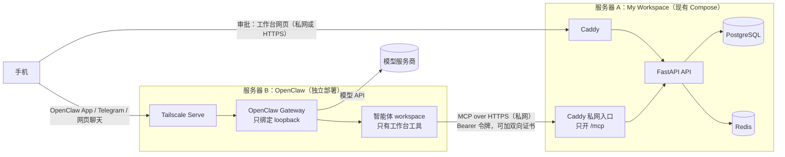
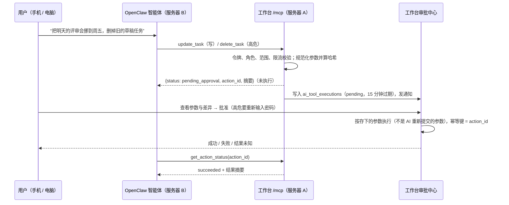

# My Workspace V2.0 优化方案：用 OpenClaw 接替 AI 方案

> 状态：**方案草稿，等人类批准**（2026-10-31，claude 起草）。批准前开发仍以 `docs/DEVELOPMENT_SPEC.md`、`docs/TASKS.md` 为准。
>
> 依据：
> - 人类在对话中的决定：
>   - “用 OpenClaw 接替之前设计的 AI 操作方案（OpenClaw 已经是很成熟的方案，可以直接用）”；
>   - “未来 OpenClaw 将运行在其他服务器上，和个人工作台不是同一台服务器”。
> - 上传的 V2 资料包（`docs/v2/package/`）和 claude 的评审（`docs/v2/REVIEW.md`）。
> - OpenClaw **v2026.10.9** 随仓库发布的文档（`openclaw/openclaw` 仓库的 `docs/`，下文引用写作 `oc:路径`）。
>   本会话的网络策略拦截了 docs.openclaw.ai，所以引用的是仓库里同一份文档的源文件。
>
> 实施前，第 9 节的 OC-0 任务要在锁定版本的真实实例上逐项核验。核验不了的写成接口桩和 TODO，不标为完成（`docs/AGENTS.md` 第 8 节第 3 条）。

## 0. 一句话

**OpenClaw 负责“想和说”，工作台负责“数据、权限、审批和留痕”。**

OpenClaw 已经提供了这些能力，我们不重造：
- 模型接入与切换；
- 对话与记忆；
- 手机 App 和聊天渠道；
- 定时任务；
- 网页聊天界面；
- 以 Codex 为后端的编程任务。

工作台只做三件事：
1. 把自己的能力做成一个 **MCP 工具服务器**，给 OpenClaw 调用；
2. 所有写操作在工作台内部执行，按现有的权限、幂等与审计规则走；
3. 高风险操作必须由人在工作台里审批后才执行。

这样做的好处：
- 原规范里的 AI 模型兼容层、对话表、Tool Executor 都不用自己写；
- V2 资料包里的 13 张表、Codex Bridge、OpenClaw WebSocket 适配器、调度器、对账器也大多不需要；
- 工作台和 OpenClaw 之间只靠 MCP 这个开放标准连接，OpenClaw 升级很频繁，但对我们影响很小。

## 1. 与原方案的对比

| 能力 | 原规范 S6-01 ~ S6-03 | V2 资料包 | 本方案 |
|---|---|---|---|
| 模型接入与切换 | 工作台自建“模型兼容层” | 未涉及 | **OpenClaw**：OpenAI、Anthropic、Google、OpenRouter、Ollama 等，带故障切换（`oc:concepts/model-providers.md`、`oc:concepts/model-failover.md`） |
| 对话与消息 | 工作台存 `ai_conversations` / `ai_messages` | Session Center 聚合 | **OpenClaw**：会话和记忆存在 OpenClaw；工作台不存对话正文 |
| 工具 | 工作台 Tool Registry | 未涉及 | **工作台 MCP 服务器**，OpenClaw 用 `mcp.servers` 接入（`oc:tools/mcp.md`） |
| 写操作审批 | 工作台 Tool Executor + 参数哈希 | 三层审批 + payload hash | **工作台审批中心**：存下参数、算哈希、人工批准后由工作台执行（第 5 节） |
| 手机 | 无 | 自建 PWA 会话页 | **OpenClaw 官方 iOS / Android App、Telegram 等渠道、网页聊天**；审批在工作台网页（手机可开） |
| 编程任务 | 无 | 自建 Codex app-server 适配器 | **以后再做**：OpenClaw 官方 Codex 插件（`oc:plugins/codex-harness.md`） |
| 定时与事件触发 | 无 | Cron / Hook 映射 | **OpenClaw 定时任务**直接调用工作台工具，比如每天早上汇总任务发到手机（`oc:automation/cron-jobs/*`） |

V2 资料包里**保留**的原则：
- 控制面不直接执行 Agent；
- 审批绑定参数哈希；
- “HTTP 200 只代表受理”；
- 每次调用都有 workspace 范围、身份和审计；
- 先核验再实现，查不到的明确标 `unsupported`。

**删掉或推迟**的部分：
- Codex Cloud 适配器：没有公开接口；
- 13 张 Agent 表、Codex Bridge、OpenClaw WebSocket 适配器：已被 OpenClaw 原生能力替代；
- 自建会话中心和实时时间线：OpenClaw 的 Control UI 和网页聊天已经有了。

## 2. 部署拓扑：两台服务器



**两台机器之间的网络（按推荐顺序）**：

1. **Tailscale 私网（推荐）**：
   - 两台服务器和手机都加入同一个 tailnet；
   - 用 ACL 只放行两条路：
     - B → A 的 `/mcp`；
     - 手机 → A 的网页、手机 → B 的 OpenClaw。
   - OpenClaw 文档推荐的远程访问方式就是 loopback 加 Tailscale Serve 或 SSH 隧道（`oc:gateway/remote.md`、`oc:gateway/tailscale.md`、`oc:gateway/security/exposure-runbook.md`）。
2. **WireGuard**：效果相同，需要自己管理密钥和路由。
3. **公网 HTTPS（不推荐）**：
   - 必须同时满足：双向证书（OpenClaw 的 MCP 配置支持 `clientCert` / `clientKey`，见 `oc:gateway/config-extensions.md`）、Bearer 令牌、来源 IP 白名单；
   - 而且 OpenClaw 自己的 Gateway 仍然不能上公网。OpenClaw 的安全说明写明“Do **not** expose it to the public internet”（`oc:../SECURITY.md`）。

**服务器 A 的改动**：
- 现在 Caddy 只绑定 `127.0.0.1`（`compose.yaml` 的 `HTTP_BIND`），这个入口不变；
- 新增一个只绑定私网地址（例如 tailnet IP）的入口，只转发 `/mcp`；
- 普通网页入口不开放 `/mcp`，私网入口也不开放其他页面。

**服务器 B 的部署**：
- 本仓库不运行它，只提供参考配置和检查清单（`infra/openclaw/README.md`，在 OC-0 里写）；
- 部署和维护由人类在服务器 B 上完成。

**两边各自故障时的表现**：

| 情况 | 结果 |
|---|---|
| OpenClaw 或服务器 B 宕机 | 工作台所有功能照常。AI 设置页显示“OpenClaw 不可用”；待审批的操作仍能查看、批准或拒绝，因为批准后由工作台自己执行，不依赖 OpenClaw |
| 工作台或服务器 A 宕机 | OpenClaw 调用工具失败，智能体只能告诉用户“工作台暂不可用”。<br/>文档写明：显式白名单让一次运行没有任何可用工具时，OpenClaw 会在提交提示词前直接停止（`oc:tools/multi-agent-sandbox-tools.md`）。MCP 服务器连不上是否也按这条处理，在 OC-0 核验 |
| 两台之间断网 | 写操作只在工作台内部、人工批准后执行，所以没有跨服务器的“执行到一半”。工具调用超时后，OpenClaw 可能重试；工作台对同一令牌、同一工具、同样参数的待审批请求去重，返回已有的那条（第 5 节） |

## 3. 工作台要新增的东西

### 3.1 AI 连接与令牌（数据库迁移 0011）

现在工作台只认浏览器的会话 Cookie（`services/api/app/api/deps.py`），没有给程序用的令牌。新增三张表（都在 `workspace` schema 下）：

| 表 | 主要字段 | 说明 |
|---|---|---|
| `ai_connections` | `id, workspace_id, name, status(active/disabled), created_by, version, created_at, updated_at` | 一个 OpenClaw 实例对应一条。`status=disabled` 就是**总开关**：关掉后这个连接下的所有令牌立即失效 |
| `ai_tokens` | `id, connection_id, workspace_id, acting_user_id, name, token_hash, token_prefix, scopes, max_role, expires_at, last_used_at, revoked_at, created_at` | 给 OpenClaw 用的令牌。只存哈希，明文只在创建时显示一次。<br/>令牌代表一个工作台用户，权限取“用户角色”和 `max_role` 中较低的一个。<br/>`scopes` 至少分 `read` / `write` |
| `ai_tool_executions` | `id, workspace_id, token_id, acting_user_id, tool_name, risk_level(read/write/critical), arguments_redacted_json, arguments_hash, status, requested_at, expires_at, decided_by, decided_at, executed_at, result_summary, error_text, version, request_id` | 每次工具调用都记一条，读也记，便于追溯；有保留期。<br/>写操作的审批状态也在这里。<br/>名字沿用规范第 5 节第 22 张表 |

状态集合：`pending → approved → executing → succeeded | failed | unknown`；另外还有 `rejected`、`expired`；读操作直接记为 `succeeded`。
- 状态和风险等级都加 CHECK 约束；
- `(workspace_id, id)` 用复合外键约束同一 workspace；
- 审批乐观锁用 `version`。

规范第 5 节的第 20、21 张表（`ai_conversations`、`ai_messages`）**不建**，因为对话存在 OpenClaw。这是对规范的偏差，需要人类批准（第 10 节）。

### 3.2 MCP 工具服务器（`/mcp`）

- **传输与实现**：
  - 用 MCP 的 Streamable HTTP 传输，这是 OpenClaw 支持的远程方式之一（`oc:tools/mcp.md`）；
  - 实现用官方的 MCP Python SDK，挂在现有 FastAPI 进程里。具体版本在 OC-0 核验后锁定，不猜版本。
- **认证与授权**：
  - 只接受 `Authorization: Bearer <ai 令牌>`，不接受 Cookie；
  - 每次调用都走现有的 `require_role` 和 workspace 范围校验，再叠加令牌的 `scopes` 和 `max_role`。
- **限流**：
  - 每个令牌设读、写两档上限，例如每分钟 60 次读、10 次写；
  - 失败认证也限流（复用现有 `ratelimit`）。
- **返回内容**：
  - 只返回需要的字段；不返回任何凭证、内部地址、其他工作空间的数据；
  - 来自第三方的文本（Vikunja 任务描述、GitHub Issue 正文、书签备注）放在明确标为“外部内容、不可信”的字段里。
- **工具清单**：首批如下，具体参数在 OC-1 契约里定：

| 风险 | 工具（MCP 名称） | 对应的现有能力 |
|---|---|---|
| 读 | `search` | 全局搜索（Sprint 4） |
| 读 | `list_tasks`、`get_task`、`list_projects` | 任务（Sprint 3，Vikunja 投影） |
| 读 | `calendar_agenda` | 日历（Sprint 4） |
| 读 | `list_bookmarks`、`list_knowledge_sources` | 知识库（Sprint 4） |
| 读 | `list_repos`、`list_issues`、`list_pull_requests` | 开发者（Sprint 4，GitHub 投影） |
| 读 | `service_status`、`list_notifications`、`list_automations`、`dashboard_overview` | 运维、通知、自动化、首页（Sprint 2、5） |
| 写 | `create_task`、`update_task`、`complete_task` | 任务写入（带版本号与 `Idempotency-Key`） |
| 写 | `create_calendar_event`、`create_bookmark`、`mark_notification_read` | 日历、知识库、通知 |
| 高危 | `delete_task`、`delete_calendar_event`、`trigger_automation` | 删除；触发 n8n（对外部有副作用） |
| 查询 | `get_action_status` | 查询某个待审批操作的结果 |

**永远不做成工具**：
- 集成凭证与设置；
- 成员与角色；
- 会话；
- 工作台设置；
- AI 连接和令牌本身；
- 审计日志的修改。

### 3.3 工作台接口

| Method | URL | 权限 | 说明 |
|---|---|---|---|
| GET / PUT | `/api/v1/ai/connection` | owner | 查看、登记、停用 OpenClaw 连接（总开关） |
| GET / POST | `/api/v1/ai/tokens` | owner | 列出、创建令牌（明文只返回一次）；创建时选 `scopes`、`max_role`、有效期 |
| DELETE | `/api/v1/ai/tokens/{id}` | owner | 吊销 |
| GET | `/api/v1/ai/tool-executions` | member（只看自己的）/ owner、admin（全部） | AI 活动记录，游标分页，可按状态筛选 |
| POST | `/api/v1/ai/tool-executions/{id}/approve` | owner / admin | 批准。带 `If-Match` 版本号；高危操作还要重新输入密码（二次认证） |
| POST | `/api/v1/ai/tool-executions/{id}/reject` | owner / admin | 拒绝 |
| POST | `/mcp` | AI 令牌 | MCP 端点，只在私网入口开放 |

这替换规范第 6.1 节的三个 `/api/v1/ai/...` 接口，需要人类批准（第 10 节）。

### 3.4 页面

- **设置 → AI（OpenClaw）**：
  - 登记连接、创建与吊销令牌；
  - 一键复制写给服务器 B 的 `mcp.servers` 配置片段，令牌用 `${MYWS_MCP_TOKEN}` 引用，不把明文写进片段；
  - 显示最近使用时间；
  - 总开关。
- **AI 审批中心**（`/ai/approvals`）：
  - 显示工具、目标资源、参数预览（更新类显示前后差异）、风险、来源令牌和过期时间；
  - 可以批准或拒绝；
  - 顶栏和通知中心提醒有新的待审批（复用 Sprint 5 的通知与 SSE）。
- **AI 活动**：所有工具调用的记录与结果。
- **首页“AI 快捷提问”组件**（规范第 8 节的 `AIQuickAsk`）：第一版只放链接，跳转到 OpenClaw 的网页聊天；内嵌聊天放在后续阶段（第 8 节）。

## 4. OpenClaw 那边怎么配（服务器 B 的参考配置）

下面每一项都来自 OpenClaw 文档；实际取值在 OC-0 核验后写进 `infra/openclaw/`。

```json5
{
  gateway: {
    mode: "local",
    bind: "loopback",                                  // 只绑定本机，外部经 Tailscale Serve 访问
    auth: { mode: "token", token: "${OPENCLAW_GATEWAY_TOKEN}" },  // openssl rand -hex 32
  },
  session: { dmScope: "per-channel-peer" },
  tools: {                                             // 加固基线：oc:gateway/security/hardened-baseline.md
    profile: "messaging",
    deny: ["group:automation", "group:runtime", "group:fs", "sessions_spawn", "sessions_send"],
    fs: { workspaceOnly: true },
    exec: { security: "deny", ask: "always" },
    elevated: { enabled: false },
    sessions: { visibility: "agent" },
    agentToAgent: { enabled: false },
  },
  mcp: {
    servers: {
      myworkspace: {                                   // 工具名会变成 myworkspace__<tool>（oc:plugins/bundles.md）
        url: "https://<服务器 A 的私网地址>/mcp",
        transport: "streamable-http",
        headers: { Authorization: "Bearer ${MYWS_MCP_TOKEN}" },
        sslVerify: true,
        // 走公网时再加：clientCert / clientKey（双向证书）
        requestTimeoutMs: 20000,
        connectionTimeoutMs: 5000,
      },
    },
  },
  agents: {
    entries: {
      workspace: {                                     // 专门操作工作台的智能体
        skills: [],
        tools: {
          allow: ["myworkspace__*"],                   // 只有工作台工具（oc:tools/multi-agent-sandbox-tools.md）
          deny: ["group:runtime", "group:fs", "group:openclaw", "canvas"],
        },
      },
    },
  },
}
```

关键点：

- **关掉不需要的工具**：
  - 给工作台用的智能体只留工作台工具；shell、文件、浏览器、网页抓取全部关掉。
  - 这样即使被 Prompt Injection，也没有渠道执行命令或把数据发到外面。
  - 原因是 OpenClaw 的默认配置是“主机命令不审批直接执行”（`security="full"`、`ask="off"`，`oc:gateway/security/trust-model.md`），必须按加固基线改掉。
- **不开沙箱、不挂 Docker socket**：智能体不执行命令，就不需要沙箱。OpenClaw 的 Docker 沙箱要通过宿主机的 Docker socket 创建容器（`oc:gateway/sandboxing/docker-backend.md`），等于给了它宿主机控制权。
- **一人一个智能体**：
  - OpenClaw 明确说它不是给互不信任的多用户共用的安全边界（`oc:gateway/security/trust-model.md`、`oc:gateway/security/index.md`）；
  - 工作台是个人工作台，默认只给 owner 配一个智能体和一个令牌；
  - 以后其他成员要用，每人单独一个智能体和令牌，互不信任的话用单独的 Gateway。
- **模型**：由人类选主模型和备用模型，密钥只放在服务器 B（环境变量或 Control UI 的模型设置，见 `oc:concepts/model-providers/control-ui-and-keys.md`）。工作台不接触模型密钥。OpenClaw 建议带工具的智能体不要用较弱的小模型（`oc:gateway/security/prompt-injection.md`）。
- **手机**：
  - 用 OpenClaw 官方 App，或者 Telegram 等渠道（私聊要配对，`dmPolicy: "pairing"`）；
  - 也可以在 tailnet 里打开它的网页聊天。
- **版本**：
  - 锁定 **extended-stable** 维护线：每月一条，修安全问题，不跟每天的新版本（`oc:reference/RELEASING.md`）；
  - 镜像用 `ghcr.io/openclaw/openclaw` 的固定版本号，或带日期的不可变 tag，再加 digest（`oc:install/docker.md`、`oc:install/docker/compose-operations.md`）；
  - 不用 `latest`。
- **升级与回滚**：
  - 升级前先 `openclaw backup create --verify`；
  - 降级不会回退配置和数据库迁移，回滚要连同备份的状态一起恢复（`oc:install/updating/rollback-and-recovery.md`）。
- **安全检查**：上线和每次改动暴露方式后，跑 `openclaw security audit --deep`、`openclaw doctor`、`openclaw health`（`oc:gateway/security/running-the-audit.md`）。

## 5. 写操作与审批流程



**规则**：

- **执行的是存下的参数**：批准后，工作台执行的是请求时存下、已算过哈希的参数。AI 改了参数就会生成一条新的待审批记录，原批准不会套用到新参数上。
- **默认策略**（人类可以调整）：
  - 读：直接执行并记录；
  - 写：第一版**全部需要审批**，以后可以按工具改为“自动执行并记录”；
  - 高危：永远需要审批，并且要二次认证；
  - 超时：默认拒绝。
- **AI 不能批准自己的请求**：
  - 审批接口只认浏览器会话、CSRF 和角色，不认 AI 令牌（规范第 9 节）；
  - 聊天里回复“同意”不算审批。
- **去重**：同一令牌、同一工具、同样的参数哈希，在待审批期间重复请求，返回已有的那条记录（应对超时重试）。
- **结果未知**：工作台调用 Vikunja、n8n 时，沿用现有的“未知完成状态”处理，不自动重发。
- **A14**：AI 试图执行未经审批的删除，工具只返回 `pending_approval`，不执行，并留下记录。这条正是原规范 A14 的验收要求。
- **审批的位置**：
  - 审批在工作台里做，不用 OpenClaw 自己的审批卡片。原因有两个：
    - OpenClaw 的 exec 审批只管 shell 命令（`oc:tools/exec-approvals.md`）；
    - 通用的“调用前审批”要写进程内插件，而且插件接口还是实验性的（`oc:plugins/plugin-permission-requests.md`、`oc:plugins/building-plugins.md`）。
  - 以后如果想在 Telegram 里直接点批准，可以再评估这个插件。但它只能作为额外提醒，不能替代工作台的审批。

## 6. 安全设计要点

| 风险 | 措施 |
|---|---|
| Prompt Injection（任务描述、Issue、书签里藏着“删掉所有任务”） | ① 工作台工具只有读写工作台数据的能力，没有执行命令、访问网络的工具；<br/>② 写和高危操作必须人工审批，审批页显示完整参数；<br/>③ 外部文本放在标明“不可信”的字段里；<br/>④ 按 OpenClaw 的建议，用更强的模型，防线放在工具和审批层，不靠提示词（`oc:gateway/security/prompt-injection.md`） |
| 令牌泄露 | 只存哈希、明文只显示一次；可设有效期、可吊销；总开关一键停用；最近使用时间可查；服务器 B 用 `${VAR}` 引用，不写明文（`openclaw mcp doctor` 会对明文密钥告警，`oc:cli/mcp/transports.md`） |
| 越权（IDOR、跨工作空间） | 每次工具调用都经过现有的 Policy 层；令牌绑定一个 workspace 和一个用户，权限取两者中较低的；有专门的越权测试 |
| 网络暴露 | `/mcp` 只在私网入口；公网入口返回 404；必须 HTTPS；OpenClaw Gateway 只绑定 loopback |
| OpenClaw 本身被攻破 | 攻击者最多拿到 AI 令牌的权限：能读，写要人工批准。拿不到工作台的会话、密钥、集成凭证。总开关可以立即切断 |
| 审批疲劳 | 第一版写操作全审批，先观察审批量；之后把低风险写操作（标记已读、新建书签）改为“自动执行并记录”；高危永远审批 |
| 审计 | 每次调用都写进 `ai_tool_executions`，批准和拒绝同时写进现有审计日志；参数脱敏后存储 |
| 依赖与供应链 | OpenClaw 不装第三方技能和插件（`plugins.allow` 白名单）；镜像锁定 tag 加 digest；OpenClaw 的依赖漏洞策略比较宽松（`oc:gateway/security/dependency-locking.md`），所以我们的镜像扫描也要覆盖它 |

## 7. 测试怎么做

- **CI 不需要真实模型和密钥**：
  - OpenClaw 支持自定义 OpenAI 兼容的模型地址（`models.providers` 的 `baseUrl` 和 `api: "openai-completions"`，见 `oc:concepts/model-providers/custom-providers.md`）；
  - CI 里放一个**假模型服务**，按脚本返回固定的工具调用，例如“调用 `delete_task`”；
  - 这样能在 CI 里跑通“OpenClaw 真实实例 → 工作台 MCP → 审批 → 执行”的完整链路。
  - OC-0 要核验这一点。
- **CI 里模拟两台服务器**：OpenClaw 容器和工作台放在两个隔离的 Docker 网络，只通过一条模拟私网的路由连接；同时验证公网入口访问不到 `/mcp`。
- **工作台的契约测试**（pytest 加 MCP 客户端）覆盖：
  - 每个工具的参数校验和权限；
  - 令牌的作用范围和吊销；
  - 限流；
  - 待审批去重、过期、重复批准、参数哈希不符；
  - 跨工作空间访问。
- **真实模型冒烟测试**：手动或每晚跑一次，用人类放在环境 Secret 里的密钥；不进普通 CI。
- **浏览器验收**：设置页登记连接和令牌、审批中心批准与拒绝、高危操作二次认证、移动端布局。

## 8. 以后再做（不在第一版）

1. **工作台里内嵌聊天**：
   - 通过 OpenClaw 的 OpenAI 兼容接口（`/v1/responses`）流式对话；
   - 但这个接口的令牌等于 Gateway 的完整操作员权限（`oc:gateway/openai-http-api.md`）。所以要在服务器 B 上放一个只放行这一个路径、并强制指定 `workspace` 智能体的反向代理，工作台只拿这个代理的令牌。
2. **事件触发**：工作台出现某些事件时，调用 OpenClaw 的 `/hooks/agent` 唤醒智能体。这个接口的令牌和 Gateway 认证分开，可以限制只能唤醒指定的智能体（`oc:gateway/config-hooks.md`）。它不返回模型输出，结果仍然通过工具回到工作台。
3. **编程任务**：在服务器 B 启用 OpenClaw 官方的 Codex 插件（`oc:plugins/codex-harness.md`），工作台只负责把 Vikunja 任务和 OpenClaw 会话关联起来。V2 资料包里自建的 Codex 适配器不再需要。
4. **审批推送到手机**：Web Push（PWA）或 Passkey 二次认证。
5. **按工具配置自动执行策略**：根据审批数据调整。

## 9. 任务拆分（替换 S6-01 ~ S6-03 与 V2-S0 ~ S7）

| 任务 | 内容 | 对应 TASKS | 需要人类 |
|---|---|---|---|
| **OC-0 核验** | 锁定 OpenClaw extended-stable 版本、镜像 tag 加 digest；用两个隔离网络起 OpenClaw；核验：<br/>- Streamable HTTP MCP 加 Bearer；<br/>- `tools.allow` 只留工作台工具；<br/>- 关闭 exec；<br/>- 假模型驱动工具调用；<br/>- `security audit`。<br/>锁定 MCP Python SDK 版本。写 ADR（附来源）和 `infra/openclaw/` 参考配置 | S6-01 | 否（CI 用假模型） |
| **OC-1 契约** | MCP 工具的参数和返回结构、`/api/v1/ai/*` 接口、Pydantic schema、OpenAPI、`schema.d.ts`、`docs/api-contract.md`、契约测试 | S6-01 | 否 |
| **OC-2 只读接入** | 迁移 0011（三张表）、AI 令牌认证、`/mcp` 端点与只读工具、限流、审计、私网入口的 Caddy 配置、越权测试 | S6-02 | 否 |
| **OC-3 写入与审批** | 写工具与高危工具、审批流程（参数哈希、过期、去重、`If-Match`、二次认证）、通知、A14、反 Prompt Injection 测试 | S6-03 | 否 |
| **OC-4 前端** | 设置页（连接、令牌、配置片段、总开关）、审批中心、AI 活动、首页组件链接；lint / typecheck / test / build / check:api 与浏览器验收 | S6-01 ~ 03 | 否 |
| **OC-5 验收** | CI 里真实 OpenClaw 加假模型的端到端测试（A14、注入、断网、令牌吊销）；部署文档（两台服务器、Tailscale ACL、服务器 B 检查清单）；威胁模型和数据字典更新；Sprint 6 验收报告；勾选 TASKS | DoD、A14 | 真实模型冒烟需要密钥（可选） |

这几项都能由 claude 独立完成：
- CI 用假模型，不需要真实密钥；
- 服务器 B 的实际部署由人类按参考配置完成，不影响开发和验收。

## 10. 需要人类决定的事项

| # | 事项 | 建议 |
|---|---|---|
| 1 | **批准本方案**，并决定规范文件怎么改：由 claude 起草修订 PR 给人类批准，还是人类自己改。<br/>涉及：`docs/DEVELOPMENT_SPEC.md` 第 2 节 AI 一行、第 5 节第 20 ~ 22 张表、第 6.1 节 AI 接口、第 13 节 Sprint 6；`docs/TASKS.md` 的 S6-01 ~ 03 | 由 claude 起草，人类批准 |
| 2 | 两台服务器之间用什么私网 | Tailscale |
| 3 | 第一版的写操作是否全部需要审批 | 是，先观察一段时间再放宽 |
| 4 | OpenClaw 用哪个模型（主模型加备用），密钥放在服务器 B | 人类决定；工作台和 CI 都不需要这个密钥 |
| 5 | 手机上用什么和 OpenClaw 聊天 | OpenClaw 官方 App 或 Telegram |
| 6 | 是否需要真实模型的冒烟测试 | 可选；需要的话把密钥放进 CI 环境 Secret，不要在对话里提供 |

V2 资料包的其余部分不纳入本方案，以后需要时再立任务：
- 编程任务控制面：交给 OpenClaw 的 Codex 插件；
- 手机 PWA 会话页：用 OpenClaw App 代替；
- 13 张 Agent 表。
