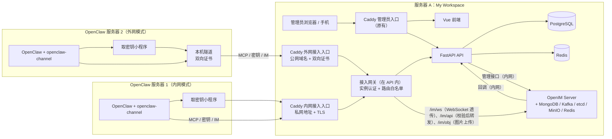

# My Workspace V2.0 改造方案（定稿）

> **状态**：已采纳（人类 2026-10-31：“按推荐的来，给我重新写一份改造方案”）。
> - 本文是 V2 中 AI 与智能体部分的**唯一依据**，替换规范的 Sprint 6 AI 部分（S6-01 ~ S6-03）和 V2 资料包里的 Agent 方案。
> - 论证过程、上游源码核对和备选方案，见 [`OPENCLAW_PLAN.md`](OPENCLAW_PLAN.md)（第 2 版）和 [`REVIEW.md`](REVIEW.md)。
> - `docs/DEVELOPMENT_SPEC.md`、`docs/TASKS.md` 的对应修订，由 claude 起草 PR，人类批准后合并（第 11 节）。
>
> 锁定的上游版本（实施时在 OC-0 实测）：
>
> | 上游 | 版本 |
> |---|---|
> | OpenClaw | extended-stable 维护线（核验时的最新版是 v2026.10.9） |
> | `@openim/openclaw-channel` | v0.3.2 |
> | open-im-server | v3.8.3-patch.18 |

## 1. 决策记录

| # | 事项 | 决定 | 由谁 |
|---|---|---|---|
| D1 | AI 方案 | 用 **OpenClaw** 接替原来自建的模型兼容层、对话、Tool Executor | 人类 |
| D2 | OpenClaw 的部署 | **多个实例**，分布在不同服务器，由工作台统一管理 | 人类 |
| D3 | 网络 | **内网、外网两种模式**；所有连接都由 OpenClaw 主动连回工作台 | 人类定需求，按推荐实现 |
| D4 | 外网模式的保护 | **必须双向证书**：OpenClaw 那边运行本机隧道 | 按推荐 |
| D5 | 密钥 | **集中在工作台密钥库**，OpenClaw 远程取（exec SecretRef） | 人类 |
| D6 | 和 OpenClaw 的交互 | 工作台内置 **基于 OpenIM 的管理员端 IM**；每个 OpenClaw 通过 `openclaw-channel` 作为一个 IM 用户接入 | 人类 |
| D7 | IM 的实现方式 | **工作台后端中转**，浏览器不直连 OpenIM | 按推荐 |
| D8 | IM 的功能 | 单聊、拉群（多个 OpenClaw 互相沟通）、**会话置顶 + 单条消息置顶**、免打扰、分组；**不提供删除好友**；OpenClaw 上线后**自动加为好友** | 人类定需求，置顶范围按推荐 |
| D9 | 群聊防刷屏 | 管理员不发言时，OpenClaw 连续最多 **8** 条；单个 OpenClaw 每群每分钟最多 **6** 条；**禁止 OpenClaw 之间单聊** | 按推荐 |
| D10 | 消息类型 | 第一版只做**文字和图片**，文件以后再做 | 按推荐 |
| D11 | OpenIM 部署 | **服务器 A**，独立的 Compose 项目 | 按推荐 |
| D12 | 许可证 | AGPL（`openclaw-channel`）可以接受 | 人类 |
| D13 | 模型 | 部署时由人类在工作台密钥库录入，不阻塞开发 | 按推荐 |
| D14 | 测试 | CI 用**假模型服务**驱动真实 OpenClaw；第一版不做真实模型冒烟 | 按推荐 |
| D15 | 写操作 | 第一版**全部需要人工审批**；高危操作还要二次认证 | 按推荐 |

## 2. 改造范围

| 类别 | 内容 |
|---|---|
| **新增：工作台后端** | - OpenClaw 实例管理与接入凭证； - 两个接入入口的认证和路由白名单； - 密钥库，以及加密密钥可轮换； - OpenIM 连接器、回调收件箱、消息投影与对账； - IM 的业务接口； - 群聊防刷屏； - MCP 工具服务器； - 工具审批 |
| **新增：工作台前端** | IM（会话、聊天、群管理、置顶、免打扰、分组、审批卡片）、OpenClaw 实例页、密钥库页、AI 审批中心与活动记录 |
| **新增：部署** | - `infra/openim/`：OpenIM 独立的 Compose 项目； - Caddy 两个接入入口； - `infra/openclaw/`：OpenClaw 服务器的接入包模板、取密钥小程序、启动包装脚本、隧道配置、检查清单； - 备份覆盖 OpenIM |
| **修改** | - 凭证加密改为可轮换（现在的 `CREDENTIAL_ENCRYPTION_KEY` 不能轮换）； - 通知中心：增加 IM 未读和审批提醒； - 首页“AI 快捷提问”组件改为打开 IM； - 运维页增加 OpenClaw 实例和 OpenIM 的状态 |
| **不做** | - 规范原来设计的 `ai_conversations` / `ai_messages` 表和 `/api/v1/ai/conversations` 接口； - 工作台调用 OpenClaw 的 OpenAI 兼容接口或 hooks； - Codex Cloud； - V2 资料包里的 Agent 控制面（13 张表、Codex 桥接、调度和对账服务） |
| **不变** | V1 的全部功能与接口；Vikunja 仍是任务主源 |

## 3. 目标架构

**三条原则**：

1. **OpenClaw 主动连回工作台**：工作台从不主动连 OpenClaw。OpenClaw 可以放在 NAT 后面，防护集中在工作台的两个接入入口。
2. **管理员只和工作台打交道**：浏览器只访问工作台。OpenIM、MinIO 都不对浏览器暴露。
3. **工作台是唯一的权限来源**：
   - 实例能做什么，由工作台的凭证、权限范围和审批决定；
   - OpenClaw 和 OpenIM 自己的权限设置只是额外一层防护，不能代替工作台的判断。

## 4. 模块设计

### 4.1 OpenClaw 实例管理

**登记流程**：

1. 管理员新建实例，填写：名称、所在服务器说明、网络模式（内网或外网）、MCP 权限范围（只读或读写）、最高角色、可取用的密钥、IM 昵称和头像。
2. 工作台在**同一个事务**里写入实例和凭证，然后调用 OpenIM：
   - 注册用户 `oc_<实例 ID>`；
   - 用 `/friend/import_friend` 和管理员互加好友（双向、幂等）。
   - 调用 OpenIM 失败时实例停在“待接入（IM 未就绪）”，后台任务会重试。
3. 生成**接入包**（第 6.2 节）。实例凭证、外网模式的客户端证书私钥只在下载时出现一次。
4. OpenClaw 启动后：
   - 取密钥、登录 IM；
   - 工作台收到 `afterUserOnline` 回调，状态改为“在线”，同时再补一次好友关系。

**状态**：`待接入`、`在线`、`离线`、`已停用`。
- 在线和离线以 OpenIM 的上线、下线回调为准，再参考最近一次 MCP 调用和取密钥的时间；
- 每 5 分钟用 `/user/get_users_online_status` 对账一次。

**管理操作**：
- **停用**：凭证立即失效、调用 `/auth/force_logout` 强制退出 IM、拒绝取密钥；
- **启用**；
- **轮换凭证或证书**：新旧两份同时有效 24 小时；
- 修改权限和密钥授权；
- 查看记录；
- **全局总开关**：一键停用所有实例。

**归属**：
- 实例属于一个工作空间；
- MCP 调用以登记它的管理员身份执行，权限取“该用户的角色”和“实例的最高角色”中较低的一个；
- 只有 owner 可以登记和管理实例。

### 4.2 接入入口与接入网关

| | 内网入口 | 外网入口 |
|---|---|---|
| 监听 | `AGENT_INTRANET_BIND`（私网地址，例如 tailnet IP）`:443` | `AGENT_PUBLIC_HOST`（单独的公网域名）`:443` |
| TLS | 内部 CA 或 Tailscale 证书 | 公网证书，**并要求客户端证书**，由工作台内部 CA 按实例签发 |
| 认证 | 实例凭证（Bearer） | 实例凭证加客户端证书。Caddy 把证书指纹传给 API，API 检查两者属于同一实例 |
| 绑定 | 凭证只在登记时选定的入口有效 | 同左 |
| 防护 | 来源网段限制、按实例限流 | 按实例限流；认证失败 10 次后封禁来源 15 分钟；可选来源 IP 白名单 |

**两个入口都默认拒绝**，只放行下面这些路径，其余返回 404：

| 路径 | 处理 |
|---|---|
| `POST /mcp` | MCP 工具（第 4.6 节） |
| `POST /agent-api/v1/secrets/resolve` | 取密钥（第 4.3 节） |
| `POST /agent-api/v1/im-token` | 启动包装脚本取 IM 令牌 |
| `POST /agent-api/v1/heartbeat` | 上报 OpenClaw 版本和插件版本 |
| `GET /im/ws` | 透传到 OpenIM 消息网关。访问日志去掉查询参数，因为令牌在 URL 里 |
| `POST /im/api/<白名单接口>` | 接入网关检查：路由在白名单内；令牌有效；请求体里的用户 ID 等于令牌的用户；然后转发到 OpenIM REST。 白名单在 OC-0 抓包确定。**一律拦截**：管理接口、`/friend/delete_friend`、`/conversation/set_conversations`、`/msg/search_msg`、用户注册、建群和踢人 |
| `/im/obj/*` | 图片上传到 MinIO：只允许图片类型，单张不超过 10 MB |

### 4.3 密钥库

- **存储**：
  - 表 `agent_secrets` 存名称、类型、说明；`agent_secret_versions` 存密文和加密密钥版本；
  - 只能写入，不能读回明文。
- **授权**：`agent_secret_grants` 记录实例、密钥、在 OpenClaw 里用的 ID（例如 `openai_api_key`）。
- **取用**：
  - `POST /agent-api/v1/secrets/resolve`，请求 `{ids:[…]}`；
  - 返回 `{values:{…}, errors:{id:"NOT_FOUND"}}`，未授权的 ID 也返回 `NOT_FOUND`，不区分“不存在”和“没授权”；
  - 每次取用都写审计：实例、ID、版本、来源 IP、结果；按实例限流。
- **加密密钥可轮换**：
  - 密文带加密密钥版本；新增版本后后台重新加密；旧版本在全部重新加密完之前保留；
  - 这项改造同时覆盖现有的集成凭证（Vikunja、GitHub、n8n）。
- **OpenClaw 那边**：
  - 模型密钥：用 exec SecretRef 调取密钥小程序；
  - MCP 请求头：直接用实例凭证（`${MYWS_INSTANCE_TOKEN}`），因为这个配置项不支持 SecretRef；
  - IM 令牌：启动包装脚本在启动前取到，写进 `OPENIM_TOKEN` 环境变量，因为插件不支持 SecretRef。
- **轮换后生效**：
  - 模型密钥：OpenClaw 服务器上的定时器每 10 分钟执行一次 `openclaw secrets reload`；
  - IM 令牌：有效期 30 天（工作台签发时指定），定时器每周重启一次 OpenClaw，到期前 7 天提醒管理员。

### 4.4 IM（基于 OpenIM，由工作台后端中转）

**身份**：

| 角色 | OpenIM 账号 |
|---|---|
| 工作台后端 | `imAdmin`，只在服务器端用，令牌缓存在 Redis，到期前刷新 |
| 管理员 | 普通用户 `ws_<工作台用户 ID>` |
| OpenClaw 实例 | 普通用户 `oc_<实例 ID>`，平台 Web（5） |
| 系统通知 | 通知账号 `ws_notice`，发审批卡片和系统提示 |

**消息怎么流转**：

- **管理员发消息**：
  1. 前端调工作台接口，带 `Idempotency-Key`；
  2. 后端调 `/msg/send_msg`，以 `ws_<用户>` 身份发出；
  3. 写入消息投影，状态为“发送中”，收到回调后改为“已送达”；
  4. 结果未知时不自动重发，沿用 V1 的规则。
- **收消息**：
  1. OpenIM 的 `afterSendSingleMsg` / `afterSendGroupMsg` 回调推到内网地址 `/internal/openim/<随机路径>`；
  2. 写入 `im_webhook_inbox`，按消息 ID 去重；
  3. Worker 处理后写入 `im_messages` 和 `im_conversations`；
  4. 通过现有 SSE 通知前端刷新。
- **对账**：回调可能丢（内存队列满了直接丢弃）。所以 Worker 每 30 秒对管理员的活跃会话执行 `/msg/newest_seq` 和 `/msg/pull_msg_by_seq`，补齐缺失的序号；每天全量对账一次。
- **图片**：
  - 管理员上传的图片：后端经 OpenIM 对象接口存进 MinIO，再发图片消息；
  - OpenClaw 发来的图片：如果在 OpenIM 的 MinIO 里，由工作台带登录校验代理显示；如果是外部 URL，**不加载**，只显示为链接并提示“外部图片”，防止 SSRF 和外部追踪。

**功能**：

| 功能 | 做法 |
|---|---|
| 单聊 | 只允许管理员和 OpenClaw 之间单聊 |
| 拉群 | 管理员建群（`groupType=2`，群主是管理员）、邀请、移出、改群名和群公告、解散 |
| 会话置顶 | `im_conversations.pinned_at`，同步到 OpenIM 的 `isPinned` |
| 单条消息置顶 | `im_message_pins`：每个会话最多置顶 10 条，显示在聊天窗口顶部，可以取消 |
| 免打扰 | `im_conversations.muted`：不发通知、不计入顶栏未读数，消息照常接收；同步到 OpenIM 的 `recvMsgOpt=2` |
| 分组 | `im_contact_groups` / `im_contact_group_members`：管理员自建分组，一个实例可以在多个分组里；通讯录和会话列表都能按分组筛选 |
| 不能删除好友 | ① 界面不提供删除入口；② 接入网关拦截 `/friend/delete_friend`；③ 收到 `afterDeleteFriend` 后立即重新导入并告警；④ 每小时对账好友关系 |
| 上线自动加好友 | 登记时导入；`afterUserOnline` 时再补；每小时对账 |
| 未读与已读 | 工作台按会话维护管理员的已读序号；免打扰的会话不计入顶栏未读数 |
| 审批卡片 | `ws_notice` 发到“审批通知”会话，消息扩展字段带审批 ID；前端渲染成卡片，直接调用工作台的审批接口 |
| 历史 | 投影默认保留 180 天（可配置）；管理员可以按会话导出 |

### 4.5 群聊治理

- **OpenClaw 那边的设置**：
  - `requireMention: true`：群里只有被 @ 才回复；
  - `inboundWhitelist`：默认只放管理员。打开“允许接力”的群，接入包里会把同群的实例也加进白名单。
- **工作台把关**：通过 OpenIM 的 `beforeSendGroupMsg` 回调，可以拒收消息：
  - 自管理员上次在群里发言以来，OpenClaw 的消息超过 **8** 条，就拒收，并由 `ws_notice` 提示“自动接力已暂停，管理员发言后恢复”；
  - 单个 OpenClaw 在一个群里超过每分钟 **6** 条，就拒收；
  - 每个群可以单独调整这两个数，也可以关闭“允许接力”。关闭后只有管理员的消息能触发回复。
- **禁止 OpenClaw 之间单聊**：`beforeSendSingleMsg` 回调拒收发送人和接收人都是 `oc_*` 的消息。
- **计数**：放在 Redis，回调要在 200 毫秒内返回。
- **注意**：OpenIM 的“发送前”回调请求失败时，操作会直接失败。所以工作台 API 不可用时，群聊和单聊都会暂停。这是**有意的**：管理员端本来就在工作台里，不让没人看管的 OpenClaw 在这时继续接力。

### 4.6 MCP 工具与审批

- **端点**：`POST /mcp`，用 Streamable HTTP 传输，实现用官方 MCP Python SDK（版本在 OC-0 锁定），只在两个接入入口开放。
- **认证**：实例凭证，外网模式还要客户端证书；然后走现有的 `require_role` 和 workspace 范围校验，再叠加实例的权限范围。
- **工具**：

| 风险 | 工具 |
|---|---|
| 读 | `search`、`list_tasks`、`get_task`、`list_projects`、`calendar_agenda`、`list_bookmarks`、`list_knowledge_sources`、`list_repos`、`list_issues`、`list_pull_requests`、`service_status`、`list_notifications`、`list_automations`、`dashboard_overview`、`get_action_status` |
| 写 | `create_task`、`update_task`、`complete_task`、`create_calendar_event`、`create_bookmark`、`mark_notification_read` |
| 高危 | `delete_task`、`delete_calendar_event`、`trigger_automation` |

- **永远不做成工具**：集成凭证与设置、成员与角色、会话、工作台设置、实例与密钥管理、审计日志。
- **写和高危操作的审批流程**：
  1. 规范化参数并计算哈希；
  2. 写入 `ai_tool_executions`，状态 `pending`，15 分钟后过期；
  3. 工具立即返回 `{status:"pending_approval", action_id, summary}`，此时**没有执行**；
  4. `ws_notice` 发审批卡片，同时写进通知中心；
  5. owner 或 admin 批准，需要会话、CSRF 和 `If-Match`；高危操作还要重新输入密码；
  6. 工作台用**存下的参数**执行，幂等键就是 `action_id`；
  7. 状态改为 `succeeded`、`failed` 或 `unknown`；
  8. OpenClaw 可以用 `get_action_status` 查询结果。
- **其他规则**：
  - 同一实例、同一工具、同样参数哈希的待审批请求会去重；
  - 超时默认拒绝；
  - AI 不能批准，聊天里回“同意”也不算批准；
  - **A14**：AI 发起未经审批的删除，工具只返回 `pending_approval`，不执行，并留下记录。
- **返回内容**：
  - 只返回需要的字段；
  - 来自第三方的文本放在标明“外部内容、不可信”的字段里；
  - 审批卡片上写明请求来自哪个实例、在哪个会话、由谁 @ 触发。

### 4.7 前端页面

| 路由 | 页面 | 权限 |
|---|---|---|
| `/im` | IM 主界面： - 左栏：会话列表（置顶在前、免打扰图标、未读数、按分组筛选、搜索）； - 中栏：聊天窗口（顶部是置顶消息、支持 @ 成员、图片、审批卡片）； - 右栏：会话详情（群成员、群设置、防刷屏设置）。 手机上切换为单栏 | owner、admin |
| `/im/contacts` | 通讯录：按分组列出所有实例、显示在线状态、管理分组。没有删除好友 | owner、admin |
| `/agents` | OpenClaw 实例列表、状态、新建、下载接入包、停用、轮换、全局总开关 | owner |
| `/agents/secrets` | 密钥库：新增、轮换、授权给实例、查看取用记录 | owner |
| `/ai/approvals` | AI 审批中心 | owner、admin |
| `/ai/activity` | 工具调用记录 | owner、admin；member 只看自己的 |

- 顶栏通知：IM 未读数（不含免打扰）、待审批数。
- 首页组件“AI 快捷提问”：打开 IM，选择一个实例。

## 5. 数据模型（迁移 0011 起，全部新增；按惯例建在 `workspace` schema 下）

| 表 | 关键字段 | 约束 |
|---|---|---|
| `agent_instances` | `workspace_id, name, network_mode(intranet/public), status(pending/online/offline/disabled), im_user_id, acting_user_id, max_role, scopes, reported_version, plugin_version, last_seen_at, disabled_at, version` | `status`、`network_mode` 有 CHECK；`im_user_id` 唯一 |
| `agent_credentials` | `instance_id, kind(token/client_cert), token_hash, cert_fingerprint, ingress(intranet/public), expires_at, revoked_at, last_used_at, last_used_ip` | 令牌只存哈希；`(instance_id, kind)` 同时最多两条有效记录，用于轮换期 |
| `agent_secrets` / `agent_secret_versions` | 名称、类型；密文、`key_version`、`created_at` | 明文不出数据库层 |
| `agent_secret_grants` | `instance_id, secret_id, ref_id` | `(instance_id, ref_id)` 唯一 |
| `ai_tool_executions` | `instance_id, acting_user_id, tool_name, risk_level, arguments_redacted_json, arguments_hash, status, expires_at, decided_by, decided_at, executed_at, result_summary, error_text, version, request_id` | 状态和风险有 CHECK；`(workspace_id, id)` 复合外键 |
| `im_conversations` | `owner_user_id, conversation_id, kind(single/group), peer_instance_id, group_id, pinned_at, muted, last_msg_seq, read_seq, last_message_at` | `(owner_user_id, conversation_id)` 唯一 |
| `im_messages` | `conversation_id, server_msg_id, client_msg_id, seq, sender_im_id, content_type, content_json, sent_at, status` | `(conversation_id, seq)` 唯一；有保留期 |
| `im_message_pins` | `conversation_id, server_msg_id, pinned_by, pinned_at` | 每个会话最多 10 条 |
| `im_contact_groups` / `im_contact_group_members` | 分组名、排序；分组和实例的对应关系 | 分组名在工作空间内唯一 |
| `im_group_policies` | `group_id, relay_enabled, max_agent_streak(默认 8), max_per_minute(默认 6)` | |
| `im_webhook_inbox` | `event_key, command, payload_json, received_at, processed_at, attempts, error` | `event_key` 唯一。复用现有收件箱的处理框架 |

另外，**加密密钥版本**：现有的凭证密文要加 `key_version`，用一个单独的迁移完成，只新增列，有默认值。

## 6. 部署与运维

### 6.1 服务器 A

- **OpenIM**：
  - 放在 `infra/openim/compose.yaml`，用单独的 Compose 项目，做法和 `infra/vikunja/` 一样；
  - 镜像全部锁定 tag 加 digest；
  - **密码和 `secret` 全部随机生成**，默认值 `openIM123` 不允许出现，`make env` 时生成；
  - `bitnamilegacy/*` 镜像在 OC-0 评估换成各组件的官方镜像；
  - MongoDB、Kafka、etcd、MinIO 不映射到宿主机；OpenIM 的 10001 和 10002 端口只在内部网络，经 Caddy 接入入口转发。
- **Caddy**：
  - 新增内网接入入口和外网接入入口两个站点；
  - 访问日志去掉 `/im/ws` 的查询参数；
  - 外网入口启用客户端证书校验，信任工作台内部 CA。
- **内部 CA**：
  - 用来签发外网模式的客户端证书；
  - CA 私钥加密后存进密钥库，有效期 5 年；
  - 客户端证书有效期 90 天，到期前提醒；
  - 吊销**以证书指纹为准**，不依赖 CRL：API 每次都检查指纹是否有效。
- **备份**：
  - restic 增加 OpenIM 的 MongoDB 导出和 MinIO 数据目录；
  - A15 恢复演练增加 OpenIM 部分：恢复后消息历史和好友关系一致。
- **监控**（Prometheus）：
  - 实例：在线数、取密钥成功与失败次数、MCP 调用量；
  - 回调：积压量、对账补齐的条数；
  - 群聊：防刷屏暂停次数；
  - 审批：待审批数。
  - 运维页显示 OpenIM 和各实例的状态。
- **资源**：OpenIM 加上 Kafka、MongoDB、MinIO 会明显增加内存需求。具体数字在 OC-0 实测，写进 `docs/deployment.md`；不够时再把 OpenIM 迁到单独的服务器（D11 的备选）。

### 6.2 OpenClaw 服务器（每台一份接入包）

接入包由工作台生成，模板在 `infra/openclaw/`：

| 文件 | 用途 |
|---|---|
| `openclaw.json` 片段 | 密钥 exec provider、模型密钥引用、加固基线、MCP 服务器、`openim` 渠道、`plugins.allow`、给工作台用的智能体及工具白名单 |
| `myworkspace.env` | 实例凭证、各接入地址。文件权限 600 |
| `myworkspace-secret-resolver` | 取密钥小程序：只用标准库，绝对路径，属主是运行用户，其他人不可写 |
| `myworkspace-openclaw-start` | 启动包装脚本：取 IM 令牌，写进环境变量，再启动 OpenClaw。Docker 部署时作为容器入口 |
| 定时器（systemd 或 cron） | 每 10 分钟 `openclaw secrets reload`；每周重启一次 |
| 外网模式：隧道配置、客户端证书和私钥 | 本机隧道（ghostunnel 客户端）在 127.0.0.1 开三个端口，分别对应 MCP、`/agent-api` 和 `/im` |
| `CHECKLIST.md` | 部署检查清单： - 锁定版本； - Gateway 只监听本机； - `openclaw security audit --deep` 通过； - exec 拒绝、只有工作台工具； - 不装其他插件和技能； - 不挂 Docker socket |

- OpenClaw 本身的数据（会话、记忆）由它所在的服务器自己备份：`openclaw backup create --verify`。
- 回滚要连同备份的状态一起恢复，因为降级不会撤销 OpenClaw 的迁移。

## 7. 安全设计

| 威胁 | 措施 |
|---|---|
| 实例凭证泄露 | 只存哈希；绑定入口；外网模式还要客户端证书；一键停用；最近使用的 IP 可查；到期轮换 |
| OpenClaw 主机被攻破 | 只能拿到授权给这个实例的密钥，以及它的 MCP 权限；写操作要人工审批。停用后立即断开 MCP、密钥和 IM |
| 工作台被攻破 | 密钥加密存储，加密密钥可轮换；管理员 API 永远不返回密钥明文；OpenIM 的 `secret` 和 `imAdmin` 令牌只在服务器端 |
| Prompt Injection（任务、Issue、其他 OpenClaw 的消息） | - OpenClaw 智能体只有工作台工具和 IM 发消息工具，没有 shell、文件、浏览器、网页抓取； - 写操作一律人工审批； - 外部文本标为不可信； - 审批卡片标明来源； - 群聊防刷屏； - 禁止实例之间单聊 |
| OpenIM 接口的权限缺陷（会话、搜索接口不检查调用者） | OpenClaw 的 REST 请求必须经过接入网关：白名单路由，校验请求体里的用户 ID 等于令牌的用户；浏览器不直连 OpenIM |
| OpenIM 回调被伪造 | 回调只走内部网络、随机路径、限定来源网段；处理时只信任回调里的 ID，所有数据以对账结果为准 |
| 外链图片（SSRF、追踪） | 服务器端不抓取；浏览器端不自动加载 |
| 删好友、越权建群 | 接入网关拦截；回调后自动补回 |
| 供应链 | 所有镜像锁定 digest；插件锁定版本；OpenClaw 只允许 `openclaw-channel` 这一个插件；镜像扫描覆盖 OpenIM 和 OpenClaw |

## 8. 测试与验收

- **CI 拓扑**（`ci-infra` 新增一个任务）：
  - 工作台加 OpenIM 一个网络；
  - OpenClaw 实例 A 走“内网”；
  - OpenClaw 实例 B 走“外网”，经隧道和双向证书；
  - 都用**假模型服务**按脚本回复，并发出固定的工具调用。
- **验收场景**：

| # | 场景 | 预期 |
|---|---|---|
| 1 | 登记实例 A、B | 通讯录自动出现；上线后显示“在线”；和管理员已是好友 |
| 2 | 管理员私聊 A | A 回复；A 取模型密钥成功，有记录 |
| 3 | 建群（管理员、A、B），管理员 @A，A @B | 只有被 @ 的回复；连续 8 条后暂停，管理员发言后恢复 |
| 4 | 会话置顶、消息置顶、免打扰、分组 | 排序正确、置顶消息显示在顶部；免打扰的会话不计未读、不通知；按分组筛选正确 |
| 5 | A 调用删好友接口；绕过网关直接删除 | 网关拦截；绕过后自动补回并告警 |
| 6 | 停用 B | 取密钥失败、MCP 返回 401、IM 被强制下线 |
| 7 | B 用 A 的凭证；内网凭证用在外网入口；外网入口不带证书 | 全部失败 |
| 8 | A 调被拦截的 OpenIM 接口（改会话、搜消息、管理接口） | 失败 |
| 9 | A 发起 `delete_task` | 只生成待审批记录，IM 里出现审批卡片；批准后才执行；改参数要重新审批（**A14**） |
| 10 | 群里诱导 A 去让 B 删除数据 | 没有审批就不会执行 |
| 11 | A 私聊 B | 被拒收 |
| 12 | 重启 OpenIM 或工作台 API；人为丢弃回调 | 对账后消息不缺 |
| 13 | 轮换模型密钥 | 10 分钟内生效；旧密钥不再下发 |
| 14 | 备份恢复（A15 扩展） | 恢复后 IM 历史和好友关系一致 |

- **单元和契约测试**：
  - 密钥库：加密、轮换、授权、审计；
  - 凭证与入口绑定；
  - 接入网关的白名单和用户 ID 校验；
  - 回调去重；
  - 防刷屏规则；
  - MCP 工具权限；
  - 审批状态机；
  - 越权和跨工作空间访问。
- **前端**：lint、typecheck、test、build、`check:api`；浏览器验收覆盖 IM 主流程和 390px 移动端。
- **对应规范**：
  - Sprint 6 DoD 的“无审批不能执行高危操作”“攻击性文档内容无法绕过工具策略”分别由场景 9、10 验证；
  - A14 由场景 9 验证。

## 9. 实施计划

| 任务 | 内容 | 产出 | 依赖 |
|---|---|---|---|
| **OC-0 核验与选型**（S6-01） | - OpenClaw extended-stable 版本、digest、`openclaw-channel` 兼容性； - OpenIM 部署与 digest、替换 bitnamilegacy 的评估、资源实测； - 抓包确定插件用到的 OpenIM REST 接口；WebSocket 层权限；回调载荷；对象存储上传流程； - exec 密钥与 `secrets reload`； - 假模型驱动； - 外网隧道和双向证书； - MCP Python SDK 版本 | ADR（附来源）、`infra/openclaw/`、`infra/openim/` 初稿 | 无 |
| **OC-1 契约**（S6-01） | 管理员 API（实例、密钥、IM、审批）、`/agent-api`、MCP 工具、内部回调；schema、OpenAPI、`schema.d.ts`、`docs/api-contract.md`、契约测试 | 契约 ADR 和接口桩 | OC-0 |
| **OC-2 实例、凭证、密钥库与接入入口**（S6-01） | 迁移；加密密钥可轮换；实例登记与接入包；取密钥小程序；启动包装脚本；两个 Caddy 入口；接入网关；内部 CA | 后端与部署配置 | OC-1 |
| **OC-3 OpenIM 部署与 IM 后端**（S6-02） | `infra/openim/`；OpenIM 连接器；用户与好友同步；回调收件箱；消息投影与对账；群管理；防刷屏；图片 | 后端 | OC-2 |
| **OC-4 管理员端页面**（S6-02） | IM、通讯录与分组、实例页、密钥库页、审批中心与活动记录、移动端 | 前端 | OC-3 |
| **OC-5 MCP 工具与审批**（S6-02、S6-03） | 读、写、高危工具；审批流程；审批卡片；A14 | 后端（加上 OC-4 的审批页） | OC-2 |
| **OC-6 安全测试**（S6-03） | 反 Prompt Injection、越权、绕过审批、接入网关、OpenIM 拦截、回调伪造 | 测试 | OC-3、OC-5 |
| **OC-7 验收**（DoD、A14） | CI 多实例端到端（第 8 节）；部署文档；威胁模型；数据字典；备份覆盖；Sprint 6 验收报告；勾选 TASKS | 验收报告 | 全部 |
| **SPEC 规范修订** | 起草 `docs/DEVELOPMENT_SPEC.md`、`docs/TASKS.md` 的修订（第 11 节） | PR，人类批准后合并 | 无，和 OC-0 并行 |

- **工作量**：大约相当于 V1 的一到一个半 Sprint，全部由 claude 实施。
- **人类需要做的**：
  - 批准规范修订 PR；
  - 部署时准备服务器 A 的资源和接入域名、私网（Tailscale 等）、OpenClaw 服务器；
  - 在工作台密钥库录入模型密钥。

## 10. 风险与 OC-0 必查项

| 风险 | 查什么 | 不通过时怎么办 |
|---|---|---|
| `openclaw-channel` 和锁定的 OpenClaw 不兼容（插件最后更新于 2026-03） | 实际安装运行，收发私聊和群聊 | 选兼容的 OpenClaw 版本；或者 fork 插件修复，按 AGPL 公开（D12） |
| OpenIM 的 WebSocket 层允许跨用户读取 | 用 A 的令牌尝试拉取管理员和 B 的会话 | WebSocket 层加过滤；或者每个实例单独部署 OpenIM 网关（成本高，作为最后手段） |
| 插件用到的 REST 接口超出预期，白名单很难收紧 | 抓包列出全部接口 | 按接口逐个做“用户 ID 等于令牌用户”的检查 |
| 资源不足 | 实测内存和磁盘 | 把 OpenIM 放到单独的服务器 |
| 插件令牌过期后不重连 | 让令牌过期，观察插件行为 | 缩短重启周期，或者 fork 加刷新 |
| 回调延迟和丢失 | 压测 | 缩短对账间隔 |

## 11. 对现有规范的修订（SPEC 任务起草，人类批准）

- **`docs/DEVELOPMENT_SPEC.md`**：
  - 第 1 节：增加“AI 由 OpenClaw 承担，工作台负责实例、密钥、IM、工具与审批”；
  - 第 2 节：AI 一行改为“OpenClaw（多实例）+ MCP 工具 + 工作台审批”，新增“IM：OpenIM（后端中转）”；
  - 第 3 ~ 4 节：架构图加入接入入口、接入网关、OpenIM；
  - 第 5 节：第 20 ~ 22 张表换成第 5 节的表；
  - 第 6.1 节：AI 接口换成第 4 节的接口；
  - 第 8 节：增加 IM 和实例页面；
  - 第 9 节：安全增加接入入口、密钥库、群聊治理；
  - 第 13 节：Sprint 6 的范围；
  - 第 15 节：增加第 8 节的验收场景。
- **`docs/TASKS.md`**：S6-01 ~ S6-03 改写为：
  - S6-01：OpenClaw 多实例接入与密钥；
  - S6-02：IM 与只读工具；
  - S6-03：写工具审批与安全。
  - 已勾选的 S6-04 ~ S6-06 不动。
- **`docs/AGENTS.md` 第 8 节**：追加 V2 补充规则（来自资料包，按本方案调整）：
  - 先核验上游接口再实现；
  - 不得放宽 OpenClaw 的工具限制；
  - 写操作必须审批；
  - 不得跨工作空间或跨实例泄露数据。
