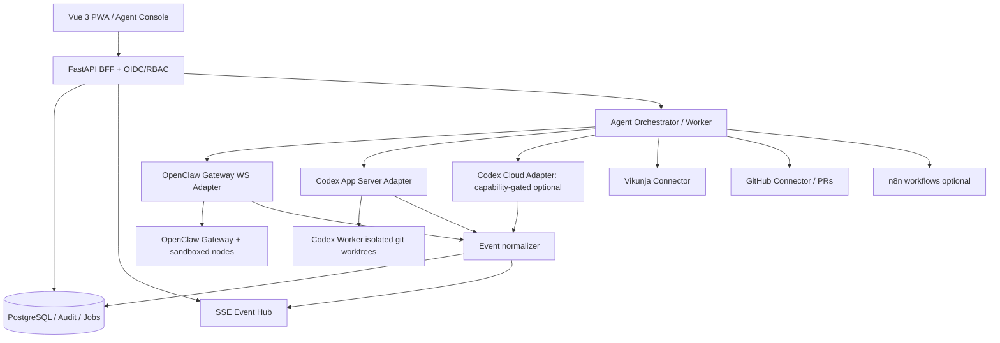

# My Workspace V2.0 — Agent Control Plane 实施增补规格

> 状态：V2.0 架构增补；与 `DEVELOPMENT_SPEC.md` 共同生效。如冲突，以本文件关于 Agent 的边界、权限、数据模型与任务优先级为准。日期：2026-10-31。

## 1. 产品目标和不可变约束

- My Workspace 是业务控制平面（Control Plane），并不直接替代 OpenClaw Gateway 或 Codex App Server。
- Vikunja 仍是业务任务主源；Workspace 自有 `agent_jobs` 是 Agent 运行任务的控制记录，不是 Vikunja Task 的第二份主数据。允许一个业务 Task 映射多个 Agent Job。
- Codex 编码执行的主会话来自本机/云主机自托管的 `codex app-server`；OpenClaw 通用执行来自 Gateway WS。ChatGPT Codex 云端任务作为另一个可选 Provider，不凭空承诺读写 API。
- 每一个执行都必须有 `workspace_id`, `requester_id`, `agent_instance_id`, `job_id` 和可信的审计链。
- 不允许 Agent 拥有生产数据库 root/superuser、Docker socket、宿主机全权限或未经审批的生产写操作。
- V2 允许用户使用手机浏览器/PWA 查看日志、接收审批、终止执行；手机不直接访问执行器的 WS 端口。

## 2. 执行架构



**进程边界**：FastAPI 负责 REST 和 ACL；Agent Orchestrator Worker 负责排队、调度、断线恢复、运行状态；Node.js/TS Codex Bridge 处理 App Server JSON-RPC（也可用 Python 严格实现协议）；OpenClaw Adapter 保持到 Gateway 的受保护 WS 连接；SSE Hub 给网页单向推送。Codex Bridge 和 Gateway 都必须仅在私有网络监听。

## 3. 模块职责

| 模块 | V2 范围 | 依赖 |
|---|---|---|
| Agent Registry | 配置执行器类型、端点、能力、可用状态、并发与项目白名单 | core |
| Agent Dispatcher | Task -> Job -> Provider，幂等提交，排队/取消/重试 | registry |
| Session Center | 聚合 OpenClaw sessions、Codex threads、关联业务 Job | adapters |
| Live Event Timeline | tokens摘要、计划、命令、工具、文件 diff、错误、turn状态 | event normalize |
| Approval Center | 申请、审批、拒绝、过期、决策回送 | security |
| Codex Worker | Repo worktree、sandbox、git diff、测试、PR 创建需要显式授权 | codex |
| OpenClaw Adapter | session创建/发送/读取、Gateway事件、Cron/Hook状态 | openclaw |
| Mobile PWA | 会话列表、审批、停止、通知 | frontend |
| Reconciler | Gateway/Bridge断线重连、Job状态恢复、超时、僵尸运行识别 | db/workers |
| Cost & Usage | token/cost如provider返回则记录，否则nullable，不编造 | events |

## 4. Provider 能力矩阵和核验门槛

| 功能 | OpenClaw Gateway | Codex 自托管 App Server | ChatGPT Codex Cloud |
|---|---|---|---|
| 列会话 | Gateway sessions RPC | `thread/list` | `unsupported` 直到验证 |
| 读历史 | Gateway session RPC | `thread/turns/list`, `thread/items/list` | 待验证 |
| 新建对话 | Gateway chat/agent RPC | `thread/start` | 待验证 |
| 发送执行 | `chat.send` 等 RPC | `turn/start` | 待验证 |
| 停止执行 | 版本锁定后验证停止 RPC | `turn/interrupt` | 待验证 |
| 审批 | `exec.approval.requested` / `exec.approval.resolve`（版本确认） | JSON-RPC server-initiated approval requests | 待验证 |
| 事件流 | WebSocket Gateway events | App Server notifications | 待验证 |

Codex App Server 首次连接须发送 `initialize` 并通知 `initialized`；以运行版本生成 schema (`codex app-server generate-json-schema`) 并做版本兼容测试。不要使用已删除的 `codex mcp-server` 作为主集成接口。OpenClaw 具体 RPC 参数必须由当前 Gateway schema/官方文档核验，不能按本文的概念名称猜测。

## 5. 运行状态机

`draft -> queued -> dispatching -> running -> (waiting_approval | completed | failed | cancelled | timed_out | orphaned)`。

- `waiting_approval` 可转回 `running` 或转 `failed/cancelled`；`orphaned` 用于 Worker/会话状态失联但远端可能继续执行的情况，不允许直接自动重试写任务。
- `cancel_requested` 是非终态标志，而非已取消证明；只有远端确认停止或人工核对后进入 `cancelled`。
- 仅运行记录允许自动重试；代码变更与外部有副作用的操作必须先做远端状态对账，杜绝重复 dispatch。
- 每个 Job 包含 `idempotency_key`、外部 run/thread 标识、`dispatch_token`、heartbeat、lease、attempts、last_observed_seq。
- 同一仓库的并行写任务必须使用独立 Git worktree，默认每仓库最多 1 个活跃合并/推送操作；同一 worktree 不并发写。

## 6. 数据库实体设计（追加到既有数据库）

推荐新增：`agent_instances`, `agent_capabilities`, `agent_jobs`, `agent_job_attempts`, `agent_sessions`, `agent_events`, `agent_approvals`, `agent_approval_decisions`, `agent_artifacts`, `agent_task_links`, `agent_execution_policies`, `agent_worker_heartbeats`, `agent_usage_daily`。

```sql
CREATE TABLE workspace.agent_instances (
  id UUID PRIMARY KEY DEFAULT gen_random_uuid(),
  workspace_id UUID NOT NULL REFERENCES workspace.workspaces(id),
  provider TEXT NOT NULL CHECK (provider IN ('openclaw','codex_app_server','codex_cloud')),
  name TEXT NOT NULL,
  endpoint_ref TEXT NOT NULL, -- secret store reference, not a plain credential
  capabilities JSONB NOT NULL DEFAULT '{}'::jsonb,
  enabled BOOLEAN NOT NULL DEFAULT false,
  max_parallel_jobs INT NOT NULL DEFAULT 1 CHECK (max_parallel_jobs > 0),
  created_at TIMESTAMPTZ NOT NULL DEFAULT now()
);
CREATE TABLE workspace.agent_jobs (
  id UUID PRIMARY KEY DEFAULT gen_random_uuid(),
  workspace_id UUID NOT NULL REFERENCES workspace.workspaces(id),
  requester_id UUID NOT NULL REFERENCES workspace.users(id),
  instance_id UUID NOT NULL REFERENCES workspace.agent_instances(id),
  title TEXT NOT NULL,
  instructions TEXT NOT NULL,
  repository_id TEXT,
  base_ref TEXT,
  status TEXT NOT NULL DEFAULT 'draft',
  cancel_requested BOOLEAN NOT NULL DEFAULT false,
  idempotency_key TEXT NOT NULL,
  external_run_id TEXT,
  started_at TIMESTAMPTZ,
  ended_at TIMESTAMPTZ,
  last_heartbeat_at TIMESTAMPTZ,
  metadata JSONB NOT NULL DEFAULT '{}'::jsonb,
  created_at TIMESTAMPTZ NOT NULL DEFAULT now(),
  UNIQUE(workspace_id, idempotency_key)
);
CREATE INDEX agent_jobs_ws_status_idx ON workspace.agent_jobs(workspace_id,status,created_at DESC);
CREATE TABLE workspace.agent_sessions (
  id UUID PRIMARY KEY DEFAULT gen_random_uuid(),
  workspace_id UUID NOT NULL REFERENCES workspace.workspaces(id),
  instance_id UUID NOT NULL REFERENCES workspace.agent_instances(id),
  job_id UUID REFERENCES workspace.agent_jobs(id),
  external_session_id TEXT NOT NULL,
  title TEXT,
  last_event_at TIMESTAMPTZ,
  metadata JSONB NOT NULL DEFAULT '{}'::jsonb,
  UNIQUE(instance_id, external_session_id)
);
CREATE TABLE workspace.agent_events (
  id BIGINT GENERATED ALWAYS AS IDENTITY PRIMARY KEY,
  workspace_id UUID NOT NULL REFERENCES workspace.workspaces(id),
  job_id UUID NOT NULL REFERENCES workspace.agent_jobs(id),
  event_key TEXT NOT NULL,
  event_type TEXT NOT NULL,
  seq BIGINT NOT NULL,
  payload JSONB NOT NULL DEFAULT '{}'::jsonb,
  created_at TIMESTAMPTZ NOT NULL DEFAULT now(),
  UNIQUE(job_id,event_key),
  UNIQUE(job_id,seq)
);
CREATE INDEX agent_events_job_seq_idx ON workspace.agent_events(job_id,seq);
CREATE TABLE workspace.agent_approvals (
  id UUID PRIMARY KEY DEFAULT gen_random_uuid(),
  workspace_id UUID NOT NULL REFERENCES workspace.workspaces(id),
  job_id UUID NOT NULL REFERENCES workspace.agent_jobs(id),
  external_approval_id TEXT NOT NULL,
  action_type TEXT NOT NULL,
  action_summary TEXT NOT NULL,
  canonical_payload_hash TEXT NOT NULL,
  status TEXT NOT NULL DEFAULT 'pending',
  requested_at TIMESTAMPTZ NOT NULL DEFAULT now(),
  expires_at TIMESTAMPTZ NOT NULL,
  resolved_at TIMESTAMPTZ,
  UNIQUE(job_id,external_approval_id)
);
CREATE TABLE workspace.agent_approval_decisions (
  id UUID PRIMARY KEY DEFAULT gen_random_uuid(),
  approval_id UUID NOT NULL REFERENCES workspace.agent_approvals(id),
  actor_id UUID NOT NULL REFERENCES workspace.users(id),
  decision TEXT NOT NULL CHECK(decision IN ('approve','reject')),
  created_at TIMESTAMPTZ NOT NULL DEFAULT now()
);
```

**必须补齐**：`agent_task_links` (task resource ID / job ID / relationship), `agent_artifacts` (diff/report/pr URL hash + permissions), `agent_job_attempts` (delivery and retry), `agent_execution_policies` (workspace/instance/action)、worker heartbeat。全部使用 Alembic，不能直接复制 SQL 到生产；跨 workspace FK 一致性须由数据库复合键或服务层测试保障。外部会话的原始消息只存授权范围内必要字段并可配置保留周期；大日志存对象存储并记哈希。

## 7. API 合约（所有端点为 My Workspace 自定义接口，不是第三方原生接口）

| Method | URL | 语义 |
|---|---|---|
| GET | `/api/v1/agents/instances` | 列出授权可见执行器/健康与能力 |
| POST | `/api/v1/agents/instances` | 管理员注册执行器，验证网络安全 |
| GET | `/api/v1/agent-jobs` | 按任务/状态/实例筛选，游标分页 |
| POST | `/api/v1/agent-jobs` | 幂等提交；初始排队或审批 |
| GET | `/api/v1/agent-jobs/{id}` | 当前状态和关联对象 |
| POST | `/api/v1/agent-jobs/{id}/cancel` | 请求取消，不能直接标记成功 |
| POST | `/api/v1/agent-jobs/{id}/retry` | 仅安全可重试状态 |
| GET | `/api/v1/agent-jobs/{id}/events` | 历史事件+断线游标 |
| GET | `/api/v1/agent-jobs/{id}/stream` | SSE；Last-Event-ID 断点续传 |
| GET | `/api/v1/agent-sessions` | 统一会话列表，分页 |
| GET | `/api/v1/agent-sessions/{id}/messages` | 历史/增量消息 |
| POST | `/api/v1/agent-sessions/{id}/messages` | 继续会话；是否允许依能力判断 |
| GET | `/api/v1/agent-approvals?status=pending` | 手机待审批列表 |
| POST | `/api/v1/agent-approvals/{id}/decision` | 审批/拒绝 + 乐观并发校验 |
| GET | `/api/v1/agent-artifacts/{id}` | 下载 diff/log/report，授权签名 |
| POST | `/api/v1/tasks/{id}/dispatch` | 从 Vikunja 业务任务派发 Agent Job |

示例提交（均为工作台 DTO）：

```json
{
  "task_resource_id": "uuid-of-external-resource",
  "agent_instance_id": "uuid-of-registered-agent",
  "job_type": "coding",
  "title": "修复项目登录错误",
  "instructions": "修复并运行测试，不直接推送主分支",
  "repository": {"provider":"github","owner":"example","name":"repo","base_ref":"main"},
  "execution_policy": "workspace_write",
  "require_approval_for": ["network", "push", "merge", "deploy"]
}
```

Headers: `Idempotency-Key`（写请求），`If-Match`（审批版本/重复决策）；输出规范包含 `job_id`, `status`, `session_id?`, `capabilities`, `last_event_seq`，不包含 Token。

## 8. 会话与实时事件标准化

标准事件类型：`job.queued`, `job.started`, `session.created`, `message.delta`, `message.completed`, `plan.updated`, `tool.started`, `tool.completed`, `approval.requested`, `approval.resolved`, `artifact.created`, `job.completed`, `job.failed`, `job.cancelled`, `provider.disconnected`。

每条事件包含 `{job_id, seq, occurred_at, provider, external_event_id?, event_type, data}`。`seq` 由工作台事务性分配且按 Job 严格递增。外部乱序/重复事件由 `event_key` 和 adapter 的游标去重；不能依赖 provider 自带全局顺序。SSE 提供 checkpoint，移动端重连先拉 DB，随后订阅流。

列表中必须分清 **session** 与 **job**：同一个 session 可以跨多次 turn，一个业务 task 可以有多个 job，一次 job 也可能关联多个外部 run。不要把 `thread_id` 当作 `task_id`。

## 9. 审批和安全模型

- 三层策略：Workspace RBAC -> Agent Job Policy -> Execution Host Policy（OpenClaw Exec Approval/Codex sandbox）。外层审批不得代替宿主机强制限制。
- 分类：Read 自动；Write 限制项目/仓库权限；Critical（delete, production restart, push, merge, deployment, secret exfiltration risk）明确人工批准并可二次确认。
- 审批绑定 `job_id`, `external_approval_id`, `action_type`, 命令/文件路径/目标主机、规范化 payload hash、过期时间。若 payload 改变，原批准无效。
- Provider 原生审批请求转发至手机后，必须通过原连接给出批准响应；HTTP 200 仅代表决策已受理，不能当作命令执行成功。
- 对 OpenClaw：默认 `exec` deny 或 allowlist + ask，使用独立最小权限身份和沙箱；不要启用 `full/off` 作为常规配置。Gateway operator 凭证必须专用并保存在 Secret Store。
- 对 Codex：默认隔离 worktree 和 workspace-write sandbox；`git push`, merge, deploy 不直接授予。远程 App Server WS 仅在内部网络、经身份认证和 TLS 暴露。
- SSRF、仓库 allowlist、固定工作目录、命令参数校验、Webhook 验签、防重放、凭证轮换、CSP、CSRF、日志脱敏全为 P0。
- 审批超时默认拒绝；手机离线不自动放行；只有真实用户身份可以审批，AI 不能审批自己的请求。

## 10. 长期运行与容灾

- Worker/Bridge 常驻在服务器，不依赖用户电脑在线。`restart: unless-stopped` 是进程恢复手段，不等于执行任务恢复机制。
- PostgreSQL 为调度与事件的持久化依据；Worker 用租约/心跳避免重复执行；重启后检查远端会话状态，再继续订阅而不是直接重新派发。
- 每次重连执行 session/turn 状态 reconciliation；App Server `thread/read`/分页历史用于恢复，OpenClaw sessions 状态按版本 RPC 查询。
- 对不可确认结果采用 `orphaned`/`needs_review`，不要自动宣告成功或重试有副作用的任务。
- Git 操作分支级隔离、可审计工件、PR 审核与 CI gate；大规模并发应配合独立 runner/VM 而非直接运行在 API 容器。
- 备份 PostgreSQL、工作台 Secret Store、Agent 配置、运行日志及 worktrees 的可恢复索引；实际仓库通过远程 Git 可重新拉取。

## 11. 前端页面布局

```text
┌ My Workspace ─ Search ─ Notifications ─ Approvals ─ Profile ┐
│ Sidebar      │ Agent Control Center                 │ Details │
│ Dashboard    │ [Queued 3] [Running 2] [Need Approval] │         │
│ Projects     │ Provider: OpenClaw | Codex | All      │ Session │
│ Tasks        │ Job table: project/title/status/age   │ stream  │
│ Knowledge    │ ───────────────────────────────────── │ logs    │
│ Calendar     │ Live job timeline & chat               │ diff    │
│ Developer    │ Plan / Tools / Test / Changes / Cost  │ approve │
│ Operations   │                                        │         │
│ AI Agents    │                                        │         │
│  - Runs      │                                        │         │
│  - Sessions  │                                        │         │
│  - Approvals │                                        │         │
│  - Workers   │                                        │         │
└──────────────┴────────────────────────────────────────┴─────────┘
```

新增路由：`/agents`, `/agents/jobs/:id`, `/agents/sessions`, `/agents/sessions/:id`, `/agents/approvals`, `/agents/workers`, `/agents/policies`。移动端默认：任务列表 -> 会话详情 -> 审批弹层，支持 SSE 自动重连和 push/站内通知；手机界面不得提供任意 shell 直通入口。

## 12. 开发路径（替换旧版 Sprint 6 AI 章节）

- **V2-S0：Provider 能力验证**。在指定版本上运行 OpenClaw Gateway 与 Codex App Server，保存 schema、连接测试、会话/事件/审批样本、ADR。ChatGPT 云端 API 单列待验证。
- **V2-S1：Agent Registry + 数据模型**。Alembic、权限、Secret Store、健康检查；模拟 provider 契约测试。
- **V2-S2：Codex App Server 集成**。Bridge、thread/list/read/start/turn/start/interrupt、事件归一化、断线恢复、独立 worktree。
- **V2-S3：OpenClaw 集成**。Gateway WS、session list/history/send、event ingest、Cron状态；运行器隔离。
- **V2-S4：Task Dispatch + Queue**。Vikunja Task -> Job，幂等、调度、公平队列、执行并发、租约恢复。
- **V2-S5：Session Center + 手机 PWA**。会话列表、历史、流式事件、停止操作、离线恢复。
- **V2-S6：审批、安全和审计**。端到端批准/拒绝/过期/重复提交测试，workspace 边界测试，命令与凭证安全测试。
- **V2-S7：GitHub PR/CI 与运维上线**。Artifact、Diff、PR 可追踪、成本统计（如支持）、备份恢复、故障演练。

每个阶段需通过 CI、迁移、契约与 E2E 测试才能转下一阶段。`V2-S0` 必须在代码适配前完成，API 不确定时显式 `unsupported`/`unverified`。

## 13. 接口验收场景（必测）

1. 手机新建 Job -> 服务器执行 Codex -> 断开手机 -> 再次打开能恢复 Thread 历史与实时事件。
2. 一个 Codex 任务请求危险命令，手机拒绝 -> 未执行、Job记录决定和原生执行器状态。
3. 手机重复点击批准 -> 仅生成一个有效审批决策，过期审批拒绝。
4. Worker 重启 -> 查询 Provider 状态，继续订阅，不重复提交 Git 写操作。
5. OpenClaw Gateway 断线 -> UI 显示 unavailable/stale，其他模块仍运行。
6. 同一仓库两个任务并发 -> 不共用可写工作树，不覆盖修改。
7. 普通成员不可读取其他 Workspace 的会话、日志、工件、审批或凭证。
8. 已停止的 turn 不会被错误显示为 completed；取消请求要等远端确认。
9. GitHub PR 由明确授权的步骤创建，不因生成了 diff 自动 push/merge。
10. Codex Cloud Adapter 未验证时 UI 显示 capability unsupported，不能伪造云端会话。

## 14. 需要修改旧版文件的准确位置

`DEVELOPMENT_SPEC.md`：
- §1：定位补充 Agent Control Plane、移动会话与长期运行；扩展非 V1 范围说明。
- §2：增 Codex App Server、OpenClaw Gateway、Bridge/Worker 和 WebSocket/SSE，锁定版本。
- §3–4：加入 agent adapters、orchestrator、event normalizer、runner、reconciler；更新架构图。
- §5：新增 13 张 Agent 领域表；禁止替换原有外部资源/Task主源关系。
- §6：新增 Agent Job、Session、Approval、Artifact REST API 与 SSE。
- §7：扩 Connector 为能力矩阵；区分 OpenClaw、Codex App Server、Codex Cloud。
- §8：新增 Agent Console / Session Viewer / Approval Center / PWA。
- §9–10：三层审批、审核与任务租约、断线恢复、幂等保护。
- §11–12：新增运行器隔离/健康检查、集成契约和故障恢复测试。
- §13：旧 Sprint 6 的通用 AI provider abstraction 改为 V2-S0~S7，避免重复开发基础 Agent。
- §15–18：增加会话/任务/审批/取消/隔离等验收与 ADR。

`AGENTS.md`：添加 Provider 真实 schema 核验、禁止猜测云端 API、不允许跨工作空间会话泄漏、不得自行放宽沙箱、安全审批不可跳过的规则。

`TASKS.md`：保留 Sprint 0–5，替换原 Sprint 6 的 AI 任务为 `AGENT_TASKS_V2.md` 中分阶段任务；旧非 AI 的备份/发布项目继续保留。

`CODEX_START.md`：先执行 V2-S0 能力验证和决策记录，不允许直接一口气实现全部 Agent 模块。

## 15. 参考依据（实施时重新核对官方最新文档与锁定版本）

- https://learn.chatgpt.com/docs/app-server
- https://learn.chatgpt.com/docs/codex-sdk
- https://docs.openclaw.ai/gateway/protocol
- https://docs.openclaw.ai/gateway/protocol/rpc-session-control
- https://docs.openclaw.ai/tools/exec-approvals
- https://docs.openclaw.ai/automation/hooks
